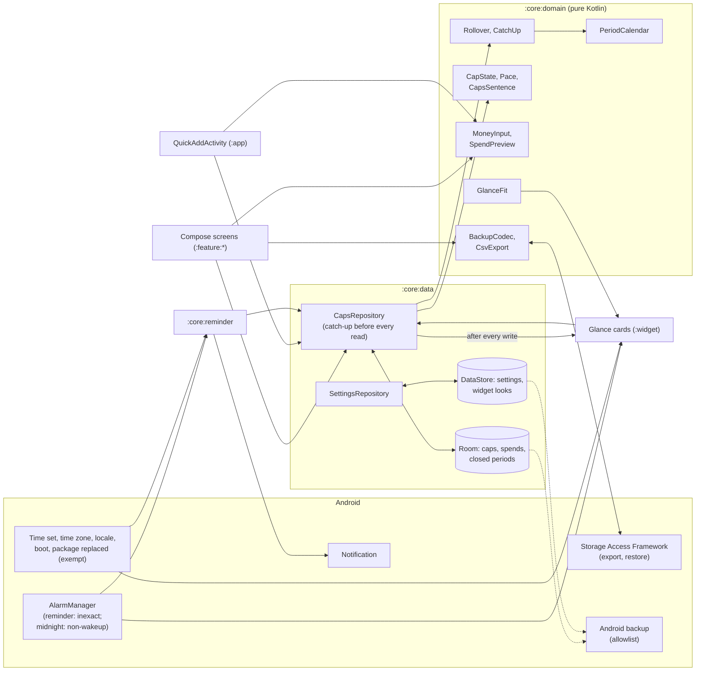

# Tetto — Technical Planning

> Companion to [VISION.md](VISION.md). This document defines the architecture, the design of the cap engine, the data, the widgets, and the delivery phases.
> It is written to be read by humans and by Claude Code.
>
> Keep the phase checklists up to date: tick the boxes as work is merged, and record every decision and deviation with its reason in §15's log. How the log is written and archived is in How it is made, below.

---

## How it is made (5 Nov 2026, as the family's)

- **This file** is the living plan: the architecture and the rules the code keeps (§1 to §10, §12 to §14: living, changed in place with the code, never archived), the phases still open (§11), what is open (§15, Open), and the log of the current period (§15, after Open). New decisions are written **at the end of the log**, one `###` section per intervention, with who asked and the date (and the step, where there is one).
- **`docs/planning/NN-<period>.md`** are the closed periods of the log, with the phases they closed, **frozen**: they are not edited. A decision that changes an old one is written here, naming the one it changes (the file, and the title or the entry's date).
- **`docs/planning/README.md`** is the index of every `##` and `###` heading of the archive, with its line: a reference by name or by date in the code ("PLANNING.md §11 Phase 3", "§15, 5 Nov 2026") that is not in this file is found there. It is written by `python3 tools/planning_index.py`, never by hand, and changes only when archiving. Both arrive in Phase 0, from the family; until the first archive the index is empty.
- **Archive** when the log passes ~80 KB (`sed -n '/^### Log since/,$p' PLANNING.md | wc -c`), or at a release, whichever first. A size and not a count of lines: this file writes a paragraph to a line. The log becomes the next archive file (the same header as the family's), and the phases of §11 that closed go with it (a closed phase's open box carried to Open); here an empty log stays with its start date, «Open» is reread, and the index script is run again.

## State

- **Released**: nothing yet.
- **Done**: Phase 0, the foundations (5 Nov 2026): green on GitHub, the release workflow rehearsed with the release key, the mark in the owner's colours. Phase 1, the cap engine (5 Nov 2026): `:core:domain` and `:core:data`, 117 tests, green on GitHub (`c762455`, 5 min 29 s). Phase 2, the caps screen and the numpad (5 Nov 2026): `:feature:caps` and the shell, green on GitHub (`4a40d7a`, 6 min 39 s). Phase 3, the first run and Settings (5 Nov 2026): `:feature:onboarding` and `:feature:settings`, 224 tests in all, green on GitHub (`e1f6b0d`, 8 min 16 s). Phase 4, your data and the reminder (5 Nov 2026): `:core:reminder` joins, 313 tests in all. Phase 5, the widgets and the launcher's shortcuts (5 Nov 2026): `:widget` joins, 424 tests in all. Phase 6, the guide, accessibility and polish (6 Nov 2026): `:feature:guide` joins, 447 tests in all, green on GitHub (PR #3). The device checks of Phases 4 to 6, TalkBack and the start-up's measure among them, done on the owner's phone (6 Nov 2026).
- **Next**: Phase 7, the 1.0 release on GitHub.
- **Later, and optional**: Phase 8, Google Play (§11).

---

## 1. Tech stack

The family's stack, as Tempo carries it from Passo (Passo ADR 0001), with Passo's Room back: Tetto is the first app since Passo to keep a table.

| Concern | Choice |
|---|---|
| Language | Kotlin 2.4, compiled by AGP 9's built-in Kotlin, with the Compose compiler Gradle plugin; KSP for Room and Hilt |
| Build | Gradle 9.8 with Kotlin DSL, AGP 9.4; version catalog (`gradle/libs.versions.toml`); convention plugins in `build-logic/` |
| JDK | Java 21, `jvmTarget` 21, without a Gradle toolchain |
| SDK levels | `minSdk 34`, `targetSdk 37`, `compileSdk 37` (the family's; owner, 5 Nov 2026) |
| UI | Jetpack Compose, Material 3 in Chiaro's design language (its generated schemes, dynamic color on request), edge-to-edge |
| Widget | Jetpack Glance (`glance-appwidget` + `glance-material3`) 1.2.x, `SizeMode.Exact` |
| Architecture | MVVM with unidirectional data flow; coroutines and `Flow` |
| Dependency injection | Hilt |
| Persistence | Room for the caps, their spends and the closed periods (schema exported, every migration tested); DataStore (Preferences) for the settings and the widgets' looks |
| Serialization | kotlinx.serialization: the navigation routes and the backup file, as Passo's |
| Money | `Long` minor units of one currency (`java.util.Currency` for its code and decimals); formatted by the locale's currency format. Never `Double` or `Float` (§4.1) |
| Background | No service, no periodic work. `AlarmManager`: the evening reminder's inexact alarm (`setAndAllowWhileIdle`, as Passo's evening reminder) and the widgets' midnight redraw (`set(RTC)`, inexact, non-wakeup, as Tempo's boundary). WorkManager only as Glance brings it, pinned as in the family |
| Navigation | Navigation 3, as Passo's and Tempo's shell |
| Time | `java.time`, local dates for periods; an injected clock and zone |
| Testing | JUnit 4, Truth, Turbine, coroutines-test; Robolectric (Room, receivers, Compose UI tests); Room's `MigrationTestHelper`; Glance's unit test utilities |
| Quality | Android Lint (`checkDependencies`), ktlint through Spotless; Baseline Profiles if start-up measures slow |
| CI | GitHub Actions: formatting, the forbidden-permission check on the merged manifest, unit tests and lint before the APKs. A release workflow on version tags builds the signed APK and publishes it to GitHub Releases |
| License | GPL-3.0. Every new dependency must have a GPL-3.0-compatible license (Apache-2.0, MIT, BSD) and the owner's approval |

Always pick the **latest stable** versions at setup time and record them in the version catalog. Avoid alpha versions unless a phase needs them and says why.

---

## 2. Project structure

```
tetto/
├── app/                    # Application, MainActivity, QuickAddActivity, navigation, launcher shortcuts, DI entry points
├── build-logic/            # Convention plugins (android-application, library, compose, feature, hilt, room, jvm)
├── core/
│   ├── model/              # Pure Kotlin data classes (no Android deps)
│   ├── domain/             # Pure Kotlin: periods, the rollover and the catch-up, money input, a cap's state, the sentence, the preview, the widgets' fit, the backup and CSV formats
│   ├── data/               # Room (caps, spends, closed periods), DataStore, repositories exposing Flow
│   ├── reminder/           # The evening reminder's Android half: alarm, receivers, notification channel
│   ├── designsystem/       # M3 theme, typography, shared components (the numpad, the amount field, the currency picker, a cap's tile, the bar, the ring), icons
│   └── testing/            # test-only: the accessibility checks and the page walk the UI tests share
├── feature/
│   ├── caps/               # the caps screen, the numpad sheet, a cap's sheet, the cap editor
│   ├── onboarding/         # welcome, the areas, the amounts
│   ├── settings/           # settings, your data (backup, restore, CSV, erase), the reminder, about
│   └── guide/              # the guide, in Chiaro's shape (Phase 6)
├── widget/                 # the Glance cards, their settings screen, their refresh
├── tools/                  # the launcher icon script, the planning index script
├── docs/                   # ADRs, the planning archive, screenshots, device checks
├── keystore/               # the shared debug key (deliberately committed)
├── VISION.md
├── PLANNING.md
└── CLAUDE.md
```

Rules:

- `core:model` and `core:domain` are pure Kotlin/JVM modules. All business logic lives there and is unit-tested without Android.
- Feature modules depend on `core:*`, never on each other. What two features share is `:core:designsystem`'s (the amount field, the currency picker).
- `core:designsystem` uses `core:domain`'s money input (`MoneyInput`), so an amount is typed by one rule wherever it is typed; nothing else of the domain.
- `app` wires everything together. `QuickAddActivity` (the numpad over the home screen) hosts `:feature:caps`'s numpad sheet.
- A module joins the build in the phase that brings its first code, not before.

---

## 3. Architecture overview



**One writer, many readers.** Tetto's own screens (the caps screen, the cap's sheet, the numpad over the home screen) are the only writers. The readers are those screens, the widgets and the reminder; each runs the catch-up (§4.4) before it reads, so none of them ever sees a period that should have closed.

**Closed when read, never on a timer.** No job closes periods at midnight. The first read after a period's end closes it, in one transaction, idempotently. A page open across midnight has a lifecycle-bound ticker for the next local midnight; the widgets have one inexact, non-wakeup alarm at the next midnight.

**Computed, not stored.** What a cap says (left, over, the pace, the mark for today, the sentence) is computed from the cap, its open period's spends and today, in `:core:domain`. The database stores facts: the caps, the spends, the closed periods.

---

## 4. The cap engine (core design)

The riskiest part of the app: a wrong period, a cent of drift or a reserve that grows by itself is what makes a reader stop trusting the numbers, and a budget whose numbers are not trusted is abandoned. Build it first, with its tests, before any screen.

### 4.1 Money

- **Whole minor units, `Long`** (`Money`, a value class): cents of the euro, pence, none for the yen. Never `Double` or `Float`, anywhere in `:core:model`, `:core:domain` or `:core:data`. Sums are exact.
- **One currency for the app**, an ISO 4217 code in the settings, chosen at the first run (the phone's region's by default) and stored then, so a later change of region relabels nothing by itself. Its decimals are `Currency.defaultFractionDigits` (0, 2 or 3). Where the region names none (a language set without a country), the euro stands in until the first run's choice (owner, 5 Nov 2026).
- **Input** (`MoneyInput`, pure): the numpad's buffer, digits and at most one separator, at most the currency's decimals after it, at most nine digits before it; delete, clear; parsed to minor units exactly, never through a floating-point number. A zero amount cannot be added.
- **Output**: formatted by the locale's currency format with the app's currency (`:core:designsystem`, from minor units through `BigDecimal.movePointLeft`), in tabular figures. The domain never formats.
- **A change of currency** relabels the amounts; it never converts them, and Settings says so. Where the two currencies' decimals differ, the stored amounts are rescaled (euro to yen: 1250 cents become ¥13, rounded half up), in one transaction, with a test. An amount above zero never becomes zero: one that would becomes the new currency's smallest (a €0.40 spend, ¥1), so no spend and no cap disappears (owner, 5 Nov 2026; `Rescale`). The setting is written first, then the amounts, under the repository's one lock; a rescale that fails puts the setting back (`CapsRepository.changeCurrency`, Phase 3).
- Nine digits and three decimals stay far inside a `Long`, sums included.

### 4.2 Periods

- **A period is a range of local dates**, start included, end excluded (`DateRange`). Its kind is the cap's: `DAY`, `WEEK`, `MONTH`, `YEAR`.
- `PeriodCalendar.containing(date, rule)`, pure:
  - **Day**: `[date, date + 1)`.
  - **Week**: from the week's first day on or before the date (the setting; the locale's `WeekFields.firstDayOfWeek` by default), seven days.
  - **Month**: from the month start day `d` (the setting, 1 to 31; 1 by default): each month starts on `min(d, its length)`, and a period runs to the next month's start. With `d = 31`: 31 Jan, 28 (or 29) Feb, 31 Mar, 30 Apr.
  - **Year**: from January's month start (`d` January) to the next.
- **A cap's open period** runs from its `openStart` to the end of the rule's period that holds it (`PeriodCalendar.openPeriod`): `openStart` is that period's own start, except where a change of rule could not reach back into a closed period (§4.5), and there the open period is the rest of the rule's one, the next whole. A cap stores no end, so no setting can contradict one.
- **Today** is `LocalDate.now(zone)` from an injected clock and zone (`TodaySource`, as Passo's), and the zone is the phone's current one.
- Periods never come from timestamps compared with a stored end: a daylight-saving night, a flight across time zones and a clock set back move instants, not dates.

### 4.3 Spends

- A spend is an amount above zero, its cap, the instant it was added (`addedAt`, for the list's time and the CSV) and **the start of the period it counts in** (`periodStart`), fixed when it is added: the cap's open period at that moment. A later change of zone never moves it.
- A spend counts **now**: there is no date to pick (VISION, non-goals).
- **Edit** (the amount) and **delete** are allowed while the spend's period is the cap's open period. Spends of closed periods are frozen (§4.4).
- **Undo** is the inverse operation by id: an add is undone by deleting that spend; a delete by inserting it again with its id and fields; an edit by writing the old amount back.
- "A spend was added today" (the reminder): any spend whose `addedAt` falls on today's local date, in the zone at the moment of asking.

### 4.4 Closing periods: the catch-up and the rollover

`CapsRepository.catchUp(today)` runs, in **one Room transaction**, before any read of the caps: the caps screen's flow, a widget's `provideGlance`, the reminder's receiver, `QuickAddActivity`, the backup's export. It is **idempotent**: run twice, the second does nothing.

For each cap whose open period ended on or before today (`openEnd <= today`), in order:

1. `spent` = the sum of the open period's spends.
2. **The rollover**, the concept's formula, exact and bounded:
   - `reserveAfter = min(limit, max(0, reserve + cap − spent))`, where `limit` is the reserve's limit, **one period's cap** (owner, 5 Nov 2026): a period can at most double;
   - `forgiven = max(0, spent − cap − reserve)`: the overspend the reserve could not cover, dropped. A new period never starts in debt.
3. A `ClosedPeriod` row is written: the dates, the cap in force, `spent`, `reserveBefore`, `reserveAfter`, `forgiven`, and `periods = 1`.
4. The cap's open period moves to the next one (`PeriodCalendar.next`), and the loop goes on while it has ended.

**A run of empty periods** (a long absence) after the first closed one is folded into **one** `ClosedPeriod` row (from the first's start to the last's end, `spent = 0`, `periods = n`), its `reserveAfter` computed by iterating in memory (it reaches the limit within a period or two). A daily cap left for 400 days writes two rows, not 400.

**What never happens:**

- A period is never reopened. If today falls before the open period's start (a clock set back, a flight west across midnight), nothing closes and a new spend counts in the open period.
- A closed period is never changed. A correction is possible only in the open period, so the reserve never changes behind the reader's back.

**While visible**: the caps screen and the cap's sheet hold a ticker for the next local midnight (`repeatOnLifecycle(STARTED)`); at its tick the catch-up runs and the state is computed again. The ticker is re-armed on a time or zone change.

### 4.5 Changing a cap

- **Name, icon**: nothing else changes.
- **Amount**: applies to the open period at once (what is left is computed again); the reserve stays, and the new limit applies at the next close.
- **Period kind**, or the settings' week start or month start day for the caps of that kind: the open period is **replaced** by the new rule's period that contains today. This period's spends move to it (their `periodStart` updated); the reserve stays. No `ClosedPeriod` row is written: nothing closed, the period was replaced. Spends of periods already closed stay in them.
  - **Never before the last closed period's end** (`CapChanges.replacedOpenStart`): a closed period is never changed, so a new period that would reach back into one starts where it ended. A daily cap turned weekly on a Thursday, after Monday to Wednesday closed as days, counts Thursday to Sunday; the next week is whole. With nothing closed yet, the new period is whole.
  - A change of week or month start writes the setting, then closes what ended under the old rule and moves the open periods, in one transaction; `CapsRepository` lets nothing read in between (one lock for every read and write), since an open period judged by a rule it was not made for can look ended.
- **Clear the reserve**: the reserve becomes zero, with undo.
- **Delete**: the cap, its spends and its closed periods (`ON DELETE CASCADE`), after a confirmation.
- **Order**: the caps' `position`, written for every moved cap in one transaction.

### 4.6 What a cap says (`CapState`, pure)

From a cap, its open period's spends and today (`CapStates.of`):

- `left = cap + reserve − spent`; **over** when `left < 0` (said "€30 over", never "−€30" alone).
- `daysLeft = openEnd − today`, today counted, at least 1.
- **The bar**: `spentShare = spent / (cap + reserve)`, held to `[0, 1]`, with an over state beyond.
- **The mark for today**, for a week, a month or a year: `daysShare = (today − openStart + 1) / length`, today counted.
- **Ahead of the days**: not over, and `spentShare > daysShare`: spending runs ahead of the period (the bar takes the *attention* ink). No fixed threshold. The two shares are kept as whole numbers (`Share`) and compared exactly; the screen turns them into lengths.
- **The pace**, for a week, a month or a year, while not over and `daysLeft ≥ 2`: `left / daysLeft`, rounded down to a whole unit of the currency; not shown under one unit.
- **The renewal** (owner, 5 Nov 2026): "until" names the open period's **last day**, included ("€12 until Sunday", "until 30 Nov"); a cap over says when it **starts again**, the next period's first day ("it starts again on Monday"). Each date is said by how near it is (`Days.near`): today, tomorrow, a weekday from two to six days ahead, else a date (a week ahead would be today's own weekday). The words are Phase 2's.
- **Renewed today**: a period closed today and the open one began with it.

`SpendPreview(state, typed)`, pure: `after = left − typed`; **fits** (`after ≥ 0`, "€15 left"), **goes over** (`left ≥ 0 > after`, "€30 over"), **still over** (`left < 0`, "still €45 over").

`CapsSentence(states)`, pure, returns a structure (a kind and its values), never a string, and how many caps there are: no caps; one or more over, with the first in the reader's order, when it starts again, and how many others; a week's, a month's or a year's cap renewed today (a day's renews every day: not news), the first and how many others; all under their caps, with the one closest (the lowest `left / (cap + reserve)`; a tie goes to the first in the reader's order), its left and its last day; all under with **nothing spent on any of two caps or more**, no cap named ("All under your caps."), since the closest would only be the first (owner, 6 Nov 2026). **When more than one holds, over first, then renewed, then all under** (owner, 5 Nov 2026). The words are resources, in both languages, with plurals.

### 4.7 Edge cases (all need unit tests)

- Money: `0,10 + 0,20` is exactly 30 cents; the separator of each locale; a currency with no decimals (the separator key absent) and one with three; nine digits; a zero amount refused; the rescale between currencies of different decimals.
- Periods: a week starting on Monday and on Sunday; a month starting on the 1st, the 15th, the 29th, 30th and 31st, across February in a leap year and not; a year starting on 1 and on 31 January; the day of a daylight-saving change (23 and 25 hours) in both directions.
- The catch-up: nothing ended; one period ended; several; a run of 400 empty daily periods (two rows); idempotence; a cap created today; today before the open period's start (clock set back, a flight west); a flight east across two midnights.
- The rollover: under the cap (the reserve grows), exactly at the cap, over within the reserve (the reserve shrinks), over beyond it (forgiveness, the reserve at zero), the reserve at its limit, the limit after a change of amount.
- Changes: the amount mid-period; the kind mid-period (week to month, month to week, to a day), the spends moved and the closed ones untouched; the month start day changed; the week start changed; clearing the reserve; deleting a cap with closed periods.
- Spends: undo of an add, a delete, an edit; an edit refused in a closed period; "a spend today" across midnight and after a change of zone.
- What a cap says: over; exactly zero left; the pace under one unit; the last day of a period; a day cap (no mark, no pace); a cap with a reserve and nothing spent.
- The sentence: no caps; one cap; all under; several over; ties for the closest; nothing spent on any cap, and on a single one.

---

## 5. Data model

### `:core:model` (pure)

- `Money` (value class over `Long` minor units), `AppCurrency(code, fractionDigits)`
- `PeriodKind` (`DAY`, `WEEK`, `MONTH`, `YEAR`), `PeriodRule(kind, weekStart, monthStartDay)`, `DateRange(start, endExclusive)`
- `Cap(id, name, icon: CapIcon, amount: Money, kind: PeriodKind, reserve: Money, openStart: LocalDate, position)`
- `Spend(id, capId, amount: Money, addedAt: Instant, periodStart: LocalDate)`
- `ClosedPeriod(capId, range: DateRange, cap, spent, reserveBefore, reserveAfter, forgiven, periods)`
- `CapState` (§4.6), `Share` (an exact ratio), `NearDay`, `CapIcon` (the curated set's keys: 30, the first run's twelve areas first, stored by key, an unknown key read as `OTHER`), `CapDraft` (a cap's four fields before it is one: the editor's and the first run's), `UserSettings` (the money's settings since Phase 1, the appearance and the first run's flag since Phase 3, the reminder's since Phase 4, the first-day tip's flag since Phase 6), `WidgetLook`

### Room (`TettoDatabase`, file `tetto.db`, version 1)

| Table | Columns | Notes |
|---|---|---|
| `caps` | `id` (PK), `name`, `icon` (key), `amount` (minor units), `kind`, `reserve` (minor units), `open_start` (epoch day), `position`, `created_at` (epoch ms) | |
| `spends` | `id` (PK), `cap_id` (FK → `caps`, `ON DELETE CASCADE`), `amount` (minor units, > 0), `added_at` (epoch ms), `period_start` (epoch day) | Index on (`cap_id`, `period_start`); index on `added_at` (the reminder's "today") |
| `closed_periods` | `cap_id` (FK, cascade), `start`, `end_exclusive` (epoch days; not `end`, a keyword of SQLite's), `cap`, `spent`, `reserve_before`, `reserve_after`, `forgiven` (minor units), `periods` (≥ 1) | PK (`cap_id`, `start`) |

- The schema is exported (`core/data/schemas/`) and committed; every migration from version 1 on has a `MigrationTestHelper` test and an upgrade test from the first release's schema, as Passo's. Never `fallbackToDestructiveMigration`. Version 1 itself is pinned by `SchemaTest`, which builds a database from the exported JSON and opens it with the code (the helper cannot open its database on Windows: CLAUDE.md).
- Ids are `AUTOINCREMENT`: an id is never reused, so a spend put back by Undo keeps its own.
- Size: a few thousand spends a year, a few hundred closed periods. Spends of closed periods are kept for the CSV and the backup and never listed (owner, 5 Nov 2026).

### DataStore (Preferences), file `settings`

| Key | Default | Meaning |
|---|---|---|
| `theme`, `palette`, `font`, `dynamic_color` | system, VIVID, GOOGLE_SANS, false | The family's appearance |
| `caps_layout` | TILES | The caps screen's tiles, or a row per cap (`LIST`), the reader's choice in Appearance (owner, 6 Nov 2026) |
| `currency` | the phone's region's, written at the first run | ISO 4217 code (§4.1) |
| `month_start_day` | 1 | 1 to 31 (§4.2) |
| `week_start` | none (the locale's) | A `DayOfWeek`, once the reader picks one |
| `reminder_on` | false | The evening reminder |
| `reminder_time` | 20:30 | Local time, written as `java.time` writes one (`20:30`) |
| `asked_notifications` | false | Whether the permission was ever asked: what tells "askable" from "denied for good" (Tempo's rule) |
| `onboarding_completed` | false | |
| `caps_tip_seen` | false | The caps screen's first-day tip, pointing to the guide, dismissed or followed (Phase 6) |

### DataStore, file `widgets` (not backed up)

One `WidgetLook` per `appWidgetId`: the card's ground (light, dark, system, one of the six colours), its opacity, which caps («At a glance»: all, or a chosen set in the reader's order; «In words»: one cap, or the closest to its cap, and «The sentence», on by default). Removed in `onDeleted`.

### Backup

- **Android's backup** (`data_extraction_rules.xml`, cloud copy and device transfer): the database (`tetto.db` and its write-ahead log) and the settings file, an allowlist (the family's rule, Passo's ADR 0007). The widgets' file stays out: widget ids are renewed by a restore.
- **The backup file** (`BackupCodec`, `:core:domain`, kotlinx.serialization over DTOs kept apart from the model; `docs/adr/0004-your-data.md`): JSON, indented, `format: "tetto-backup"`, `version: 1`; the app's version, the zone and the instant it was written; the currency's code and its `decimals` where it was written; the settings the reader chose (month start, week start, appearance and the caps' layout, the reminder); the caps in the reader's order, each holding every spend and every closed line. Dates ISO, instants epoch milliseconds, amounts minor units. No ids, and nothing of one phone's (the first run's flag, the asked permission, the first-day tip seen). A file cut short is **damaged**; a newer version asks for an **update**; anything else is **not a Tetto backup**. Read whole and checked before anything is written: strict where a value decides a figure or a period (an amount, a date, a kind, the month or week start, a spend or a closed line after the open period, a closed period twice, figures too large to sum), lenient where a default cannot mislead (an unknown icon is "other", an unknown palette the default, a file without the caps' layout the tiles). A file whose decimals for its currency are not this phone's is rescaled as a change of currency would be (§4.1).
- **A restore replaces** this phone's caps, spends and closed periods, and its settings with the backup's, after a confirmation that says when and by which Tetto the file was written, its caps by name, and what it replaces: on a new phone there is nothing to merge with, and a merge of two sets of caps would double them. (Passo merges because a new phone has already counted steps by itself; Tetto has no data it did not get from the reader.) The settings come with the caps because the open periods were made by the backup's week and month starts. Under the caps' one lock: the settings, then one transaction (the old caps out, the backup's in, the catch-up); a transaction that fails puts the settings back (`BackupRepository.restore`).
- **The CSV** (`CsvExport`, pure): one row per spend of every period, oldest first, a header row of fixed English identifiers (`date,time,cap,amount,currency,period_start,period_end`), ISO dates and 24-hour times in the phone's zone, the cap's name (never a formula), the amount in the currency's major unit with a dot, the currency's code, the period's first and last day; RFC 4180, UTF-8 with a byte-order mark. From the same snapshot as a backup, after the catch-up.
- **Erase everything**: confirmed; the caps (and with them every spend and closed line) in one transaction, then the settings to their defaults, so the first run takes over. The asked permission and the first-day tip seen stay: facts about the phone, not the reader's data. Ids are never given twice (`AUTOINCREMENT`), so an Undo still pending can never reach a cap or a spend made after.

---

## 6. Derived views (`core:domain`)

- **`PeriodCalendar`**: a date and a rule → the period that contains it; a period → the next (§4.2).
- **`Rollover`** and **`CatchUp`**: one period closed, a run folded, the plan of what a catch-up writes (pure; the repository applies it in one transaction) (§4.4). The most tested code of the app.
- **`CapState`**, **`Pace`**: §4.6.
- **`SpendPreview`** and **`MoneyInput`**: the numpad's arithmetic (§4.1, §4.6).
- **`CapsSentence`**: the caps screen's sentence, and «In words»'s (§4.6).
- **`ReminderSchedule`**: the next moment the reminder fires, from the time, today and now; across a daylight-saving change (as Passo's `EveningReminder`).
- **`BackupCodec`**, **`CsvExport`**: §5.
- **`GlanceFit`** (pure arithmetic, as the family's `GlanceLayout` / `AgendaFit`): given a card's granted size in dp and the text sizes measured in the system face, which form the card takes and how many caps fit; pinned by tests at the family's reference grants (one row ≈ 85 dp tall, two ≈ 189; widths 2 cells ≈ 159 dp, 3 ≈ 250, 4 ≈ 340), with the family's widget scale (`WidgetType`) and its text metrics.
- **`WidgetCaps`**, **`CapNote`**: which caps a card shows (the reader's choice, or every cap; «In words»'s chosen cap, or the one closest to its cap: the first over, else the lowest share left), and what «In words» says of its cap under the figure (the pace, ahead of the days, the reserve, forgiven when it starts again), a structure, never a string.

---

## 7. Widgets (Glance)

The family's pair (owner, 5 Nov 2026), on the family's card (Passo's ADR 0005, from Chiaro): its corner, insets, grounds, Chiaro's six colours (`WidgetPalette.kt`), opacity and ink rule. The details of each form are settled in Phase 5 with their ADR (`docs/adr/0003-widgets.md`); what follows binds them.

### Configuration

- `SizeMode.Exact`: every form is read off the size the launcher really granted.
- Default placement 4×2 for «At a glance», 4×1 for «In words»; minimum one cell; `resizeMode="horizontal|vertical"`; **no maximum** (Passo's ADR 0005).
- `updatePeriodMillis = 0`. `configure` is the per-widget settings screen, `reconfigurable|configuration_optional`: the card is placed at once with sensible defaults.
- `widgetCategory="home_screen"`.
- Reference grants the layout tests measure against (the family's): one row ≈ 85 dp tall, two ≈ 189; two cells ≈ 159 dp wide, three ≈ 250, four ≈ 340.

| «At a glance» form | When | Content |
|---|---|---|
| CELL | one cell | One cap: its icon and what is left |
| ROW | one row | The caps side by side, as many as the width holds, each its icon, its left and a slim bar; the rest counted |
| GRID | two rows and up | The caps in rows, each its icon, name, left and bar; "3 more" where they do not all fit |

### «In words»: the family's ring card

The owner asked (5 Nov 2026) that this card have **the ring of Passo's and Tempo's ring cards, at the same sizes for every size of card and every line of text**, so the three stand on a home screen as one set. So its ring is not designed again: it is **the family's circle**, the three functions both sisters draw their circle with since 4 Nov 2026 (Tempo's `WordsFit.cellCircle`, `rowCircle`, `tallCircle`; Passo's `dotRingSize`, `rowRingSize`, `tallCircle`, the same arithmetic), **copied constant for constant** into Tetto's `GlanceFit`. Its rule, the sisters': a circle is the size the card's size gives, **whatever the day's words say**, so two cards of one size side by side show one circle, and a card's own does not grow when its words are short; it grows with the card, and yields only to the reader's text size. Only the words are Tetto's, set in the family's widget scale (`WidgetType`: hero 34 sp, title 22, body 16, label 13), copied with it.

**The circle**, in dp, with the family's card insets (14 dp; 6 dp snug, on a row):

- **One cell wide** (under 120 dp): the cell's shorter side less 8 dp on each side, between 36 and 104 dp.
- **One row** (under 150 dp tall): the height inside the snug insets, but never so wide that the words beside it keep less than 84 dp (the width less 14 dp on each side, the 12 dp gap and those 84 dp), between 44 and 56 dp.
- **Two rows and up**: the card's inner height less **a budgeted band of words**, never measured, at 1.32 em a line and the reader's text size: a 34 sp line and three 16 sp lines under 230 dp wide (108.24 dp at the default size), a 34 sp line and two from 230 dp (87.12 dp), where a sentence that takes two lines on two cells takes one; a 34 sp line and one (66 dp) where the reader hides the sentence. Between 44 dp and the smaller of the card's inner width and the ceiling (the larger of 104 dp and 45% of the card's inner height and width), rounded down to a quarter of a dp.

At the family's reference grants (one cell 85 dp; rows 85, 189 and 293 dp tall; two, three and four cells 159, 250 and 340 dp wide), the numbers both sisters' tests pin and Tetto's pin too:

| | 1×1, 1×2, 1×3 | 2×1 | 3×1, 4×1 | 2×2 | 3×2, 4×2 | 2×3, 3×3 | 4×3 |
|---|---|---|---|---|---|---|---|
| The circle | 69 | 44 | 56 | 52.75 | 73.75 | 104 | 119.25 |
| Without the sentence | 69 | 44 | 56 | 95 | 95 | 104 | 119.25 |

At 115% and 130% text the two-by-two's band grows and its circle stands at 44 dp. The owner's own two-by-two (188 × 218 dp, measured from the phone's screenshots in Tempo's entry of 5 Nov 2026) draws 81.75 dp, 104 without the sentence: it is one of the grants Tetto's tests measure too.

| Form | When | The ring | The words |
|---|---|---|---|
| CELL | one cell wide | The cell's circle, centred; the cap's icon inside | What is left under it ("€12"), at the label step, only where it fits under the circle, which is never made smaller for it |
| ROW | one row | The row's circle at the leading edge, 12 dp from the words | What is left ("€12 left", 20 sp, Medium; 16 sp on a narrow row, down to 14) over the cap's name and its renewal ("Coffee · until Monday", 16 sp; 14, 13, 12 on a narrow row; else "until Monday", else "Coffee", the fullest that stays whole); the pace at the far edge where those words stay whole beside it |
| TALL | two rows and up | The tall circle in the top trailing corner | From the bottom leading corner, the band the circle budgets: what is left (34 sp, the hero, smaller only where the width cannot hold it; "€12 left", "€30 over"), the cap's sentence (16 sp, up to two lines under three cells wide, one from three: the pace, "about €4 a day", "ahead of the days", the reserve, or, over, "forgiven when it starts again"), and the last words (16 sp: "of €20 · until Monday" on one line, else broken at its separator over two, else the day alone); the cap's name beside the circle where 56 dp are left (16 sp, 14 or 13 before a word of it breaks), else in the last words in the amount's place ("Coffee · until Monday"), so the circle never yields to a name |

- **«The sentence»** («La frase»), a switch on «In words»'s settings, on by default, as Passo's card hides its sentence and Tempo's its «day's note»: off, a tall card says the amount and "of €20 · until Monday" alone, and its circle takes the band they leave (95 dp two rows high), the size the sisters' circles take without theirs. One cell and one row are unchanged: they never show the sentence.
- **The ring** is what was spent of the cap and its reserve: its track, and the arc in the accent; in the *attention* ink when spending runs ahead of the days; full past the cap, with "over" in the words ("€30 over"). It is a bitmap painted at the size shown, capped at 416 px a side, one per card (Passo's rule), with the cap's icon drawn in its middle.
- Without a cap to show (the chosen one deleted, no caps at all) the card says so in the words' place and opens the app.
- A gallery test draws «In words» at every reference grant, with the sentence and without, and `WidgetFitTest` pins the circle at each (the table above) and every type step to the family's scale, and finds nothing cut at 100, 115 and 130% text: a change to them is a change to the family's, decided with the owner, never alone.

### Rendering

- **No scrolling container**: a Glance `Column`/`Row`, never `LazyColumn`. Glance drops the eleventh child of a container silently: caps go in groups of at most five, counted.
- Inks resolved against the ground the card really has (`widgetInk`, Chiaro's rule), never left to the launcher's day/night resolution. Figures as the launcher's face draws them: Glance cannot ask a `TextView` for tabular figures.
- A cap over its cap says "over" in words on the card too; never a colour alone.
- A drawing that throws (`onCompositionError`) is never Glance's blank "Can't show content" box: the reason goes to the log under `TettoWidget` with the sizes the launcher gave the card, and the card says "This card could not be drawn · Touch to open Tetto" in the default dress (`WidgetFailure`, `widget_failure.xml`) until its next redraw (owner, 6 Nov 2026).
- Previews: a static `previewLayout`, and generated previews on Android 15+ (`providePreview`) from sample caps, once per version, as Tempo's.

### Taps

- **A cap**: `QuickAddActivity` on that cap: the numpad sheet over the home screen (a translucent activity, `excludeFromRecents`, its own task affinity). After Add, the sheet becomes one line, "€5.00 added to Coffee", with **Undo**, for a few seconds (longer with TalkBack), then closes by itself; a touch outside closes it at once.
- **The rest of the card**: the caps screen.

### Update strategy (battery-aware)

- **A write** (a spend added, edited or deleted; a cap or a setting changed): the cards redraw once the transaction is committed, heard from Room's invalidation of the caps' tables and from the settings (`WidgetUpdater`, started by the application), whatever wrote it.
- **Midnight**: while a card is placed, one `AlarmManager.set(RTC, next local midnight)`, inexact and **non-wakeup**, armed after every render: delivered when the phone is next awake, which is when someone can see the card. The card's render runs the catch-up first.
- **Clock, zone, language**: `TIME_SET`, `TIMEZONE_CHANGED`, `LOCALE_CHANGED`, exempt from the implicit-broadcast limits, received in the manifest.
- **Boot and update**: the system sends the cards their update; the alarm is armed again from it.
- Nothing else: no periodic work, no polling, no observer while nothing is shown.

---

## 8. Notifications and system surfaces

- **Channel `reminder`** (default importance), the evening reminder, opt-in:
  - turned on in Settings, where `POST_NOTIFICATIONS` is asked (never at the first run); denied, the switch says why and how to change it;
  - one inexact alarm, `setAndAllowWhileIdle(RTC_WAKEUP, …)` at the reader's time (as Passo's evening reminder: no exact-alarm permission), armed again at every start of the process, every change of the setting, every clock or zone change, after a boot (`RECEIVE_BOOT_COMPLETED`) and an update (`MY_PACKAGE_REPLACED`), and at each firing;
  - at its firing: the next alarm armed first; then **nothing** if the reminder was turned off meanwhile, if its day is over (an alarm held back past midnight: `ReminderSchedule.stillTimely`), if there is no cap, or if a spend was added today (§4.3), the catch-up first; else "Anything to add today?", whose touch opens the caps screen; it goes by itself at the end of the day (`setTimeoutAfter`), and is taken back when the app comes to the front (its question has brought the reader there) or the reminder is turned off;
  - no alarm armed while the reminder's notifications cannot show (armed again when they can: the app's return, the system's block-state broadcasts, Settings' own request), Passo's rule of 2 Nov 2026;
  - its status-bar icon is the mark's roof alone (`ic_stat_tetto`, drawn by `tools/draw_launcher_icon.py` at a lighter stroke than the launcher's);
  - in Settings, with the reminder on and its notifications blocked, a card over the group says why and holds the one button that fixes it: "Allow" while Android will still ask (`asked_notifications` tells "askable" from "denied for good"), else the system's page, the app's notifications or the reminder's channel.
- **No other notification**: no threshold alerts, no "over" alerts (VISION).
- **Launcher shortcuts** (dynamic: a static one names its package, and the debug build's is another): the first four caps in the reader's order, each its icon and name, opening `QuickAddActivity` on that cap. Published again when the caps, their order or their names change, and when the app's language changes (Tempo's lesson of 30 Oct 2026).
- **Pin request**: the first run's last page and Settings offer "Add a widget to the home screen" through `AppWidgetManager.requestPinAppWidget`, where the launcher supports it.

---

## 9. Battery rules (non-negotiable)

1. No service, foreground or background. Tetto runs only when a screen of it is visible, when a card is being drawn, or when the reminder fires.
2. No wakelocks of the app's own (WorkManager holds its own while Glance's work runs, as in the family).
3. No exact alarms, no `REQUEST_IGNORE_BATTERY_OPTIMIZATIONS`, no periodic workers.
4. Two alarms at most, each only while needed: the reminder's (inexact, one a day, only while on and allowed) and the cards' midnight redraw (inexact, non-wakeup, only while a card is placed).
5. Periods close when read (§4.4), never on a timer. The midnight ticker lives in a visible page's lifecycle.
6. A phase that touches an alarm ends with a check: `adb shell dumpsys alarm | grep tetto` (the alarms above and nothing else), `dumpsys batterystats --charged com.callbackdev.tetto`, Doze (`dumpsys deviceidle force-idle`).

---

## 10. Permissions and manifest

| Permission / element | Type | Why |
|---|---|---|
| `POST_NOTIFICATIONS` | Runtime | The evening reminder, asked when the reader turns it on (Phase 4) |
| `RECEIVE_BOOT_COMPLETED` | Normal | Arm the reminder again after a boot (declared by `:core:reminder`; also brought by WorkManager) |
| `WAKE_LOCK`, `ACCESS_NETWORK_STATE`, `FOREGROUND_SERVICE` | Normal | Brought by WorkManager, which Glance runs its sessions on, as in the family. Without `INTERNET` nothing can leave the phone. Tetto's own code uses none of them |
| `android:allowBackup="true"` + `dataExtractionRules` | Manifest | The database and the settings file only (§5) |

**Forbidden:** `INTERNET`, `ACCESS_*_LOCATION`, `REQUEST_IGNORE_BATTERY_OPTIMIZATIONS`, `SCHEDULE_EXACT_ALARM`, `USE_EXACT_ALARM`, `CAMERA`, `RECORD_AUDIO`, `READ_SMS`, `RECEIVE_SMS`, `READ_CONTACTS`, `WRITE_CONTACTS`, `READ_CALENDAR`, `WRITE_CALENDAR`, `READ_EXTERNAL_STORAGE`, `WRITE_EXTERNAL_STORAGE`, `MANAGE_EXTERNAL_STORAGE`, `READ_MEDIA_*`, `QUERY_ALL_PACKAGES`, `ACTIVITY_RECOGNITION`, `HIGH_SAMPLING_RATE_SENSORS`, `BODY_SENSORS*`.

The export, the restore and the CSV go through the Storage Access Framework (`ACTION_CREATE_DOCUMENT`, `ACTION_OPEN_DOCUMENT`), which needs no storage permission. The numpad's haptics go through the view's `performHapticFeedback`, which needs no `VIBRATE`.

`checkForbiddenPermissions` (build-logic, `ForbiddenPermissionPatterns`) checks every variant's merged manifest, is wired to `check`, and runs in CI and in the release workflow. A library that adds one is removed or patched with `tools:node="remove"`.

No service of Tetto's own in the merged manifest (§9): Room declares `MultiInstanceInvalidationService`, for a database shared between processes, which Tetto never asks for; the app's manifest removes it (Phase 1). From Phase 5 the merged manifest holds the services Glance and WorkManager declare, as in the family (`GlanceRemoteViewsService`, `RemoteViewsCompatService`, WorkManager's job, alarm and foreground services): Glance runs its sessions on them; Tetto's own code starts none.

---

## 11. Delivery phases

Each phase ends with a merged PR, green CI and its acceptance criteria met. Phases 4 and 5 need **testing on a physical device**: the reminder's delivery, the launcher's grants and shortcuts, a backup restored on a clean install.

**How to run a step** (the family's): one step is one session. Read CLAUDE.md, the step and the files it names; build it with its tests (the domain's first, for anything that decides a period, a reserve or an amount); run `spotlessApply`, `test`, `:app:lintDebug` and `:app:checkForbiddenPermissions`; look at the screenshots the step changes (`build/screenshots`); tick the step, record its decisions in §15, and add its line to `CHANGELOG.md`'s Unreleased section in the reader's words. A step that changes a decision already recorded says so, and the owner confirms it before anything is built.

### Phase 0 — Foundations

- [x] Create the repo; the owner's concept committed as `VISION.md` (`0ea1b66`, 5 Nov 2026)
- [x] `VISION.md` from the owner's concept, with its corrections and open questions (draft, 5 Nov 2026)
- [x] `PLANNING.md` and `CLAUDE.md` (5 Nov 2026)
- [x] The owner's review of VISION.md and answers to its open questions (5 Nov 2026, recorded in §15)
- [x] `README.md` in the family's style (centred header, badges, What Tetto is, Screenshots, Features, Principles, Install with the fingerprint, Roadmap, Build, Tech stack, Project structure, Project documentation, The family, License; no em or en dashes), `LICENSE` (GPL-3.0 full text), `.gitignore` (the family's: `*.jks`, `*.keystore`, `*.p12`, `*.pfx` refused, `keystore/debug.keystore` allowed), `.editorconfig`, `CHANGELOG.md` (Keep a Changelog, an empty `[Unreleased]`)
- [x] Gradle setup from Tempo (Passo's build): version catalog at the latest stable versions, `build-logic` convention plugins renamed `tetto.*`, **with Passo's `AndroidRoomConventionPlugin` back** (`tetto.android.room`, the schema directory); the wrapper; `gradle/google-maven-mirror.init.gradle.kts`; `tetto.versionName` in `gradle.properties`, `versionCode` derived (major * 10000 + minor * 100 + patch)
  - *Deviation:* the versions are Passo's and Tempo's of 2 Nov 2026, kept (owner, 5 Nov 2026), though lint names newer stable ones (AGP 9.5.0, Kotlin 2.4.21, DataStore 1.3.0, kotlinx.serialization 1.12.0, Navigation 3 1.2.1, Spotless 8.11.0; WorkManager 2.12.0, which stays pinned).
- [x] The forbidden list of §10 in `ForbiddenPermissions.kt`, wired to `check`
- [x] Module skeleton (§2), each module joining with its first code
  - `:app`, `:core:model` (the appearance's enums), `:core:designsystem`, `:core:testing`. The caps screen's empty state is the shell's, in `:app`, until `:feature:caps` joins in Phase 2 (ADR 0001, 6).
- [x] `:core:designsystem` from Tempo's: Chiaro's two generated dresses (`Scheme.kt`, never hand-edited), `Type.kt`, `Shape.kt`, `Motion.kt`, `PageWidth.kt`, `WidgetPalette.kt`, `DenseTargets.kt`, the settings rows, `StatusCard`, `RevealItem`; Google Sans and Inter with their licences; `TypographyTest`, `ContrastTest`. The semantic inks reduced to `attention` until a phase needs another (an over ink, if Phase 2 needs one, comes with its contrast test)
- [x] `:core:testing` from Tempo's (`assertAccessible()`, `walkPage()`)
- [x] Hilt, `MainActivity` edge to edge with the caps screen's empty state
- [x] `strings.xml` for `values/` (English) and `values-it/`; `locales_config.xml` for the per-app language
- [x] Launcher icon drawn by `tools/draw_launcher_icon.py`, from Saldo's script (the emblem in the same place): the family's ring (radius 21, stroke 10, on the warm white `#F7F4EE`), cut by Tetto's amber roof at the lower right, with the sisters' gap; the monochrome layer for themed icons; the ring's colours with the owner (§15, Open)
  - Drawn (5 Nov 2026): the roof as three strokes with round ends (two slopes, a chimney), 6.2 units, upright, its edge at 31.4 of the 33-unit safe circle; the ring fuchsia to wine, the owner's choice of two proposals (§15, 5 Nov 2026, «the owner's three answers»).
- [x] The crash page (`app/src/crashpage`), for debug builds and the debug-signed release, as Tempo's
- [x] CI: `android-ci.yml` (formatting, forbidden permissions, unit tests, lint, then the APKs and the R8 mapping) and the tag-triggered `release.yml` (the tag matches `tetto.versionName`; the same gates; the keystore decoded from the secrets; the signed APK; **the signature checked against the release key's fingerprint**; the SHA-256 file; the mapping; the body from `CHANGELOG.md`), as Tempo's
  - Verified locally with CI's own sequence (`spotlessCheck`, `checkForbiddenPermissions`, `test`, `lintDebug`, `assembleDebug`, `assembleRelease -PsignReleaseWithDebugKey`): green, 13 tests. The release workflow's signature check pins `28:A0:…:9D:F1`.
- [x] Tetto's own debug keystore (`keystore/debug.keystore`, alias `tetto-debug`, passwords `android`, RSA 2048, PKCS12), committed on purpose, with `keystore/README.md`; not a copy of a sister's
  - `CN=Tetto Debug, O=callbackdev, C=IT`, created 5 Nov 2026, SHA-256 `D4:DF:35:86:…:69:78:17` (`keystore/README.md`).
- [x] The **release key**: created by the owner, kept outside the repo, in the four repository secrets `KEYSTORE_BASE64`, `KEYSTORE_PASSWORD`, `KEY_ALIAS`, `KEY_PASSWORD` (set on 5 Nov 2026)
- [x] The release key's SHA-256 fingerprint from the owner, into `keystore/README.md`, the README's Install section and `release.yml`'s signature check
- [x] `docs/planning/README.md` and `tools/planning_index.py` from Tempo's (How it is made)
- [x] `docs/adr/0001-foundations.md`, `docs/adr/0002-design-language.md` (the family's language, Tetto's mark)

**Acceptance:**
- CI is green on GitHub.
  - Android CI run #1 (Phase 0, `20b7757`), green in 5 min 50 s; the release workflow's rehearsal, run by hand the same day, green: the four secrets decoded, the APK signed by `CN=callbackdev`, SHA-256 `28a0e860…199df1`, the release key's. Nothing published.
- The app launches and shows the caps screen's empty state in the family's dress, in English and Italian.
  - Drawn and tested under Robolectric (`CapsEmptyPageTest`: English, Italian, dark, twice the text size, an open foldable, `assertAccessible`); not yet run on a device.
- Adding `INTERNET` or `CAMERA` to any manifest fails `checkForbiddenPermissions`.
  - Verified (5 Nov 2026): both added to the app's manifest failed the debug and release checks, naming both. The merged manifest today holds only AndroidX's own `DYNAMIC_RECEIVER_NOT_EXPORTED_PERMISSION`.

### Phase 1 — The cap engine (highest risk)

- [x] `core:model`: `Money`, `AppCurrency`, `PeriodKind`, `PeriodRule`, `DateRange`, `Cap`, `Spend`, `ClosedPeriod`, `CapState`, `CapIcon`
  - With `Share` (the bar and the mark as exact ratios), `NearDay` and `UserSettings` (the money's three settings).
- [x] `core:domain`, test first, every case of §4.7: `MoneyInput`, `PeriodCalendar`, `Rollover`, `CatchUp`, `CapState` (left, over, the bar, the mark for today, ahead of the days, the pace, the renewal), `SpendPreview`, `CapsSentence`
  - With `Days` (midnights, a day's instants, how near a day is), `CapChanges` (§4.5's dates) and `Rescale` (§4.1). 90 tests.
- [x] `core:data`: `TettoDatabase` version 1 (§5), DAOs, the schema exported; `CapsRepository` (the caps with their states as a `Flow`, the catch-up in one transaction before every read, add, edit, delete and undo of a spend, the changes of §4.5); `SettingsRepository`; `TodaySource` (today, its next midnight)
  - With `PhoneDefaults` (the region's currency, the locale's first day). The midnight ticker of a visible page is Phase 2's (§11, "live across midnight"): the flow recomputes on every write and setting, and `catchUp()` is the tick's call. `:app` depends on `:core:data` from now, so lint and R8 see the engine.
- [x] Repository tests under Robolectric on an in-memory database: the catch-up idempotent, a run of empty periods folded, a change of period moving the open spends and leaving the closed ones, the cascade on delete, undo by id
  - 27 tests in `:core:data`, `SchemaTest` among them (§5).

**Acceptance:**
- [x] All engine tests pass, every §4.7 case named in a test.
  - 5 Nov 2026: CI's sequence green on this machine (`spotlessCheck`, `checkForbiddenPermissions`, `test`, `lintDebug`, both APKs), 130 tests in all; each case of §4.7 is a test's name in `MoneyInputTest`, `RescaleTest`, `PeriodCalendarTest`, `DaysTest`, `CatchUpTest`, `RolloverTest`, `CapChangesTest`, `CapStatesTest`, `CapsSentenceTest` and `CapsRepositoryTest`.
- [x] A catch-up after 400 days without a read, on a daily cap, runs in one transaction, writes two rows and leaves the reserve at its limit.
  - `CapsRepositoryTest`: two rows, 401 periods, the reserve at €3 of a €3 cap; and one transaction, shown by a planted line in the second row's way: the catch-up fails and leaves nothing written.

### Phase 2 — The caps screen and the numpad

- [x] The shell (Navigation 3): the caps screen, the cap's sheet, the editor, Settings' entry
  - Pages: the caps screen, the editor, the order. The numpad and the cap's sheet are the caps screen's bottom sheets, closed by the system's gestures. Settings' gear joins with Settings, Phase 3 (owner, 5 Nov 2026: no entry before its page).
- [x] The caps screen: the sentence, the tiles (two columns on a phone, one at large text sizes), the bar with the mark for today, the reserve's chip, the pace, the renewal, the states; live across midnight (§4.4); the last tile "New cap"; the order by dragging in an edit mode
  - Today's date on top, the family's first row. The edit mode is a page of its own, from "Change the order" under the tiles, from two caps up (owner, 5 Nov 2026). Live across midnight through `DayTicks` (`:core:data`).
- [x] The numpad sheet (`:core:designsystem` draws the keys, `:feature:caps` holds the sheet and its ViewModel): the keys, the locale's separator, delete and clear, the hardware keyboard, the preview, Add disabled until an amount; the haptics through Compose's `LocalHapticFeedback` (a keyboard tap per key, a confirm on Add, a reject at the digits' limit), following the phone's setting
  - The ViewModel is the caps screen's, `CapsViewModel`; the typed amount is the sheet's own state. The same numpad corrects a spend from the cap's sheet ("Save €3.20").
- [x] After Add: the figure rolls, the snackbar with Undo (Material's accessible timing)
- [x] The cap's sheet: this period, its spends (edit, delete, undo), the last periods' lines, clear the reserve, edit, delete
  - The last three periods (owner, 5 Nov 2026).
- [x] The cap editor: name, amount, period, icon from `TettoIcons` (about two dozen Material Symbols drawn in code, Apache-2.0, credited in `licenses/`)
  - The 24 icons of `CapIcon`, their path data copied from `google/material-design-icons` (`SymbolPaths`), the licence in `licenses/MaterialSymbols-Apache-2.0.txt`.
- [x] UI tests from states, never from a database, with `assertAccessible()` and `walkPage()` at twice the text size and on an open foldable; the screenshots looked at
  - `CapsScreenTest`, `NumpadTest`, `CapSheetTest`, `CapEditorTest`, `ArrangeCapsTest`, `CapWordsTest`: 47 tests; the screenshots of `feature/caps/build/screenshots` looked at (the caps, over, at twice the text, on a foldable, the numpad with nine digits, the sheet, the editor).

**Acceptance:**
- [x] From the caps screen, a spend is two touches and the amount; Undo puts the figure back.
  - `CapsViewModelTest`, on a real Room database: the tile's touch opens the numpad on its cap, the amount and Add write the spend, Undo puts €20 back. Not yet tried on a phone.
- [x] TalkBack reads a tile as one sentence ("Coffee, €12 left of €20, until Monday") and the preview as it changes.
  - "Coffee, €16 left of €20, until Sunday, about €4 a day, with €4 in reserve" (`CapsScreenTest`); the preview a polite live region (`NumpadTest`). Heard with TalkBack on the owner's phone (owner, 6 Nov 2026).
- [x] At twice the text size nothing is cut, and the tiles stand in one column.
  - Walked at 2× by every screen's test; the tiles stacked (`CapsScreenTest`); the numpad's amount steps down to fit, never cut.

### Phase 3 — First run and Settings

- [x] Onboarding: welcome in the family's frame (no icon, three promises, Start); "What do you want to put a cap on?" (the areas' grid); the amounts (one row per area, the period, the currency from the phone's region, changeable there); "Start from nothing"
  - `:feature:onboarding`: three pages, no permission asked. The areas are `CapIcon`'s first twelve; "Next" waits for one, "Start from nothing" under it; "Done" waits for every amount. The run's end stores the currency, the caps together, then the flag (`SettingsRepository.finishFirstRun`).
- [x] Settings: money (the currency from a searchable list of the phone's currencies, the month start day, the week start), appearance (the family's, applied by `MainActivity`), language (the system's per-app picker), about (the privacy statement, credits, the licence); the guide's entry, waiting for Phase 6
  - `:feature:settings`, from the caps screen's gear. The guide's card joins with the guide (Phase 6), the reminder and your data with Phase 4: no entry before what it opens. The currency picker and the amount field are `:core:designsystem`'s, shared with the first run.
- [x] A change of currency rescales where the decimals differ and says it does not convert (§4.1); a change of month start or week start replaces the open periods of the caps of that kind (§4.5)
  - `CapsRepository.changeCurrency`, in one transaction, the setting put back if it fails; Settings asks first when there are caps to relabel, with an example where amounts round ("€12.55 becomes ¥13").

**Acceptance:**
- [x] A first run ends on a caps screen shaped by the reader's picks.
  - `OnboardingViewModelTest`, on a real Room database: the currency stored, the caps in the grid's order with their amounts and periods, the flag last; a second touch on Done makes nothing twice. Not yet tried on a phone.
- [x] Every setting changes what it says and survives a restart.
  - `SettingsRepositoryTest`: every setting written, a new store over the same file reads each back; `SettingsScreenTest`: each row says the setting in force, and each dialog changes it.

### Phase 4 — Your data and the reminder

- [x] Android's backup: `data_extraction_rules.xml`, the allowlist of §5; checked with `bmgr` on a device
  - The allowlist names the files the code writes (`TettoDatabase.NAME`, `UserPreferencesDataSource.FILE_NAME`, the WAL), in force since Phase 0; `docs/adr/0004-your-data.md`. The `bmgr` check (`adb shell bmgr backupnow com.callbackdev.tetto.debug`, then a restore on a clean install): Done on the owner's phone (owner, 6 Nov 2026).
- [x] The backup file: `BackupCodec` with its tests (damaged, newer, not a Tetto backup, the round trip); export (`ACTION_CREATE_DOCUMENT`); restore (`ACTION_OPEN_DOCUMENT`, read whole and checked, replace after a confirmation, the catch-up after)
  - `BackupCodec` (20 tests), `BackupRepository` (`:core:data`, 9 tests), `DataViewModel` on real files (6 tests); the restore's dialog names the file's caps and what it replaces (`docs/adr/0004-your-data.md`).
- [x] The CSV export (`CsvExport`, with its tests)
  - One row per spend, from the backup's snapshot: 8 tests (the periods, the zone, the decimals, quoting, formulas).
- [x] Erase everything, confirmed, back to the first run
- [x] The evening reminder (§8): the setting and its time, the permission when turned on, `:core:reminder` (the alarm, its re-arming, the receivers, the channel), "a spend today" at firing; `ReminderSchedule` tested across daylight saving
  - `ReminderSchedule` (13 tests: both daylight-saving days, a skipped and a repeated time, a new zone, a flight west, a late alarm); `EveningReminder` under Robolectric (16 tests: the alarm's kind and time, armed only while on and allowed, the firing's four silences, the catch-up first, taken back when turned off or the app opens).
- [x] The privacy statement's words: "Tetto sends nothing", and what Android's backup does
  - Settings' «Your data», over its rows: they leave the phone only in a file the reader saves, or in Android's backup if turned on.

**Acceptance:**
- [x] An export restored on a clean install reproduces the caps, the reserves, the open spends and the closed periods exactly.
  - `BackupRepositoryTest`: a month of spending on one phone, encoded, decoded and restored on a clean install of another (another region, another first day of the week): every cap's state, open spends and closed lines equal, and a backup of the restored phone is the same file. Not yet tried on a phone.
- [x] On the phone: the reminder arrives near its time on a day with no spend, and not on a day with one; with it off, `dumpsys alarm` shows no alarm of Tetto's.
  - Done on the owner's phone (owner, 6 Nov 2026), with §9's checks (`dumpsys alarm | grep tetto`, `batterystats`, Doze). Under Robolectric: the alarm is `RTC_WAKEUP`, allowed while idle, one at a time, none while off or blocked.

### Phase 5 — The widgets and the launcher's shortcuts

- [x] `GlanceFit` (pure, §6) with tests at the reference grants; the forms of §7; «In words»'s circle (the family's three functions) and type steps (`WidgetType`) copied from the sisters' and pinned at every reference grant, with the sentence and without; `docs/adr/0003-widgets.md`
  - `:core:domain`'s `widget/`: `GlanceFit`, `WidgetType`, the text metrics, `WidgetCaps`, `CapNote`; 40 tests (`GlanceFitTest`: the circle's table, the owner's two-by-two, 115 and 130% text, every form's words in their height).
- [x] «At a glance» and «In words» in Glance on the family's card; the ring painted as the family's (a bitmap, 416 px at most); the per-widget settings screen with its live preview; the previews (static and generated)
  - `:widget` joins. The ring carries the cap's icon (`CapIconDrawing`, the badges' path data) and the mark for today; the bars are boxes. The settings screen draws the real card, composed into `RemoteViews`; sample caps, said so, before any cap exists.
- [x] `QuickAddActivity`: the numpad over the home screen, its confirmation line with Undo; from a card's cap and from a shortcut
  - A spend added from it takes the evening reminder back from the shade, as the app's return does (`EveningReminder.appOpened`; §15, Phase 4).
  - Undo puts the amount back on the numpad (§15, Phase 5). `QuickAddViewModel` and the sheet in `:feature:caps`, the activity in `:app`; the door named in `:core:data` (`QuickAdd`).
- [x] The refresh (§7): after every write, the midnight alarm, the exempt broadcasts; the catch-up in `provideGlance`
  - `WidgetUpdater` (Room's invalidation and the settings), `MidnightAlarm` (`set(RTC)`, a second past midnight, only while a card is placed), `WidgetSystemReceiver`; every render reads `currentStates()`.
- [x] The dynamic launcher shortcuts (§8)
  - `CapShortcuts`: the first four caps, each its icon as an adaptive bitmap; published again on a change of the caps, their order, names, icons or palette, and of the app's language; never resent unchanged.
- [x] The pin request, in the first run and in Settings
  - The first run's last page (`HomeOffer`, the shell's), after a run that made caps, where the launcher takes the request and no card is placed yet; Settings' «Home screen» group, where it takes it.
- [x] `WidgetGalleryTest` draws every form to `widget/build/screenshots`; `WidgetFitTest` fails on anything cut
  - Both cards at twelve grants, three text sizes, three caps (at ease, ahead, over), with the sentence and without, every line 5% wider than measured: nothing cut but a cap's name; and the ring's side on the card as drawn, the family's at every grant. The screenshots looked at (§15, Phase 5).

**Acceptance:**
- [x] On the owner's phone, beside the sisters' cards: the same card, the same colours; «In words» beside Passo's and Tempo's ring cards of the same size, its ring and its lines at their sizes.
  - Under Robolectric: the ring at the family's sides at every reference grant (`WidgetFitTest`), the type steps the family's (`WidgetTypeTest`). Done on the owner's phone (owner, 6 Nov 2026).
- [x] From the home screen, a spend is two touches and the amount, and the card shows it at once.
  - `QuickAddViewModelTest` on a real Room database (the touch opens the numpad on the cap, the amount and Add write the spend, Undo takes it back); `CapsRepositoryTest`: a committed write is a change the cards hear. Done on the owner's phone (owner, 6 Nov 2026).
- [x] With the screen off, `dumpsys alarm` shows no wake-up alarm of Tetto's but the reminder's.
  - `MidnightAlarmTest`: one `RTC` alarm (non-wakeup) a second past the next local midnight, only while a card is placed, none after the last goes. Done on the owner's phone (owner, 6 Nov 2026), with §9's checks.

### Phase 6 — The guide, accessibility and polish

- [x] `feature:guide`, in the family's shape and style (owner, 5 Nov 2026), from Tempo's `GuideScreen` and the family's prose kit: the card first in Settings, as the sisters'; a first-day tip on the caps screen (once dismissed or followed, never again; a `DataStore` flag); short chapters (what the caps screen answers; a period, the reserve and forgiveness; the numpad and correcting a spend; the home screen; your data; what Tetto does not do, and what kind of app does: an expense tracker, never named, as no sister is in a string the app shows). It never teaches a control; the app's own components as examples, each captioned as one; no view model where nothing depends on the reader's settings. UI tests for every chapter, the dark theme, Italian, twice the text size, an open foldable; a README screenshot
  - `:feature:guide`: six chapters; three examples drawn by the engine (`CapStates`, `Rollover`, `SpendPreview`) through the design system's own tile, bar and badge, in the reader's currency and week, so it has a view model (`GuideViewModel`, the one thing it reads). The tip (`caps_tip_seen`, over the tiles) and the guide's card (first in Settings); `GuideScreenTest` (12 tests), the tip in `CapsScreenTest`, the card in `SettingsScreenTest`. The screenshots looked at (§15, Phase 6).
- [x] The accessibility pass: contrast (`ContrastTest`), labels, targets, twice the text size, foldables, the numpad with TalkBack
  - `ContrastTest` pins a status card's softened body on its three grounds; the numpad's amount and preview are one polite live region ("€4.50, €11.50 left" at each key) and its decimal key is named; a tile drawn as a picture (`CapTile(enabled = false)`) is no longer a button; Settings' group headers and the guide's chapters are headings. Every screen's tests already walk twice the text size and an open foldable, and the guide and the tip join them. Heard with TalkBack on the owner's phone (owner, 6 Nov 2026).
- [x] README screenshots (`ReadmeScreenshots`, sample caps, English) and their table in the README
  - Eight pictures from five modules (the caps, dark with one over, the numpad, a cap's sheet, the cards, the first run, Settings, the guide), looked at.
- [x] Start-up measured; a Baseline Profile if it is slow
  - Measured on the owner's phone (owner, 6 Nov 2026); no Baseline Profile asked for. Read in the code before (§15, Phase 6): nothing on the main thread but the reminder's channel; the activity draws one bare frame until the settings are read; Compose's own baseline profiles reach the phone already, through `androidx.profileinstaller` in the merged manifest.

### Phase 7 — Release on GitHub (v1.0.0)

- [ ] `CHANGELOG.md`'s 1.0.0 section; `tetto.versionName=1.0.0`; tag `v1.0.0`
- [ ] The README's download link and the release key's fingerprint
- [ ] The sister apps' READMEs name Tetto in "The family" (Chiaro, Passo, Tempo, Saldo)
- [ ] The log archived, as How it is made says

### Phase 8 — Google Play (optional, later)

- [ ] As the family's: the same key, the store listing, the data safety form ("no data collected, no data shared").

---

## 12. Testing strategy

- **Pure Kotlin first.** `MoneyInput`, `PeriodCalendar`, `Rollover`, `CatchUp`, `CapState`, `SpendPreview`, `CapsSentence`, `ReminderSchedule`, `BackupCodec`, `CsvExport` and `GlanceFit` are tested on the JVM with fixed dates, instants and zones, every §4.7 case named in a test.
- **Room under Robolectric.** The repositories on an in-memory database: the catch-up's transaction, undo by id, the changes of §4.5, the cascade. Every migration with `MigrationTestHelper`, and an upgrade test from the first release's schema.
- **ViewModels on real threads.** A ViewModel's test on a real database runs Main on a thread of its own, `RealMainThread` (`:core:testing`): started in `@Before`, and stopped first thing in `@After` with every ViewModel the test made, their work cancelled and waited for before Main is reset and the database closed. A flow a ViewModel shares re-reads Room after the test's last write and comes back to Main after its last check.
- **Screens from states.** Compose UI tests draw a screen from a state, never from a database, with `assertAccessible()` and `walkPage()` (`:core:testing`), at twice the text size and on an open foldable; their screenshots land in each module's `build/screenshots` and are looked at.
- **The widgets' forms.** Glance's test utilities for content; a gallery test that draws every form at the reference grants.
- **On a device**, for what only a device can say: the reminder's delivery and its silence, the launcher's grants and shortcuts, the numpad over the home screen, Android's backup and a restore on a clean install.

---

## 13. Working with Claude Code

`CLAUDE.md` holds the operating rules (commands, modules, invariants, design, signing). The workflow, as in the family:

- Work one phase at a time, from its section in §11.
- Write the domain test first for anything that decides a period, a reserve or an amount.
- Tick the boxes as work lands; record every decision and deviation, with its reason, in §15, as a `###` section at the end of its log (and as an ADR in `docs/adr/` when it is architectural). The closed periods of the log are archived, frozen, in `docs/planning/` (How it is made, at the top).
- Run `spotlessApply`, `test`, `:app:lintDebug` and `:app:checkForbiddenPermissions` before pushing.

---

## 14. Risks and mitigations

| Risk | Mitigation |
|---|---|
| A period on the wrong dates (daylight saving, month ends, travel) | Local dates, never timestamps against a stored end (§4.2); tests in §4.7 |
| A cent of drift | `Long` minor units everywhere; no `Double` in the model, the domain or the data |
| A reserve that grows by itself after an absence | The reserve's limit; a run of empty periods folded (§4.4) |
| A widget or the reminder reading a period that should have closed | The catch-up before every read, idempotent, in one transaction |
| A number the reader cannot fix | The open period's spends editable; undo after every change |
| Data lost by a migration | Exported schemas, migration tests, never destructive |
| A damaged or foreign backup file | Read whole and checked before anything is written; replace only after a confirmation |
| The reminder late or missing on a maker's aggressive battery saver | Inexact by design, said in the guide; no exemption asked |
| A stale card after midnight | The non-wakeup midnight alarm and the catch-up in `provideGlance`; the card says dates, never hours |
| Glance's eleventh-child limit | Caps in groups of five, a test that counts children |
| A change of currency with different decimals | The rescale rule, tested, and said on screen |
| Readers confusing Tetto with Saldo's budgets | VISION's border; the guide says what Tetto does not do |

---

## 15. Decisions log and open questions

### Open

What is still to decide or to do, in one place, besides the steps of the phases in §11 (which keep their boxes there): a box opens here, with the reference to the log entry it comes from, and closes here, with the one that closes it. A new question is written here and asked before it is built.

Nothing is open (5 Nov 2026): the three questions of Phase 0 were answered the same day (the log, «the owner's three answers»), and the two of Phase 1 too (the log, «the currency's two answers»).

- [x] **A correction's amount, typed back** (asked of the owner; the log, «Phase 6»; answered the same day, the log, «A correction's amount in full»): `MoneyInput.of` writes the decimals only where they are not zero, so a €3.20 spend opens for correction as "€3.2" (the button says "Save €3.20"). Proposed: the decimals in full whenever there are some ("3.20"), so the figure reads as the sheet lists it; a change to Phase 1's written rule, so not built before the owner says yes.
- [ ] **«In words» drawn blank the first time it was placed** (the log, «The owner's four requests from the phone»): the cause is not found; the card now logs the reason under `TettoWidget` and says it could not be drawn. If it comes back: the card removed and placed again, then `adb logcat -d -s TettoWidget:* GlanceAppWidget:*`.
- [x] `DataViewModelTest`'s three file tests time out on Windows, on the untouched code too: check them on CI, and fix the test or the code if they fail there (the log, «Phase 6»). Green on CI (Linux) for PR #3, runs 42196860934 and 42196882885: a Windows-only failure, noted in CLAUDE.md beside the migration helper's (the log, «A correction's amount in full»).

---

### Log since 5 Nov 2026

### 5 Nov 2026 — The repository, the vision's review and this plan (owner)

The owner created `fiorenzobrioni/tetto` with their concept as `VISION.md` (pushed as `0ea1b66`, the `main` branch), and asked for a candid review of it, a completion where it falls short, and a plan in the family's shape: the family's typography and UI, stack, repository structure, README style, this file's structure and archive rules, workflows and releases on GitHub; the developer and id `callbackdev`; the release key already made. Done, as a draft for the owner's review:

- **The vision**, rewritten in English as the family's are, from the concept, which stands in its essentials (the question it answers, the independent periods, the reserve and forgiveness, the numpad and its preview, the curated icons, the first run, the reminder that stays quiet, no background work). Its changes, each with its reason, are VISION's «From the concept to this vision»; the six questions only the owner can settle are VISION's «Open questions» and §15's Open. The most important: the border with Saldo, which already has per-category budgets, a "spendable today" and a rollover on its roadmap.
- **The repository** is `fiorenzobrioni/tetto`; package and applicationId `com.callbackdev.tetto` (debug `.debug`), as the family. License GPL-3.0.
- **The build** is Tempo's (itself Passo's), with Passo's Room convention back: Tetto keeps tables. `minSdk 34`, the family's, pending VISION Open question 6.
- **The engine's rules** (§4): money in `Long` minor units; periods in local dates; the concept's rollover formula, exact and bounded by a reserve's limit (pending Open question 3); periods closed by an idempotent catch-up before every read, not at launch alone; closed periods frozen; three tables instead of the concept's one.
- **The forbidden list** (§10) is the family's, plus what a money app must never touch: camera, SMS, contacts, calendar, storage, the list of installed apps.
- **Signing**: the release key is in the four secrets since 5 Nov 2026 (`gh secret list`); its fingerprint is asked of the owner (Open). The debug keystore is not in the repository yet: Phase 0 makes Tetto's own, as Tempo did, not a copy of a sister's.

### 5 Nov 2026 — The owner's review of the vision (owner)

The owner reviewed VISION.md the same day and accepted every change of «From the concept to this vision», every suggestion for what the concept lacked, and the six proposals of its open questions. VISION's open questions became «The owner's answers»; the Status line says "reviewed by the owner". What the review added or settled:

- **Tetto and Saldo are two alternatives, two separate apps** (owner): the whole of one's finances in Saldo, a budget alone and at speed in Tetto; nothing stops a reader from keeping both, but most will choose one. They share the family's look and structure, so the apps are recognisable, and nothing else. **Tetto's decisions are never shaped by what Saldo does**: a choice is argued on Tetto's merits alone (VISION, «Tetto and Saldo»; CLAUDE.md). The reasons in VISION that leaned on Saldo were rewritten on Tetto's own. Nothing about Saldo's own plans is written in Tetto's documents (owner).
- **Open question 2**: the open period's spends listed in the cap's sheet, editable and deletable; closed periods frozen; old spends kept for the CSV and the backup, never listed.
- **Open question 3**: the reserve's limit is one period's cap (§4.4).
- **Open question 4**: the widgets and the launcher's four shortcuts in v1. **«In words» is the family's ring card** (owner: "the circle as Tempo and Passo, with the same dimensions by the widget's size and the text shown, so they stay in line and homogeneous together on the home screen"): its forms, ring sizes and type steps are Tempo's `WordsFit` and `WidgetType` (Passo's row and tall card), copied constant for constant and pinned by tests; only the words are Tetto's (§7).
- **Open question 5**: the caps screen in two columns of tiles on a phone.
- **Open question 6**: `minSdk 34`, the family's.
- **The guide** in the family's shape and style, from Tempo's (Phase 6).
- **The mark**: the owner proposed Tetto's roof at the lower right, Saldo's place ("four o'clock"): the two money apps share it, and a reader most often installs one of them. Agreed, for a reason of its own besides: a roof at twelve o'clock over a ring reads as a house, the generic "home" glyph of launchers and smart-home apps, while a roof as an emblem on the ring reads as the app's mark, as the sisters' do. The price is that a reader with both money apps sees their emblems in one place, so the ring's colours must keep the two apart at a glance (§15, Open).
- **Signing**: the owner asked where the sisters' release keys are and how to load Tetto's into the repository. They are not in any repository and must never be (CLAUDE.md, Signing): each is a `<app>-release.jks` in the owner's own keys folder outside the repositories, and reaches CI only through the four secrets of its repository, which `release.yml` decodes into the runner's temp folder. Tetto's is there (`tetto-release.jks`, alias `tetto`, made 5 Nov 2026) and already in Tetto's four secrets: nothing is to be loaded. What Phase 0 still needs is its public SHA-256 fingerprint, which the keystore keeps encrypted under its password (§15, Open). A local signed build needs the four `TETTO_KEYSTORE*` / `TETTO_KEY_*` lines in the owner's `~/.gradle/gradle.properties`, as some sisters have; optional, CI signs the releases. The keys folder needs its offline backup: a lost release key means no reader can update without uninstalling.

### 5 Nov 2026 — The release key's fingerprint (owner)

The owner read the release key's certificate with `keytool -list -v` and handed over its SHA-256 fingerprint, which closes the item of §15's Open:

`28:A0:E8:60:45:9D:3C:24:06:BC:A7:6F:18:FA:1D:91:42:37:9F:A2:03:EA:85:1D:DE:4B:66:B2:55:19:9D:F1`

It is public: Phase 0 writes it into `keystore/README.md` and the README's Install section, and pins it in `release.yml`, which refuses an APK signed by any other key (§11 Phase 0, its box ticked when those three files carry it).

### 5 Nov 2026 — «In words»: the family's circle, recalibrated (owner)

The owner had updated Tempo and Passo the evening before, on the very sizes of their circles, and pulled them after this plan was written: "read the two repositories again and recalibrate Tetto's widget". §7's first table came from Tempo's `WordsFit` as it stood on 2 Nov 2026 (the tall dial from 48 dp, 72 at ease, grown with the room its words left), and is replaced.

Read again (Tempo's PLANNING §15, 4 and 5 Nov 2026, and `WordsFit`; Passo's PLANNING §15 and `GlanceLayout.kt`): both sisters now draw **the family's circle**, three functions with one arithmetic, sized by the card and never by the day's words, so two cards of one size show one circle (owner, 4 Nov 2026: "at the same size of card and the same content they are the same size", "at every size"). One cell, the shorter side less 8 dp each side, 36 to 104 dp; one row, the height inside the snug insets with 84 dp kept for the words, 44 to 56 dp; two rows and up, the inner height less a budgeted band of words (34 sp and three 16 sp lines under 230 dp wide, two from 230 dp, one where the reader hides the sentence or the note), between 44 dp and the ceiling or the inner width, rounded down to a quarter. Recomputed here before writing them: 69; 44, 56, 56; 52.75, 73.75, 73.75; 104, 104, 119.25; without the sentence 95 two rows high; the owner's two-by-two 81.75 and 104, as both sisters' tests pin.

What changes in Tetto (§7, rewritten in place):

1. **«In words»'s ring is the family's circle**, copied constant for constant, with the table of the reference grants its tests pin.
2. **The tall card's words are the band the circle budgets**: what is left at the hero size (34 sp), the cap's sentence (16 sp, two lines under three cells wide, one from three), and "of €20 · until Monday" (16 sp); Passo's composition (a figure, its sentence, its goal), which the band was measured on. It was the 22 sp title of Tempo's earlier card; an amount is a figure, and reads at the figure's size.
3. **«The sentence», a switch on the card's settings**, on by default: off, the circle takes the band without it (95 dp two rows high), as Passo's ring without its sentence and Tempo's dial without its «day's note» (5 Nov 2026), so a reader who keeps the three cards terse sees one circle there too. Proposed with this entry, from the owner's own words for the sisters ("a still greater uniformity a reader could choose"); the owner confirms it before Phase 5 builds it (Open).
4. The owner's two-by-two (188 × 218 dp) joins the reference grants Tetto's widget tests measure.

Nothing else in Tetto had been copied from what changed: the pulls touched the sisters' widgets and plans only (`git diff` of both), not the build, the design system or the catalog Phase 0 copies.

### 5 Nov 2026 — Phase 0: the foundations (owner: "commit, push and start Phase 0")

Built from the sisters as they stood after the owner's pull of 5 Nov 2026 (`passo@e2b7923`, `tempo@6ce51eb`; the pull touched only their widgets and plans). ADR 0001 and 0002 record the choices; what is worth saying here:

- **The build is Passo's**, which is Tempo's with Room: `build-logic` renamed `tetto.*`, `tetto.android.room` included (it joins with `:core:data`), the catalog as theirs. The versions were not raised for Tetto alone (Open, «the family's versions»).
- **The permission gate** carries §10's list in full: the family's, plus camera, microphone, SMS, contacts, calendar, shared storage and media, installed apps and activity recognition. Checked by hand: `INTERNET` and `CAMERA` in the manifest turn both variants red.
- **Modules**: `:app`, `:core:model`, `:core:designsystem`, `:core:testing`. The empty caps screen is the shell's in `:app` until `:feature:caps` (Phase 2): the feature convention brings `:core:domain` and `:core:data`, which have no code yet. It says "No caps yet" and what a cap is; no "New cap" before it works.
- **The design system is Tempo's**, without its two panes (`TwoPanes`: Tetto has no page for them; `PageWidthTest` now pins the column's gutter instead), without Tempo's clock and calendar icons, and with `attention` redefined as the ink of a cap spending ahead of its days.
- **Backup**: the allowlist is written now (the database and the settings file, before they exist), so no build ever carries more; checked on a device in Phase 4.
- **Keystores**: Tetto's own debug key (`D4:DF:…:78:17`); the release key's fingerprint pinned in `release.yml` and published in `keystore/README.md` and the README.
- **The mark**: the roof as three heavy strokes with round ends, upright at the lower right, cut out of the ring with the sisters' gap. A lighter stroke (4.6) was drawn first and read as a thin tool beside the sisters' filled emblems at launcher size. The ring's colours are the owner's (Open): two proposals drawn beside the four sisters' marks, on light and dark grounds, under deuteranopia and in grey, raspberry to deep plum (in the script until the choice) and fuchsia to wine. Said with them: a peach, rose and berry ring was once turned down for Tempo, and the free hues are few.
- **Lint** reads `local.properties` too: on Windows its `sdk.dir` needs `C\:/…`, or lint fails with `PropertyEscape`. The file is not committed; CI has none.

### 5 Nov 2026 — The owner's three answers: the ring, «The sentence», the versions (owner)

The owner answered the three questions Phase 0 left open, which close in §15's Open:

- **The ring is fuchsia to wine** (`FF9AD5` to `E0218A` to `7A0B4E`), proposal B of two drawn beside the sisters' marks; raspberry to deep plum was the other. Drawn by `tools/draw_launcher_icon.py`; the README's badges take the ring's deep end, as Tempo's take its own (ADR 0002). Phase 0 closes with it.
- **«The sentence» on «In words»: yes** (§7, as written there): on by default; off, a tall card says the amount and its cap, and its circle takes the band without the sentence, as the sisters' cards do. Built in Phase 5.
- **The versions stay** Passo's and Tempo's of 2 Nov 2026. Asked whether they should be raised, and what is lost if not: the apps build as they are, pinned versions do not drift, and nothing breaks by waiting; what waiting forgoes is the fixes in the newer releases, which were not read here, and a gap that is cheaper to close a step at a time than all at once later. The advice given: no bump inside a phase, nor for one app alone; one session for the apps that share this build (Passo, Tempo, Tetto) between two releases, patch versions first, each app through its full CI and a look on the phone, WorkManager left pinned. Said with it, correcting ADR 0001 as first written: Chiaro and Saldo are on an older build (AGP 8.13), so the family is not one build today.

### 5 Nov 2026 — Phase 1: the cap engine (owner: "parti con la fase 1")

Built as §11 Phase 1 lists it: `:core:model`'s types, `:core:domain`'s engine test first (89 tests, every case of §4.7 a test's name), `:core:data`'s Room and DataStore behind `CapsRepository` and `SettingsRepository` (27 tests under Robolectric). CI's sequence green on this machine; on GitHub with the next push. §4.2, §4.5, §4.6, §5 and §10 are updated in place; what is worth saying here:

- **The owner's two answers**, asked before `CapsSentence` and the renewal were built, since §4.6 left them open:
  - **The sentence**: when more than one kind holds, **a cap over first, then a cap renewed today, then all under** with the closest; a day's cap renews every day and is never "renewed today" news (the recommended order of three).
  - **"Until" names the last day, included**: "€12 until Sunday", "until 30 Nov"; a cap over says when it **starts again**, the next period's first day. §4.6 had said the period's end, the day it starts again; rewritten. The examples elsewhere that say "until Monday" (§7, VISION, CLAUDE.md) stand, read as a last day. The domain gives both dates, and how near each is (`NearDay`: today, tomorrow, a weekday two to six days ahead, else a date); the words are Phase 2's.
- **A replaced period never reaches back into a closed one** (§4.5, `CapChanges.replacedOpenStart`): §4.5 said "the new rule's period that contains today", which, for a daily cap turned weekly on a Thursday, would start on the Monday whose days already closed as days, and collide with the first of them in `closed_periods`' key. It starts where the last closed period ended instead; the next period is whole. So a cap's open period is "from `openStart` to the rule's end" (`PeriodCalendar.openPeriod`), which also keeps the engine sound when the locale's first day of the week changes under a reader who never chose one.
- **One at a time** (`CapsRepository`): a change of week or month start writes DataStore and then Room, and no transaction spans the two. Realigning the caps first and the setting after, as first written, was wrong: a weekly cap made this week moves back to Sunday the 1st, and a read in between, under the old Monday rule, saw [1 Nov, 2 Nov) as ended and closed it (found writing the flow's test). Every read and write now takes one lock and reads the settings inside it; the setting is written first, then, in one transaction, the catch-up under the old rule and the move. Were the process to die between the two writes, the next read judges the old open periods by the new rule: one the new rule has already ended closes at its boundary, the rest carry on.
- **Every read and every write runs the catch-up first**, in the same transaction, the writes too: a spend added after midnight goes to the new period, and a correction of a spend whose period has just closed is refused rather than written into a closed one. Undo follows the same rule: an add undone, a delete put back (with its id: ids are `AUTOINCREMENT`, never reused), an edit written back, a reserve cleared and restored, each only while its period is open.
- **`closed_periods.end_exclusive`**, not `end` (§5): `END` is a keyword of SQLite's.
- **No floating point in the engine at all**, not only in the money: the bar and the mark for today are `Share`s, two whole numbers compared exactly, so "ahead of the days" cannot flip on a rounding; the screen makes lengths of them.
- **The numpad's buffer** takes the locale's decimal separator, and a dot or a comma from a hardware keyboard as well: it never holds a grouping separator, so neither can mean anything else. A leading zero is replaced ("05" is 5). `MoneyInput.of` types a spend's amount back for a correction.
- **`CapIcon`**: 24 keys, the first run's twelve areas first, then bills, health, kids, clothes, books, sport, car, tech, subscriptions, hobbies, education, other. Stored by key; an unknown key (a newer backup's) reads as `OTHER`. The set may still change with Phase 2's drawings: no reader has data yet.
- **The settings** carry the money's three (currency, month start day, week start) for now; each later phase adds its own keys (§5's table is the target). The currency where the region names none is the euro, to be confirmed (Open).
- **The schema test** builds version 1 from the exported JSON and opens it with the code (Room checks its identity; a wrong hash fails it, tried). Room's `MigrationTestHelper` cannot open its database on Windows under Robolectric (its driver looks for the file name after a `/`); it works on CI. Noted in CLAUDE.md for the migrations to come.
- **No service in the manifest**: Room declares `MultiInstanceInvalidationService`, for a database shared between processes; Tetto has one process, and the app's manifest removes it (§9, §10). The merged manifests now hold no service, and no permission but AndroidX's own.
- **`:app` depends on `:core:data`** from this phase, though nothing reads it yet: `:app:lintDebug` (`checkDependencies`) and R8 see the engine from the phase it joins.
- **Left for Phase 2**, as §11 places them: the midnight ticker of a visible page (the flow recomputes on every write and setting; `catchUp()` is the tick's call), the open spends as a flow for the cap's sheet. **Left for Phase 3**: the change of currency in the repository (the rescale itself is `Rescale`, tested), after the Open question on amounts that round to zero.

### 5 Nov 2026 — The currency's two answers (owner)

The owner accepted both proposals of Phase 1's Open list ("per le due domande va bene le proposte che mi fai"), which close there:

- **A phone whose region names no currency** takes the euro until the first run's choice (`PhoneDefaults.FALLBACK_CURRENCY`, §4.1).
- **A change of currency never rounds an amount above zero to zero**: one that would becomes the new currency's smallest (a €0.40 spend, ¥1), so no spend and no cap disappears and none reads as nothing (§4.1). Built now in `Rescale`, with its test, for every amount above zero (the reserve and a closed line's figures too: one rule, and a figure that was something stays something); zero stays zero. Phase 3 applies it in the repository's change of currency.

### 5 Nov 2026 — Phase 2: the caps screen and the numpad (owner: "parti con la fase 2")

Phase 1 went green on GitHub first (`c762455`, 5 min 29 s). Built as §11 Phase 2 lists it: `:feature:caps` (the caps screen, the numpad, a cap's sheet, the editor, the order; `CapsViewModel`) and the shell in `:app` (Navigation 3); in `:core:designsystem` the money's format, the cap's tile, the bar, the rolling figure, the numpad's keys, the cap palette; in `:core:data` the page's midnight (`DayTicks`) and the sheet's flows. 175 tests in all; CI's sequence green locally. What is worth saying:

- **The owner's three answers**, asked before the screen was drawn: **no gear until Phase 3** (Settings arrives then; an entry to an empty page is the dead tab the family's rule forbids); **"Change the order" under the tiles**, from two caps up, to a page where caps are dragged by a handle (a long press on a tile is its sheet, VISION); **the cap's sheet shows the last three periods**.
- **The words** (§4.6, the owner's answer of the same day): "until" names the last day, by how near it is: "today" (a day's cap), "until tomorrow", "until Sunday", "until 30 Nov"; a cap over "starts again on Monday". In Italian a date beyond the week carries its weekday, "fino a lunedì 30 nov", "riparte martedì 1 dic": the date's own article ("al 30", "all'8") would need agreeing in code, the weekday needs none (`skeleton_date` is the language's). Over is "sotto di" (VISION's glossary), what is left "ancora": both agree with no number.
- **Cents only where there are some** on a cap's figures ("€12 left", "€203.60 left", "of €200"), a spend always in full ("€5.00 added to Coffee", "Add €5.00"), as VISION writes them. `MoneyFormat` is the one place an amount becomes text.
- **The over ink is Material's `error`** of the generated dresses, not a new one: the figure and the preview in it, the bar full and hatched (a shape, not a colour alone), "over" in words. `ContrastTest` now pins `error` on every ground, as §11 Phase 0 asked of an over ink. The *attention* ink takes a bar running ahead of the days; TalkBack says "spending ahead of the days".
- **The tiles are rows, not a lazy grid**, each row as tall as its tallest tile, so a pace or a reserve chip never leaves a neighbour hanging; a screenful of caps needs no recycling. One column from 1.5 times the text, or where the page, in the reader's text, is under 300 dp.
- **The numpad**: the typed amount at the hero size, stepping down to 24 sp so nine digits and the decimals fit, never cut; a caret that does not blink. A hardware keyboard types digits, a dot or a comma, Backspace and Enter. The editor's amount field types through the same buffer, so it refuses what the numpad would.
- **The cap palette**: the 24 `CapIcon`s as Material Symbols (outlined, 400, 24 px), their path data downloaded from `google/material-design-icons` and copied verbatim into `SymbolPaths` (checked: each concatenates back to the published path), drawn by Compose from it; kept as path data so Phase 5's ring bitmaps can draw them too. Three line icons joined `TettoIcons` (backspace, drag handle, bin), drawn as the family's are.
- **Live across midnight** (§4.4): `DayTicks` emits today, then at each local midnight and at each change of time, date or zone, registered only while a page collects; the caps screen reads its states again at each tick. Its wait is the coroutine's; a phone asleep at midnight is not a visible page, and a page shown again collects afresh.
- **Snackbars** for every change with Undo (an add, a correction, a deletion, a cleared reserve), `SnackbarDuration.Long`, which Material stretches to the reader's accessibility timeout. A correction or a deletion that arrives after its period closed says so instead.
- **README screenshots** stay with Phase 6, as §11 places them; the README's features and roadmap are updated.

### 5 Nov 2026 — Phase 3: the first run and Settings (owner: "procedi con la fase 3")

Built as §11 Phase 3 lists it: `:feature:onboarding` (the welcome, the areas, the amounts) and `:feature:settings` (the money, the appearance, the language, the privacy statement, about and the credits); `MainActivity` wears the reader's appearance, the shell shows the first run until it is done, and the caps screen's gear opens Settings. 224 tests in all (175 at Phase 2); CI's sequence green locally. No question was open: the phase follows VISION's «First run» and «Settings», §4.1 and §4.5 as written, and what follows are the choices of design made on the way, each with its reason. What is worth saying:

- **The first run**: three pages in the family's frame, no permission asked. The areas are `CapIcon`'s first twelve, three to a row on a phone, two at large text sizes, four on an open foldable; a pick is a shape as well as a colour (a firmer edge and a tick), and TalkBack reads each area as a checkbox. "Next" waits for an area, and "Start from nothing" is the quiet way under it. The amounts' page: the currency first (the phone's region's, changed through the same picker as Settings'), then a group per area, its amount (typed through the numpad's buffer) and its period, a month by default. "Done" waits for every amount and says so under it ("Each cap needs an amount"): disabled, never relabelled. No amount is suggested: a figure for the reader's money is the reader's. Each cap is named after its area in the reader's language ("Coffee and bars"), theirs to rename, and the caps take the grid's order.
- **The run's end** (`SettingsRepository.finishFirstRun`): the currency stored, so a later change of the phone's region relabels nothing by itself (§4.1); the caps together, in one transaction (`CapsRepository.addCaps`); the flag last, so the caps screen the shell turns to is already shaped by them, never empty first. A second touch on Done makes nothing twice. "Start from nothing" stores the currency too. A phone that ran a Phase 2 build meets the first run once, and keeps its caps (no reader has one).
- **Settings**: the money first (the currency; the start of the month, "Day 27 · this month: 27 Oct – 26 Nov", picked from a month's days, no ordinals to agree in either language; the start of the week, "Monday, as the phone" or the reader's day), then the appearance under a preview (two sample tiles, one under its cap in the accent and one over it in the over ink, captioned "Example" so no sample reads as the reader's money, silent to TalkBack), the language (the system's per-app picker), the privacy statement ("Tetto sends nothing", and what Android's backup does: its allowlist is in force since Phase 0), about and the credits (the typefaces; Material Symbols, Apache-2.0). **No reminder, no «Your data», no guide's card**: Phase 4's and Phase 6's, drawn with what they open, as the gear waited for Settings.
- **A change of currency** (`CapsRepository.changeCurrency`, §4.1): the setting first, then, in one transaction under the repository's lock, every stored amount rescaled where the decimals differ (`Rescale`: the caps and their reserves, every spend, the closed lines). A rescale that fails puts the setting back, so no figure is read in a currency it was not counted in; tested with a trigger planted to refuse the spends' writes. Only a process killed between the two writes could leave them apart, as with the week and month starts (Phase 1). With caps to relabel, Settings asks first ("Count in Japanese Yen?"), says the figures stay and nothing is converted, and, where the new currency has fewer decimals, rounds an example in both ("€12.55 becomes JP¥13", the locale's own symbol). The picker says "it never converts them" under its search, not in its list: the list opens on the reader's currency and would scroll it away (found by the screen's test).
- **The currencies listed** (`Currencies`, `:core:designsystem`): those some region uses today (`Currency.getInstance` of each country), so no lira, no funds' accounting codes, no gold; the reader's own is kept even if no region uses it; named in the reader's language and in its alphabetical order; found by a part of the name, accents aside ("zloty" finds the złoty), the start of the code, or the symbol.
- **What two features share is `:core:designsystem`'s**: the amount field (`MoneyField`, out of the editor) and the currency picker. So `:core:designsystem` uses `:core:domain`'s `MoneyInput` (pure Kotlin): one rule for what an amount may be, wherever it is typed (§2). `CapDraft`, the editor's four fields, moved to `:core:model`, where the first run and the repository take it too.
- **The appearance** (`MainActivity`): theme, dress, typeface and wallpaper colours from the settings, the bars' ink following the applied theme, and one bare frame until the settings are read, so neither the wrong dress nor the first run flashes before the caps. The rows and their words are the family's, as the sisters' Settings write them.

### 5 Nov 2026 — Phase 4: your data and the reminder (owner: "Implementa la fase 4 di Tetto")

Built as §11 Phase 4 lists it: in `:core:domain` the backup file (`BackupCodec`), the spends' CSV (`CsvExport`) and the reminder's schedule (`ReminderSchedule`); in `:core:data` the three new settings and `BackupRepository`; `:core:reminder` joins, with the alarm, its receiver, the channel and the notification; in `:feature:settings` the reminder's group and «Your data». 313 tests in all (224 at Phase 3); CI's sequence green locally. §5, §8 and §10 are updated in place; the backup file, a contract with every later version, has its ADR (`docs/adr/0004-your-data.md`; 0003 stays the widgets', as §7 names it). No question was open, and none was opened: what follows are the choices made on the way, each with its reason.

- **The backup file** (ADR 0004): JSON, indented so it can be read without the app; the caps in the reader's order, each holding its spends and its closed lines, so the file cannot hold a spend without its cap; no ids (a restore gives new ones). The currency travels with its `decimals`, and a file written where its currency had others is rescaled by §4.1's rule. **Read whole and checked**: strict where a value decides a figure or a period (a new period kind, in a later Tetto, raises the version), lenient where a default cannot mislead. Every figure together must fit a `Long`, so no sum the engine makes of a restored file can overflow.
- **A restore brings the settings with the caps**: the open periods were made by the backup's week and month starts, and another phone's rule could close them by mistake; the appearance and the reminder come too, a restore being the reader's own phone again. One exception: a week that follows the phone (never chosen) follows the new phone's, from the restore on, as a change of the phone's language would; the engine closes the old week at the new rule's boundary (tested). What belongs to one phone stays: whether its first run is done, whether it asked for the permission. Under the caps' one lock, with the catch-up in the same transaction; a failure puts the settings back (tested with a planted trigger).
- **The restore's dialog** says when and by which Tetto the file was written, its caps by name (four at most, else three "and 2 more", in the locale's own list), its spends, their currency, and what it replaces here; its button is in the over ink when it replaces caps. The export's card says where the file went, and that it is not encrypted.
- **The CSV** is the spends of every period, oldest first, with the period each counts in (its first and last day, as the cap's sheet says them), from the same snapshot as a backup. The row is offered only when there are spends: a table with nothing in it is no file to offer.
- **Erase everything** says, before it is done, what goes, that a saved backup is not touched, and that it cannot be undone; then the caps, then the settings, and the first run takes over by itself. Its row's label is in the over ink: the settings kit's `ValueRow` took a `labelColor` for it.
- **The reminder is decided at its firing**, not by leaving a day with a spend unarmed: a spend added and then undone would leave that day without its reminder. One wake a day while it is on and can show, as §9 allows. At its firing, silence for four reasons (turned off meanwhile, its day over, no cap, a spend today), the catch-up first. Its notification goes at the end of the day, when it is turned off, and when the app comes to the front: its question has brought the reader there.
- **The permission**: asked when the reader turns the reminder on, where Android still asks; refused, the switch stays on and a card over the group says why, with "Allow" while Android will ask again (`asked_notifications`, Tempo's rule) and the system's page after, the app's notifications or the reminder's channel. Not asked yet is the quieter card; blocked is the problem's. The time row is always open: a time chosen while the reminder is off is the one it starts with.
- **The status-bar icon** is the mark's roof alone, three strokes on the 24-unit grid, drawn by `tools/draw_launcher_icon.py` at a lighter stroke than the launcher's (at the launcher's weight the slopes and the chimney ran into one blot at 24 dp; drawn and looked at both ways).
- **Settings' order**: the money, the reminder, the appearance, the language, «Your data» (the privacy statement first, its words now saying the data leaves the phone only in a file the reader saves or in Android's backup if turned on; then the three rows; erasing apart, below), about, the credits. The «Privacy» header became «Your data», as VISION names the group.
- **Left for the owner's phone**: the `bmgr` check of Android's backup, a restore on a clean install, the reminder's delivery and its silence, and §9's alarm checks (§11 Phase 4, its two open boxes). Left for Phase 5: `QuickAddActivity` should take the reminder back too when a spend is added from the home screen, as the app's return does.

### 5 Nov 2026 — Phase 5: the widgets and the launcher's shortcuts (owner: "Implementa la fase 5 di Tetto")

Built as §11 Phase 5 lists it: in `:core:domain` the widgets' arithmetic (`GlanceFit`, `WidgetType`, `WidgetCaps`, `CapNote`); `:widget` joins (the two cards, their settings screen, the refresh, the previews); the numpad over the home screen (`QuickAddActivity` in `:app`, its ViewModel and sheet in `:feature:caps`), the launcher's shortcuts and the first run's last page in `:app`; the pin request in Settings. 424 tests in all (313 at Phase 4); CI's sequence green locally. §6, §7 and §10 are updated in place; the choices are `docs/adr/0003-widgets.md`'s. No question was open, and none was opened; what changes a line of §7 as first written, and the choices of design made on the way, each with its reason:

- **«In words»'s name, where the circle leaves it no room** (§7, the TALL row): "else over the amount" would put a line in the band the family's circle does not budget, and the circle would yield to a name: 66.75 dp instead of 95 on a two-by-two without the sentence, 95.75 instead of 104 on the owner's (found by `GlanceFitTest`). The name goes into the last words instead, in the amount's place ("Coffee · until Monday"), and the circle is the family's at every grant, with the sentence and without. Beside the circle, a long name steps down to 14 and 13 sp before a word of it breaks ("Grocerie / s" on the gallery's first draw).
- **The tall card's last words take the fullest form the card has the lines for**: "of €20 · until Sunday" is wider than a two-by-two (it was ellipsized in `WidgetFitTest`'s first run), so it is said on one line where it fits, broken at its separator over two ("of €20" / "until Sunday") where it does not, and as the day alone where the card has one line left (a two-by-two without the sentence, whose circle takes the band). They come before the sentence, which is whole or not at all.
- **The sentence says how much a day, not until when** (§7 had "about €4 a day until Monday"): the day is the last words', and said twice it took a line the card does not have. Over, the sentence is "Forgiven when it starts again", Tetto's own rule, kind to the bad week, which the hero ("€30 over") and the last words ("starts again on Monday") leave unsaid.
- **The band is counted as the family's counts it** (1.32 em a line at the reader's text size, no rounding pixel, no gap under the circle): at the default text size the circle and the fullest band stand together exactly, as on the sisters' ring cards, where the ring stands about 12 dp over the hero's capitals through the line's own leading.
- **A row's second line and its pace**: the pace at the far edge only where the words beside it stay whole ("Groceries · until 30 N…" for "about €3 a day" on the first draw); on a narrow row, the fullest second line that stays whole ("until Sunday", else the name).
- **Over on the cards**: "€30 over" in Material's `error` of the dress, 4.5:1 or better on every solid ground and on the six colours (`WidgetInkTest`); on a one-cell «In words» with no room under the ring, the word inside it, in the icon's place; on a row's slot, the word in the name's place. Never the ring's or the bar's colour alone.
- **«At a glance»**: one cell is one cap, its figure the hero; a row, slots of 60 dp at least (two, three, four on two, three, four cells), the last counting the rest ("+3"); a grid of one, two or three columns of items on one line (icon, name, figure, bar), "3 more" where they do not all fit. No container holds more than five groups.
- **The refresh after a write is heard, not called** (§7, "A write"): `WidgetUpdater`, started by the application, listens to Room's invalidation of the caps' tables (after the commit) and to the settings, so every writer is covered (the caps screen, the numpad over the home screen, the first run, a restore, an erase, a change of currency) without a call in each. A render's own catch-up at midnight is one more redraw, which writes nothing.
- **Undo over the home screen puts the amount back on the numpad**: a spend undone at once is most often a key pressed wrong; the reader fixes it in one touch more, or a touch outside closes the sheet. The line after Add says what is left after it ("€15 left until Sunday").
- **The first run's last page**: offered after a run that made caps, where the launcher takes a pin request and no card of Tetto's is placed: the real «At a glance», drawn from the reader's new caps, «Add the card», «Not now». The caps and the flag are written by «Done» as before; the shell keeps the page until it is left, and a process ended on it loses nothing and makes nothing twice. Settings' «Home screen» group has a row per card, where the launcher takes the request.
- **The shortcuts**: the cap's name as the short label, "Add a spend to Coffee" as the long; the cap's symbol on the dress's container, as an adaptive bitmap; a shortcut whose cap is gone is disabled with the words that say why, and the numpad over the home screen says it too, should one be touched before.
- **Left for the owner's phone**: the three acceptance checks of §11 Phase 5 (the cards beside the sisters', a spend from the home screen, `dumpsys alarm` with the screen off), and the launcher's pin dialog and shortcuts. Phase 4's two device checks stay open with them.

### 6 Nov 2026 — Phase 6: the guide, accessibility and polish (owner: "Implementa la fase 6. Fai implementazioni e UI/UX di qualità da app premium.")

Built as §11 Phase 6 lists it: `:feature:guide` joins (the guide, its view model, its examples); the caps screen's first-day tip in `:feature:caps`, the guide's card in `:feature:settings`, the flag in `:core:model` and `:core:data`; four glyphs and the accessibility fixes in `:core:designsystem`; the README's screenshots from five modules. 446 tests in all (424 at Phase 5), and the README's eight pictures, drawn on request; CI's sequence run on this machine, green but for three tests that fail as they did before the phase (the last point). §5 is updated in place; no ADR (nothing architectural). No question was open, and none was opened: what follows are the choices made on the way, each with its reason.

- **The guide's six chapters**, each opening with what its part of the screen answers, then its parts by name and purpose, in the family's prose kit (chapter, paragraph, feature, caption): what the caps screen answers; a period, the reserve and forgiveness; the numpad and fixing a spend; the home screen; your data; what Tetto does not do. It names places (the cap's sheet "behind a long press on a tile", a card's settings "touch and hold"), as the sisters' guides do, and teaches no control beyond where a thing lives. Each chapter's title is a heading for TalkBack, and its glyph is one title line tall in the reader's text size, by the first line: at twice the text a title runs to three lines, and a fixed 28 dp glyph centred on them floated (seen in the first screenshots).
- **The examples are the engine's** (`GuideSamples`): two tiles on the fourth day of a week (Coffee at ease with a €4 reserve, about €4 a day; Eating out ahead of the days, its bar past today's line), four weeks of a €20 cap closed by `Rollover` (+€6 to the reserve; €23 spent and €3 from the reserve; the reserve's €3 used and €7 forgiven; the fourth starting whole), and the numpad's top with €5.00 typed. Drawn by the design system's own tile, bar and badge from `CapStates`, `Rollover` and `SpendPreview`, so an example cannot say what the app would not. Each is captioned as an example, and TalkBack hears each as one sentence that starts "Example".
- **In the reader's currency and week, hence a view model**: §11 allowed none where nothing depends on the reader's settings; the examples' figures do. `GuideViewModel` reads the currency (whole units, as the appearance's preview writes them: a yen reader reads ¥20, nothing is converted) and the first day of the week ("until Sunday" is the week's last day, "on a Thursday" its fourth); nothing else, and it writes nothing. Until the settings are read the page draws no example, so none flashes in the wrong currency.
- **What Tetto does not do** hands over without naming: "you want an expense tracker: another kind of app, made for that". Its four parts (no total, no moving money between caps, no alerts, one currency) each say why, on Tetto's own reasons. **The reminder's inexactness is said** (§14): near its time, not to the minute, and some phones hold it back longer.
- **The tip** (`caps_tip_seen`, §5): a note card with the roof under the sentence and over the tiles, only where there are caps (an empty page has its own words and no tile to read). "Open the guide" and "Got it" both set the flag; it leaves with a fade and its space closing, so the tiles rise where it was (a fade alone under reduced motion). The flag is the phone's, as the asked permission is: a backup does not carry it, and a restore and erasing everything keep it (a reader who erases has met the caps screen).
- **The guide's card**, first in Settings: "How Tetto works", on the primary container, as the sisters'.
- **Four glyphs joined `TettoIcons`**, drawn as the others: the roof (the status-bar icon's centrelines at the line weight, the caps' chapter and the tip), an arrow round a circle (a period), the keypad's dots, a ledger. The bell's comment, a clock's from the copy, now says what it is.
- **The accessibility pass** found and fixed:
  - the numpad told TalkBack what a key would leave, never what was typed, and nothing at all for the separator (which changes the figure, not what is left): the amount and the preview are now one polite live region, "€4.50, €11.50 left" at each key;
  - the decimal key was its character alone, which TalkBack's punctuation setting can leave unspoken: it is named ("Decimal separator");
  - a tile drawn as a picture (the appearance's preview, the guide's examples) was still touchable, with a ripple: `CapTile(enabled = false)` takes the touch away altogether, since a disabled one would still be read as a button;
  - Settings' group headers were plain text: they are headings, as the guide's chapters;
  - a status card's body is its ink at 86%, never pinned: `ContrastTest` now holds it at 4.5:1 on its three grounds, both dresses, both themes.
  Labels and targets were already checked on every screen by `assertAccessible()`, twice the text size and the foldable by `walkPage()`; the guide and the tip join them. Not yet heard with TalkBack on a phone.
- **Two flaws the README's pictures showed, fixed**: a tile's name broke inside a word ("Restaurant / s" beside its badge, on a phone 393 dp wide): `WholeWordsAutoSize` (`:core:designsystem`) steps a name down from the title's 16 sp to 13 sp until no word breaks, as the cards do beside their circle; and a date broke between its month and its day ("until Nov / 30", in the sentence and on the tiles): the caps' dates are held together by no-break spaces (`CapWords`), in both languages.
- **Lint's warnings read again**: the Italian plurals of Settings and the cards gained the `many` form lint asks for (Italian's, for the millions, written as the plural); two strings of the cards no code used are gone; the cards' date skeleton is translatable, as it is translated. The rest are the versions kept at Phase 0 (§11 Phase 0) and suggestions left as they are.
- **The README's screenshots** (`ReadmeScreenshots`, `-PupdateScreenshots`): the caps, the caps in the dark with one over, the numpad, a cap's sheet, the cards, the first run, Settings, the guide. The two sheets are drawn over the page as Material's modal sheet draws them (the scrim, the rounded ground, the handle): its own window would leave the page out of the picture.
- **The start-up is not measured**: no phone or emulator on this machine. The start was read instead: the application starts three listeners, each on a background scope, and nothing on the main thread but the reminder's channel; the activity draws one bare frame until the settings are read; `androidx.profileinstaller` is in the merged manifest (through Compose), so the libraries' own baseline profiles reach the phone. Measured on the owner's phone with the device checks (§11 Phase 6, its open box); a Baseline Profile only if it is slow, as §11 says.
- **Asked, not changed**: a correction opens the numpad on the spend's amount through `MoneyInput.of`, which drops zero decimals ("€3.2" for €3.20; Phase 1's rule, documented and tested). The README's numpad is typed key by key instead; the proposal is in Open.
- **Found on the way, not changed**: on this Windows machine three tests of `DataViewModelTest` (those that write or read a file through `Uri.fromFile`) time out, and they do identically on the untouched `58b0b78` (checked with the phase's changes set aside). Open, to be read on CI.

### 6 Nov 2026 — A correction's amount in full (owner: "riguardo alla correzione di una spesa ad esempio di €3,20 modifica e mostra i decimali per intero come suggerisci tu")

The owner accepted Phase 6's proposal, which closes in Open. `MoneyInput.of` types an amount back with every decimal its currency has wherever there are some ("3,20", "5,50"), and whole units alone where there are none ("5" for 5.00): a €3.20 spend opens for correction as "€3.20", as the cap's sheet lists it and as "Save €3.20" says, no longer "€3.2". This changes Phase 1's rule (the log, «Phase 1»: "MoneyInput.of types a spend's amount back for a correction"), which wrote the decimals without their trailing zeros. The same function feeds the amount put back on the numpad by Undo over the home screen and a cap's amount in its editor ("12.50" for a €12.50 cap, no longer "12.5"), which follow. Tested in `MoneyInputTest`, `NumpadTest` (the readout, four deletes back to the whole units) and `CapEditorTest`.

Asked with it, the numpad for a cap's amount (the editor, the first run) instead of the phone's keyboard: not advised, and not built. The numpad is made for the act repeated several times a day, where every touch counts and its preview says what a spend leaves; a cap's amount is set at the first run and changed rarely, with nothing to preview. It stands in a form beside a name, which takes the phone's keyboard anyway, and on the first run one amount per area. A keypad of the app's own in a form would leave out what an input method gives: TalkBack's braille keyboard, voice typing, pasting, moving the cursor to fix one digit. The rule that matters is shared already: `MoneyField` types through the numpad's own buffer (`MoneyInput`), so it takes the locale's separator, a dot or a comma from a keyboard that shows only one, nine digits and the currency's decimals, and refuses what the numpad would.

Phase 6's CI on GitHub (PR #3, runs 42196860934 and 42196882885) is green, `DataViewModelTest` included: its three file tests time out on Windows only, and CLAUDE.md says so, which closes the item in Open.

### 6 Nov 2026 — The device checks of Phases 4 to 6 (owner: "I controlli delle fasi 4 e 5 sono stati già fatti e anche il talkback e la misura dell'avvio")

The owner ran on their phone the checks §11 left for it, and reported them done: Phase 4's (Android's backup with `bmgr` and a restore on a clean install; the evening reminder's delivery and its silence, with §9's alarm checks), Phase 5's three acceptance checks (the cards beside the sisters', a spend from the home screen, `dumpsys alarm` with the screen off), TalkBack, and the start-up's measure. Their boxes are ticked in §11. No figure was handed over with them, and none is written here; no Baseline Profile was asked for, so none is built. Phase 6 closes; next is Phase 7, the 1.0 release.

### 6 Nov 2026 — The ViewModels' tests stop their work before Main is reset (owner: "Applica la correzione così in futuro non abbiamo più questo problema")

The CI of PR #3's merge on `main` (run 42200762620) failed on code that had passed on the PR: the merge's tree is the PR head's, `29a608d`, green twice. `DataViewModelTest`'s restore test had checked everything right, then failed in `@After` with "Dispatchers.Main is used concurrently with setting it". The restore invalidates Room's tables; `BackupRepository.contents` counts them again on Room's threads, inside the ViewModel's `stateIn` (alive five seconds after its last collector), and came back to Main just as `tearDown` reset it. `CapsViewModelTest`, `QuickAddViewModelTest` and `OnboardingViewModelTest` closed the same way, open to the same race.

`RealMainThread` (`:core:testing`) is now the one way a ViewModel's test on real threads sets Main: `stop(viewModels)` cancels each ViewModel's work and joins it, Main still in place, and only then resets Main; the database is closed after it, so no query is left running on a closed database. A `NonCancellable` task (Your data's write or restore) is waited for to its end. The four tests take it; §12 says so. `:core:testing` exports `lifecycle-viewmodel` (catalog entry added, the version the app already uses) and `kotlinx-coroutines-test`, which it reached before only through Compose's test library: no new dependency. On Windows the three file tests of `DataViewModelTest` still time out, as before, and end there: none waits in `stop`.

### 6 Nov 2026 — The owner's four requests from the phone, and the blank card (owner: "Approvo tutte le tue proposte che hai fatto. Unica cosa che non mi convince è l'icona "Fumo": non metterla, metti Affitto e condominio (apartment)")

Trying the app, the owner asked for six more icons, the tile's "ancora 200 €" on one line and smaller, a more compact view of the caps for a reader with many, and the sentence on top on two lines; and reported «In words» drawn white, with a line like "cannot show the data", the first time it was placed, until its settings were changed. The proposals below were made first, each with its cost, and approved; the smoking icon proposed with them was refused.

- **Six icons** (`CapIcon`, 30 now; `OTHER` stays last, where the editor's grid ends): takeaway and delivery (`takeout_dining`: `delivery_dining` is in the old Material Icons, not in Material Symbols), drinks and nights out (`local_bar`), games (`sports_esports`), cinema and events (`local_activity`), bank and loans (`account_balance`), rent and building fees (`apartment`), in place of the refused smoking. Path data copied from `google/material-design-icons` as the others, checked byte for byte. Stored by key, so no migration; an older build reads a new key as "other".
- **The tile's figure on a line of its own**: measured on the owner's screenshot, a tile has about 141 dp of text and "ancora 200 €" at 24 sp asks 146; "ancora 203,60 €" would need 18 sp. A figure shrunk to fit would make €203 look smaller than €16 beside it, so the figure keeps 24 sp, alone on its line, and its word is set small beside it in the language's order (`cap_word_first`: "ancora / 12 €" in Italian, "€12 / left" in English), as «In words» already does. A tile is now as tall whatever the amount. A figure too long even alone (millions) steps down to 16 sp at the least (`RollingText`).
- **The caps as a list** (`CapsLayout`, `caps_layout`, Settings › Appearance «Caps: Tiles / List», the preview drawing the choice; tiles by default): a row per cap across the page (`CapRow`): the icon, the name and "ancora 200 €" on one line (the figure under the name where both do not fit, a long name or a large text size: never a broken word), the cap and its day, the bar. About 87 dp a row against a tile's 125 dp per cap: on the owner's phone about six caps where four stood. A row that kept the pace and the reserve would have saved a tenth only, so they stay in the cap's sheet, which now shows the pace too ("To stay under, a day: about €8"), and in TalkBack's sentence. In the backup file (`capsLayout`; a file without it opens on the tiles), kept by a restore, reset by erasing everything. The guide's caps chapter says where the list is and where the pace and the reserve go.
- **The sentence**: the headline's 24 sp, stepping down to 20 sp at the least where that puts it on two lines (`FewLinesAutoSize`); where even 20 sp would not (a long cap's name; 18 sp would be needed for "Restaurants" on a phone 393 dp wide), it stays at 24 sp on more lines, never cut and never shrunk for nothing, and so at large text sizes too. "Always two lines" was not built: it would cut the sentence or shrink it against the reader's text size. And with nothing spent on any of two caps or more, the sentence names no cap ("All under your caps.", `CapsSentence.NothingSpent`): the owner's screenshot named "the closest" among caps all whole, only because it was first in the order.
- **The blank card**: Glance's own words for a drawing that throws are "Impossibile mostrare i contenuti" on a white box. The forms' arithmetic was swept at every size from 0 to 600 dp, both ways, at six text sizes, with and without the sentence (1.1 million plans): none threw, so the cause is Android's side and needs the log; it was not found. What was built: a drawing that throws is logged under `TettoWidget` with the sizes the launcher gave the card, and the card says "Impossibile disegnare la scheda · Tocca per aprire Tetto" in the default dress until its next redraw (`WidgetFailure`, `onCompositionError`, both cards). Open: the cause, from the owner's log if the white card comes back.

Tests: `CapsSentenceTest` (nothing spent, one spend, a single cap), `BackupCodecTest` (a file without the layout), `SettingsRepositoryTest`, `CapsScreenTest` (the list: rows, touches, words, Italian, dark, 2× text, foldable; the sentence on two lines, and kept at 24 sp where two cannot hold it), `CapSheetTest` (the pace), `SettingsScreenTest` (the row, its dialog, the list's preview; "Your data" brought into view row by row, since the group now stands lower), `WidgetFailureTest`. VISION's «Caps» and the owner's answer 5 say the list too.

### 6 Nov 2026 — The numpad over the home screen hears a spend before it says so (owner: "La CI che è fallita")

PR #5's CI (run 42222341636) failed in `QuickAddViewModelTest` ("the amount and Add", line 99), on code the PR does not touch, and green on Windows: `QuickAddViewModel.add` published `Added` and only then called `onAdded`, so the test, on its own thread since `RealMainThread` (the log, «The ViewModels' tests stop their work»), could see `Added` before the callback had run. `onAdded` (the reminder told a spend came in today) now runs first, then the phase: whoever sees `Added` finds it done. Nothing a reader sees changes.
