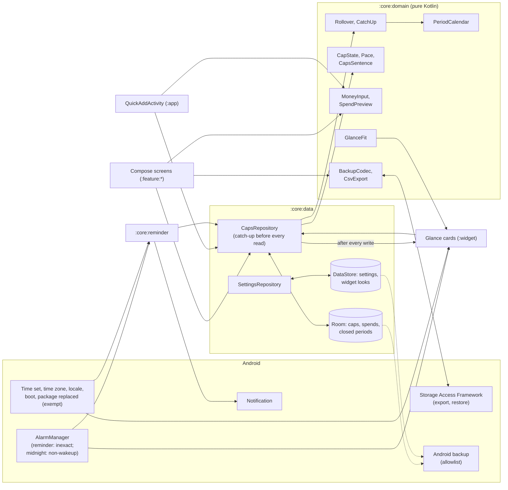

# Tetto — Technical Planning

> Companion to [VISION.md](VISION.md). This document defines the architecture, the design of the cap engine, the data, the widgets, and the delivery phases.
> It is written to be read by humans and by Claude Code.
>
> Keep the phase checklists up to date: tick the boxes as work is merged, and record every decision and deviation with its reason in §15's log. How the log is written and archived is in How it is made, below.

---

## How it is made (5 Nov 2026, as the family's)

- **This file** is the living plan: the architecture and the rules the code keeps (§1 to §10, §12 to §14: living, changed in place with the code, never archived), the phases still open (§11), what is open (§15, Open), and the log of the current period (§15, after Open). New decisions are written **at the end of the log**, one `###` section per intervention, with who asked and the date (and the step, where there is one).
- **`docs/planning/NN-<period>.md`** are the closed periods of the log, with the phases they closed, **frozen**: they are not edited. A decision that changes an old one is written here, naming the one it changes (the file, and the title or the entry's date).
- **`docs/planning/README.md`** is the index of every `##` and `###` heading of the archive, with its line: a reference by name or by date in the code ("PLANNING.md §11 Phase 3", "§15, 5 Nov 2026") that is not in this file is found there. It is written by `python3 tools/planning_index.py`, never by hand, and changes only when archiving. Both arrive in Phase 0, from the family; until the first archive the index is empty.
- **Archive** when the log passes ~80 KB (`sed -n '/^### Log since/,$p' PLANNING.md | wc -c`), or at a release, whichever first. A size and not a count of lines: this file writes a paragraph to a line. The log becomes the next archive file (the same header as the family's), and the phases of §11 that closed go with it (a closed phase's open box carried to Open); here an empty log stays with its start date, «Open» is reread, and the index script is run again.

## State

- **Released**: nothing yet.
- **Done**: Phase 0, the foundations (5 Nov 2026): green on GitHub, the release workflow rehearsed with the release key, the mark in the owner's colours. Phase 1, the cap engine (5 Nov 2026): `:core:domain` and `:core:data`, 117 tests, green on GitHub (`c762455`, 5 min 29 s). Phase 2, the caps screen and the numpad (5 Nov 2026): `:feature:caps` and the shell, green on GitHub (`4a40d7a`, 6 min 39 s). Phase 3, the first run and Settings (5 Nov 2026): `:feature:onboarding` and `:feature:settings`, 224 tests in all, green on GitHub (`e1f6b0d`, 8 min 16 s). Phase 4, your data and the reminder (5 Nov 2026): `:core:reminder` joins, 313 tests in all. Phase 5, the widgets and the launcher's shortcuts (5 Nov 2026): `:widget` joins, 424 tests in all. Phase 6, the guide, accessibility and polish (6 Nov 2026): `:feature:guide` joins, 447 tests in all, green on GitHub (PR #3). The device checks of Phases 4 to 6, TalkBack and the start-up's measure among them, done on the owner's phone (6 Nov 2026).
- **Done**: Phase 6b, the one-off cap, the hidden amounts and the lock (7 Nov 2026), with the first run's reminder page; checked on the owner's phone (7 Nov 2026).
- **Archived**: the steps of Phases 0 to 6b and the log of 5 to 14 Nov 2026, in [`docs/planning/01-5-to-14-nov-2026.md`](docs/planning/01-5-to-14-nov-2026.md) (14 Nov 2026).
- **Next**: Phase 7, the 1.0 release on GitHub.
- **Later, and optional**: Phase 8, Google Play (§11).

---

## 1. Tech stack

The family's stack, as Tempo carries it from Passo (Passo ADR 0001), with Passo's Room back: Tetto is the first app since Passo to keep a table.

| Concern | Choice |
|---|---|
| Language | Kotlin 2.4, compiled by AGP 9's built-in Kotlin, with the Compose compiler Gradle plugin; KSP for Room and Hilt |
| Build | Gradle 9.8 with Kotlin DSL, AGP 9.4; version catalog (`gradle/libs.versions.toml`); convention plugins in `build-logic/` |
| JDK | Java 21, `jvmTarget` 21, without a Gradle toolchain |
| SDK levels | `minSdk 34`, `targetSdk 37`, `compileSdk 37` (the family's; owner, 5 Nov 2026) |
| UI | Jetpack Compose, Material 3 in Chiaro's design language (its generated schemes, dynamic color on request), edge-to-edge |
| Widget | Jetpack Glance (`glance-appwidget` + `glance-material3`) 1.2.x, `SizeMode.Exact` |
| Architecture | MVVM with unidirectional data flow; coroutines and `Flow` |
| Dependency injection | Hilt |
| Persistence | Room for the caps, their spends and the closed periods (schema exported, every migration tested); DataStore (Preferences) for the settings and the widgets' looks |
| Serialization | kotlinx.serialization: the navigation routes and the backup file, as Passo's |
| Money | `Long` minor units of one currency (`java.util.Currency` for its code and decimals); formatted by the locale's currency format. Never `Double` or `Float` (§4.1) |
| Background | No service, no periodic work. `AlarmManager`: the evening reminder's inexact alarm (`setAndAllowWhileIdle`, as Passo's evening reminder) and the widgets' midnight redraw (`set(RTC)`, inexact, non-wakeup, as Tempo's boundary). WorkManager only as Glance brings it, pinned as in the family |
| Navigation | Navigation 3, as Passo's and Tempo's shell |
| Time | `java.time`, local dates for periods; an injected clock and zone |
| Testing | JUnit 4, Truth, Turbine, coroutines-test; Robolectric (Room, receivers, Compose UI tests); Room's `MigrationTestHelper`; Glance's unit test utilities |
| Quality | Android Lint (`checkDependencies`), ktlint through Spotless; Baseline Profiles if start-up measures slow |
| CI | GitHub Actions: formatting, the forbidden-permission check on the merged manifest, unit tests and lint before the APKs. A release workflow on version tags builds the signed APK and publishes it to GitHub Releases |
| License | GPL-3.0. Every new dependency must have a GPL-3.0-compatible license (Apache-2.0, MIT, BSD) and the owner's approval |

Always pick the **latest stable** versions at setup time and record them in the version catalog. Avoid alpha versions unless a phase needs them and says why.

---

## 2. Project structure

```
tetto/
├── app/                    # Application, MainActivity, QuickAddActivity, navigation, launcher shortcuts, DI entry points
├── build-logic/            # Convention plugins (android-application, library, compose, feature, hilt, room, jvm)
├── core/
│   ├── model/              # Pure Kotlin data classes (no Android deps)
│   ├── domain/             # Pure Kotlin: periods, the rollover and the catch-up, money input, a cap's state, the sentence, the preview, the widgets' fit, the backup and CSV formats
│   ├── data/               # Room (caps, spends, closed periods), DataStore, repositories exposing Flow
│   ├── reminder/           # The evening reminder's Android half: alarm, receivers, notification channel
│   ├── designsystem/       # M3 theme, typography, shared components (the numpad, the amount field, the currency picker, a cap's tile, the bar, the ring), icons
│   └── testing/            # test-only: the accessibility checks and the page walk the UI tests share
├── feature/
│   ├── caps/               # the caps screen, the numpad sheet, a cap's sheet, the cap editor
│   ├── onboarding/         # welcome, the areas, the amounts
│   ├── settings/           # settings, your data (backup, restore, CSV, erase), the reminder, about
│   └── guide/              # the guide, in Chiaro's shape (Phase 6)
├── widget/                 # the Glance cards, their settings screen, their refresh
├── tools/                  # the launcher icon script, the planning index script
├── docs/                   # ADRs, the planning archive, screenshots, device checks
├── keystore/               # the shared debug key (deliberately committed)
├── VISION.md
├── PLANNING.md
└── CLAUDE.md
```

Rules:

- `core:model` and `core:domain` are pure Kotlin/JVM modules. All business logic lives there and is unit-tested without Android.
- Feature modules depend on `core:*`, never on each other. What two features share is `:core:designsystem`'s (the amount field, the currency picker).
- `core:designsystem` uses `core:domain`'s money input (`MoneyInput`), so an amount is typed by one rule wherever it is typed; nothing else of the domain.
- `app` wires everything together. `QuickAddActivity` (the numpad over the home screen) hosts `:feature:caps`'s numpad sheet.
- A module joins the build in the phase that brings its first code, not before.

---

## 3. Architecture overview



**One writer, many readers.** Tetto's own screens (the caps screen, the cap's sheet, the numpad over the home screen) are the only writers. The readers are those screens, the widgets and the reminder; each runs the catch-up (§4.4) before it reads, so none of them ever sees a period that should have closed.

**Closed when read, never on a timer.** No job closes periods at midnight. The first read after a period's end closes it, in one transaction, idempotently. A page open across midnight has a lifecycle-bound ticker for the next local midnight; the widgets have one inexact, non-wakeup alarm at the next midnight.

**Computed, not stored.** What a cap says (left, over, the pace, the mark for today, the sentence) is computed from the cap, its open period's spends and today, in `:core:domain`. The database stores facts: the caps, the spends, the closed periods.

---

## 4. The cap engine (core design)

The riskiest part of the app: a wrong period, a cent of drift or a reserve that grows by itself is what makes a reader stop trusting the numbers, and a budget whose numbers are not trusted is abandoned. Build it first, with its tests, before any screen.

### 4.1 Money

- **Whole minor units, `Long`** (`Money`, a value class): cents of the euro, pence, none for the yen. Never `Double` or `Float`, anywhere in `:core:model`, `:core:domain` or `:core:data`. Sums are exact.
- **One currency for the app**, an ISO 4217 code in the settings, chosen at the first run (the phone's region's by default) and stored then, so a later change of region relabels nothing by itself. Its decimals are `Currency.defaultFractionDigits` (0, 2 or 3). Where the region names none (a language set without a country), the euro stands in until the first run's choice (owner, 5 Nov 2026).
- **Input** (`MoneyInput`, pure): the numpad's buffer, digits and at most one separator, at most the currency's decimals after it, at most nine digits before it; delete, clear; parsed to minor units exactly, never through a floating-point number. A zero amount cannot be added.
- **Output**: formatted by the locale's currency format with the app's currency (`:core:designsystem`, from minor units through `BigDecimal.movePointLeft`), in tabular figures. The domain never formats.
- **A change of currency** relabels the amounts; it never converts them, and Settings says so. Where the two currencies' decimals differ, the stored amounts are rescaled (euro to yen: 1250 cents become ¥13, rounded half up), in one transaction, with a test. An amount above zero never becomes zero: one that would becomes the new currency's smallest (a €0.40 spend, ¥1), so no spend and no cap disappears (owner, 5 Nov 2026; `Rescale`). Nor does an amount the numpad typed (a cap's amount, its reserve, a spend) grow past what it can type back, nine nines and every decimal (`Rescale.typed`, `MoneyInput.largest`): the largest three-decimal amount would round to a tenth digit with none, and the editor could not show the cap (6 Nov 2026); a closed line's sums are figures and keep `Rescale.amount`. The setting is written first, then the amounts, under the repository's one lock; a rescale that fails puts the setting back (`CapsRepository.changeCurrency`, Phase 3).
- Nine digits and three decimals stay far inside a `Long`, sums included.

### 4.2 Periods

- **A period is a range of local dates**, start included, end excluded (`DateRange`). Its kind is the cap's: `DAY`, `WEEK`, `MONTH`, `YEAR`, or `ONE_OFF` (Phase 6b).
- **A one-off cap** (`ONE_OFF`, owner, 6 Nov 2026) has no rule's period: its dates are its own, from its `openStart` to its `endExclusive` (the day after its last), stored on the cap; `PeriodCalendar.containing` refuses the kind, `openPeriod(cap, rule)` gives its dates. Its first day may be before today (a trip under way) or after it (a trip to come: what is added now counts in it); its last day never before today (`CapChanges.oneOffDates`, which also keeps it after the last closed line).
- `PeriodCalendar.containing(date, rule)`, pure:
  - **Day**: `[date, date + 1)`.
  - **Week**: from the week's first day on or before the date (the setting; the locale's `WeekFields.firstDayOfWeek` by default), seven days.
  - **Month**: from the month start day `d` (the setting, 1 to 31; 1 by default): each month starts on `min(d, its length)`, and a period runs to the next month's start. With `d = 31`: 31 Jan, 28 (or 29) Feb, 31 Mar, 30 Apr.
  - **Year**: the calendar year, from 1 January to the next, whatever the month start day (owner, 7 Nov 2026, replacing "from `d` January": a salary's month from the 27th made a year's cap, a holiday's or the gifts', run from 27 January to 26 January). A yearly cap made by the old rule, its open period from `d` January, simply closes on 1 January, on its share of the cap (§4.5): nothing to move.
- **A cap's open period** runs from its `openStart` to the end of the rule's period that holds it (`PeriodCalendar.openPeriod`): `openStart` is that period's own start, except where a change of rule could not reach back into a closed period (§4.5), and there the open period is the rest of the rule's one, with its share of the cap (§4.5, `PeriodAmount`), the next whole. A cap stores no end, so no setting can contradict one.
- **Today** is `LocalDate.now(zone)` from an injected clock and zone (`TodaySource`, as Passo's), and the zone is the phone's current one.
- Periods never come from timestamps compared with a stored end: a daylight-saving night, a flight across time zones and a clock set back move instants, not dates.

### 4.3 Spends

- A spend is an amount, its cap, the instant it was added (`addedAt`, for the list's time and the CSV) and **the start of the period it counts in** (`periodStart`), fixed when it is added: the cap's open period at that moment. A later change of zone never moves it.
- A spend counts **now**: there is no date to pick (VISION, non-goals).
- **A refund** (owner, 6 Nov 2026) is a spend below zero: money back, added from the cap's sheet to its open period (`CapsRepository.addRefund`), at most what that period spent. What a period spent is its spends less its refunds, and **it never goes below zero**: a spend deleted or lowered under the period's refunds is refused (`SpendChange.RefundsHeld`; the numpad says the least a spend can be corrected to, «At least €4.00, to cover this period's refunds», and a deleted row slides back with a notice), and so is an undo that would do the same; the refund is corrected or deleted first (7 Nov 2026). Held at the write and not only at the read: a sum left below zero was a credit nobody could see, which swallowed the next spends. `MAX(0, SUM)` in `capRows` (and the reader's month) stays, for a period an older build left below zero, which a change can then only bring back up. A correction keeps a refund a refund; undo, the CSV (`-4.00`), the backup and a change of currency carry the sign (`Rescale` rounds a refund as its size).
- **Edit** (the amount) and **delete** are allowed while the spend's period is the cap's open period. Spends of closed periods are frozen (§4.4).
- **Undo** is the inverse operation by id: an add is undone by deleting that spend; a delete by inserting it again with its id and fields; an edit by writing the old amount back.
- "A spend was added today" (the reminder): any spend whose `addedAt` falls on today's local date, in the zone at the moment of asking.

### 4.4 Closing periods: the catch-up and the rollover

`CapsRepository.catchUp(today)` runs, in **one Room transaction**, before any read of the caps: the caps screen's flow, a widget's `provideGlance`, the reminder's receiver, `QuickAddActivity`, the backup's export. It is **idempotent**: run twice, the second does nothing.

For each cap whose open period ended on or before today (`openEnd <= today`), in order:

1. `spent` = the sum of the open period's spends.
2. **The rollover**, the concept's formula, exact and bounded:
   - `reserveAfter = min(limit, max(0, reserve + cap − spent))`, where `limit` is the reserve's limit, **one period's cap** (owner, 5 Nov 2026): a period can at most double;
   - `forgiven = max(0, spent − cap − reserve)`: the overspend the reserve could not cover, dropped. A new period never starts in debt.
3. A `ClosedPeriod` row is written: the dates, the cap in force, `spent`, `reserveBefore`, `reserveAfter`, `forgiven`, and `periods = 1`.
4. The cap's open period moves to the next one (`PeriodCalendar.next`), and the loop goes on while it has ended.

**A one-off cap** closes once, the day after its last (`CatchUp.plan`): one line, with what was spent and what was forgiven (`Rollover.close` with a limit of nothing: no reserve), `periods = 1`, however long the absence; its `openStart` then moves to its end, and the cap has **ended** (`Cap.ended`: `openStart >= endExclusive`). It never opens a new period, takes no spend or refund, and a clock set back reopens nothing.

**A run of empty periods** (a long absence) after the first closed one is folded into **one** `ClosedPeriod` row (from the first's start to the last's end, `spent = 0`, `periods = n`), its `reserveAfter` computed by iterating in memory (it reaches the limit within a period or two). A daily cap left for 400 days writes two rows, not 400.

**What never happens:**

- A period is never reopened. If today falls before the open period's start (a clock set back, a flight west across midnight), nothing closes and a new spend counts in the open period.
- A closed period is never changed. A correction is possible only in the open period, so the reserve never changes behind the reader's back.

**One moment per read** (owner, 6 Nov 2026): every read and write reads now and the zone once (`Moment`), so the catch-up and the work after it see the same day; a spend added on the stroke of midnight counts in the day its instant falls on.

**The week in force** (owner, 6 Nov 2026): the catch-up closes each weekly cap's open period by the week it was made by, noted in the settings (`week_in_force`) and carried by the backup file. Where the reader's week follows the phone and the phone's changes under it (another language, a backup restored on a phone of another region, Android's own copy), the open weekly periods are then moved to the new week as a change in Settings moves them (§4.5), in the same transaction, and the note is written once it commits; never judged by a week they were not made for, which ended a Monday week on a Sunday, or gave a Sunday week opened on Sunday a one-day period with a whole week's cap.

**While visible**: the caps screen and the cap's sheet hold a ticker for the next local midnight (`repeatOnLifecycle(STARTED)`); at its tick the catch-up runs and the state is computed again. The ticker is re-armed on a time or zone change.

### 4.5 Changing a cap

- **Name, icon**: nothing else changes.
- **Amount**: applies to the open period at once (what is left is computed again); a reserve larger than the new amount is held to it at once, the limit the next close would hold it to (`CapChanges.heldReserve`; owner, 6 Nov 2026). A cap raised keeps its reserve.
- **Period kind**, or the settings' week start or month start day for the caps of that kind: the open period is **replaced** by the new rule's period that contains today (`CapChanges.replace`; owner, 6 Nov 2026, replacing Phase 1's "the spends move, the reserve stays"):
  - **A new period that holds the open period's start** (a longer one, or the same days): this period's spends move to it (their `periodStart` updated), no `ClosedPeriod` row is written, and the reserve is held to the new cap.
  - **A new period that starts later** (a week turned into days on a Thursday, a month start moved forward): the days before it are **kept**, closed as one `ClosedPeriod` line from the open period's start to the new one's, with what was added in them (the spends added before the new period's first instant in the zone of asking, which keep their `periodStart`) and **their share of the old cap**: its days over the open period's own length, rounded down to a minor unit. It closes as any period does (§4.4), its reserve held to the cap that runs on. Only what was added from the new period's first day moves into it. So a Monday spend never makes Thursday's day look over, and the CSV keeps the week it was added in.
  - **A refund follows what it gave back** (`SpendSplits`; owner, 7 Nov 2026): divided by their instants alone, a refund and its spend can fall on either side of the cut (Monday's €50 given back on Thursday, the week turned into days that Thursday), leaving one side spending less than nothing: the days kept counting €50 never given back, the new period starting at −€50 and swallowing the next €50 of spends. So a refund gives back the spends of its own side first, and only what is past them crosses the cut: the refunds nearest it, whole, then the last one in part, until the side is at nothing (days kept below nothing give back the new period's spends only as far as it has spent). A refund crossing in part is **cut in two**: the refund itself, with its id (an Undo still reaches it), keeps the part in the new period; the part the days kept hold is a spend of its own, at the same instant. Every cent is kept and the two sides add up to the period's spends; neither is below nothing where the period was not.
  - Spends of periods already closed stay in them.
  - **Never before the last closed period's end** (`CapChanges.replacedOpenStart`): a closed period is never changed, so a new period that would reach back into one starts where it ended. A daily cap turned weekly on a Thursday, after Monday to Wednesday closed as days, counts Thursday to Sunday; the next week is whole. With nothing closed yet, the new period is whole.
  - **A period cut short has its share of the cap** (`PeriodAmount`; owner, 7 Nov 2026, replacing "the new period has the whole cap", which gave Thursday to Sunday a whole week's cap on top of three days' caps): an open period that starts after its rule's period began has the cap's amount times its days over the whole period's, rounded down to a minor unit (Thursday to Sunday of a €70 week: €40), **never to nothing** (owner, 7 Nov 2026: held at one minor unit, as a change of currency never makes an amount nothing; a cap of a few units cut to a day of a year rounded to zero, and a period of nothing with no reserve had no bar to draw: every read failed until it ended). Derived from the dates, never stored: what it says (`CapState.amount`, `partial`; the sheet's receipt «Cap, 4 days of 7»), what it closes on (`CatchUp`, the reserve still held to a whole cap) and the days a later change keeps (their share of the share) all read it; the next period is whole. The same for a period cut short by a week or a month start moved, or by the week in force.
  - A change of week or month start writes the setting, then closes what ended under the old rule and moves the open periods, in one transaction; `CapsRepository` lets nothing read in between (one lock for every read and write), since an open period judged by a rule it was not made for can look ended.
- **A one-off cap** (owner, 6 Nov 2026) takes the same rules, to it, from it and between two of its dates: its chosen dates stand in for the rule's period (`CapChanges.oneOffDates`: never before the last closed line, never ending before today); it keeps no reserve, so a cap turned into one lets its reserve go (the editor says so) and the days kept close with a limit of nothing. New dates that start after today keep only the days already past (`keptUntil`, today), and what was added from today on goes with the new dates. An end moved alone moves nothing else. **An ended one-off** given new dates or a kind (its sheet's «Again, with new dates») starts again from them, after its closed line, with no reserve; nothing moves.
- **Clear the reserve**: the reserve becomes zero, with undo.
- **Delete**: the cap, its spends and its closed periods (`ON DELETE CASCADE`), after a confirmation.
- **Order**: the caps' `position`, written for every moved cap in one transaction.

### 4.6 What a cap says (`CapState`, pure)

From a cap, its open period's spends and today (`CapStates.of`):

- `left = cap + reserve − spent`; **over** when `left < 0` (said "€30 over", never "−€30" alone). The cap is the open period's (`CapState.amount`): its share for a period a change cut short (§4.5).
- `daysLeft = openEnd − today`, today counted, at least 1.
- **The bar**: `spentShare = spent / (cap + reserve)`, held to `[0, 1]`, with an over state beyond.
- **The mark for today**, for a week, a month or a year: `daysShare = (today − openStart + 1) / length`, today counted.
- **Ahead of the days**: not over, and `spentShare > daysShare + slack / length × daysLeft / length`: spending runs ahead of the period (the bar takes the *attention* ink). The slack is one step of the period, a day of a week, seven days of a month, thirty of a year, fading to nothing by its last day (owner, 6 Nov 2026, replacing `spentShare > daysShare`, which lit three caps of five on the 5th of a month, and a week's shop on a month's first day for a week): on a week's first day the line is two sevenths, the mark and the day the reader approved; a month nearly spent with a week to go is still ahead. No fixed threshold. The shares are kept as whole numbers (`Share`, `CapStates.aheadLine`) and compared exactly; the screen turns them into lengths. Said in words too (owner, 7 Nov 2026): «ahead of the days» under the bar, in the attention ink, on a tile and on a row of the list, for an eye that does not know what the mark means; «List» keeps the ink and the mark, its rows too small for a line more, and «At a glance» says it in its note as before.
- **The cap's habits** (`RecentAmounts`, owner, 6 Nov 2026): the numpad offers the most frequent amounts of the cap's last twenty spends, of any period, at most three, ties to the one used last, shown smallest first; each is added in one touch. Amounts only.
- **The pace**, for a week, a month or a year, while something is left and `daysLeft ≥ 2`: `left / daysLeft`, rounded down to a whole unit of the currency; under one unit, «less than €1 a day» (`Pace.lessThan`; owner, 7 Nov 2026, replacing "not shown under one unit": a cap nearly spent with days to go said nothing at the moment it mattered).
- **The renewal** (owner, 5 Nov 2026): "until" names the open period's **last day**, included ("€12 until Sunday", "until 30 Nov"); a cap over says when it **starts again**, the next period's first day ("it starts again on Monday"). Each date is said by how near it is (`Days.near`): today, tomorrow, a weekday from two to six days ahead, else a date (a week ahead would be today's own weekday). The words are Phase 2's.
- **Renewed today**: a period closed today and the open one began with it; never a one-off's.
- **A one-off cap** (owner, 6 Nov 2026): its own dates; no reserve, no renewal; a mark and a pace over its days (none for a one-off of one day, as for a day); «ahead of the days» with a slack of a seventh of its length, at least a day, fading as the others' (kept exact: `Share(max(length, 7), 7)` days). Over, it says until when it runs, never when it starts again. **Ended**, it says what its dates spent of its cap, from the closed line that ends where it does (`CapState.ended`: its period the line's, its left what the line left), and `endedToday` the day after its last.

`SpendPreview(state, typed)`, pure: `after = left − typed`; **fits** (`after ≥ 0`, "€15 left"), **goes over** (`left ≥ 0 > after`, "€30 over"), **still over** (`left < 0`, "still €45 over").

`CapsSentence(states)` leaves an ended one-off out of every count (owner, 6 Nov 2026); over first, then **ended** (yesterday was a one-off's last day: "Lisbon trip ended: €720 of €800", over "It was €50 over: forgiven"), then renewed, then all under; with every cap ended, «Nothing runs now» (`AllEnded`).

`CapsSentence(states)`, pure, returns a structure (a kind and its values), never a string, and how many caps there are: no caps; one or more over, with the first in the reader's order, when it starts again, and how many others; a week's, a month's or a year's cap renewed today (a day's renews every day: not news), the first and how many others, and, for one, how its last period ended (`CapState.renewal`, from the closed line that ends today, `Renewals`: forgiven, else covered by the reserve, else saved to it, else the reserve full, else right on the cap; owner, 6 Nov 2026). Each is read from what the period spent against its cap, never from the reserve alone (owner, 7 Nov 2026): **covered** is the overspend the reserve paid, `spent − cap`, only when the period spent past its cap; a reserve that went down under the cap was held to a lower limit by a change of kind (§4.5), and is **full** at it. A month with €260 of reserve turned into an €80 week on a Monday said «the reserve covered €180 over» with nothing overspent; it says «with its reserve full»; all under their caps, with the one closest (the lowest `left / (cap + reserve)`; a tie goes to the first in the reader's order), its left and its last day; all under with **nothing spent on any of two caps or more**, no cap named ("All under your caps."), since the closest would only be the first (owner, 6 Nov 2026). **When more than one holds, over first, then renewed, then all under** (owner, 5 Nov 2026). The words are resources, in both languages, with plurals.

### 4.7 Edge cases (all need unit tests)

- Money: `0,10 + 0,20` is exactly 30 cents; the separator of each locale; a currency with no decimals (the separator key absent) and one with three; nine digits; a zero amount refused; the rescale between currencies of different decimals.
- Periods: a week starting on Monday and on Sunday; a month starting on the 1st, the 15th, the 29th, 30th and 31st, across February in a leap year and not; a year starting on 1 and on 31 January; the day of a daylight-saving change (23 and 25 hours) in both directions.
- The catch-up: nothing ended; one period ended; several; a run of 400 empty daily periods (two rows); idempotence; a cap created today; today before the open period's start (clock set back, a flight west); a flight east across two midnights.
- The rollover: under the cap (the reserve grows), exactly at the cap, over within the reserve (the reserve shrinks), over beyond it (forgiveness, the reserve at zero), the reserve at its limit, the limit after a change of amount.
- Changes: the amount mid-period, raised and lowered (the reserve held); the kind mid-period (week to month, month to week, to a day), the days kept as a line on their share where the new period starts later, the spends moved where it holds the old start, the closed ones untouched; a refund after the cut of a spend before it, one that gave back spends on both sides (cut in two), days kept below nothing, a period an older Tetto left below nothing (`SpendSplitTest`); a period already cut short cut again; a share that would round down to nothing; the month start day changed, backward and forward; the week start changed; the phone's week changed under a week that follows it, once; clearing the reserve; deleting a cap with closed periods.
- Ahead of the days: the line on a week's first and last day, on the line exactly, a month's first-day shop, a month nearly spent late.
- The numpad's habits: none, the most frequent, ties to the last used, the window of twenty, another cap's spends left out.
- Spends: undo of an add, a delete, an edit; an edit refused in a closed period; "a spend today" across midnight and after a change of zone.
- What a cap says: over; exactly zero left; the pace under one unit; the last day of a period; a day cap (no mark, no pace); a cap with a reserve and nothing spent.
- The sentence: no caps; one cap; all under; several over; ties for the closest; nothing spent on any cap, and on a single one; the renewal after a change of kind that held the reserve down, under its cap and over it.
- A one-off cap (`OneOffTest`, `OneOffBackupTest`, `OneOffRepositoryTest`): one of one day, one that ends today, one far in the future, an absence past its end (one line), ended and idempotent, a clock set back after it; its mark, pace and slack; ended under and over, said the day after; a change of kind to and from it, new dates later, an end moved alone, «Again» after it ended; a change of currency; the month's share; the backup and the CSV, open and ended.

---

## 5. Data model

### `:core:model` (pure)

- `Money` (value class over `Long` minor units), `AppCurrency(code, fractionDigits)`
- `PeriodKind` (`DAY`, `WEEK`, `MONTH`, `YEAR`), `PeriodRule(kind, weekStart, monthStartDay)`, `DateRange(start, endExclusive)`
- `Cap(id, name, icon: CapIcon, amount: Money, kind: PeriodKind, reserve: Money, openStart: LocalDate, position, endExclusive: LocalDate?)` (a one-off's end, null for any other kind; `ended`, `oneOffDates`)
- `Spend(id, capId, amount: Money, addedAt: Instant, periodStart: LocalDate)`
- `ClosedPeriod(capId, range: DateRange, cap, spent, reserveBefore, reserveAfter, forgiven, periods)`
- `CapState` (§4.6), `Share` (an exact ratio), `NearDay`, `CapIcon` (the curated set's keys: 30, the first run's twelve areas first, stored by key, an unknown key read as `OTHER`), `CapDraft` (a cap's four fields before it is one: the editor's and the first run's), `UserSettings` (the money's settings since Phase 1, the appearance and the first run's flag since Phase 3, the reminder's since Phase 4, the first-day tip's flag since Phase 6), `WidgetLook`

### Room (`TettoDatabase`, file `tetto.db`, version 1)

| Table | Columns | Notes |
|---|---|---|
| `caps` | `id` (PK), `name`, `icon` (key), `amount` (minor units), `kind`, `reserve` (minor units), `open_start` (epoch day), `position`, `created_at` (epoch ms), `end_exclusive` (epoch day, nullable) | `end_exclusive`: a one-off's end (Phase 6b), added to version 1 in place before the first release (§15, 7 Nov 2026) |
| `spends` | `id` (PK), `cap_id` (FK → `caps`, `ON DELETE CASCADE`), `amount` (minor units, never 0; below 0 a refund), `added_at` (epoch ms), `period_start` (epoch day) | Index on (`cap_id`, `period_start`); index on `added_at` (the reminder's "today") |
| `closed_periods` | `cap_id` (FK, cascade), `start`, `end_exclusive` (epoch days; not `end`, a keyword of SQLite's), `cap`, `spent`, `reserve_before`, `reserve_after`, `forgiven` (minor units), `periods` (≥ 1) | PK (`cap_id`, `start`) |

- The schema is exported (`core/data/schemas/`) and committed; every migration from version 1 on has a `MigrationTestHelper` test and an upgrade test from the first release's schema, as Passo's. Never `fallbackToDestructiveMigration`. Version 1 itself is pinned by `SchemaTest`, which builds a database from the exported JSON and opens it with the code (the helper cannot open its database on Windows: CLAUDE.md).
- Ids are `AUTOINCREMENT`: an id is never reused, so a spend put back by Undo keeps its own.
- Size: a few thousand spends a year, a few hundred closed periods. Spends of closed periods are kept for the CSV and the backup and never listed (owner, 5 Nov 2026). Kept, so nothing the screens, the cards or the reminder read grows with them (7 Nov 2026): each of their queries goes to its rows by a key or an index (a cap's open period by `(cap_id, period_start)`, a day's or a month's spends by `added_at`, a cap's latest closed lines and its last closed end by the key's order, `LIMIT`ed), pinned by `HistoryVolumeTest` on ten years of a daily cap. The one read that sorts a cap's whole history is the numpad's habits (`lastAmounts`), a few thousand rows at most: left without an index of its own (owner, 7 Nov 2026), since one would cost a schema version.

### DataStore (Preferences), file `settings`

| Key | Default | Meaning |
|---|---|---|
| `theme`, `palette`, `font`, `dynamic_color` | system, VIVID, GOOGLE_SANS, false | The family's appearance |
| `caps_layout` | TILES | The caps screen's tiles, or a row per cap (`LIST`), the reader's choice in Appearance (owner, 6 Nov 2026) |
| `currency` | the phone's region's, written at the first run | ISO 4217 code (§4.1) |
| `month_start_day` | 1 | 1 to 31 (§4.2) |
| `week_start` | none (the locale's) | A `DayOfWeek`, once the reader picks one |
| `reminder_on` | false | The evening reminder |
| `reminder_time` | 20:30 | Local time, written as `java.time` writes one (`20:30`) |
| `asked_notifications` | false | Whether the permission was ever asked: what tells "askable" from "denied for good" (Tempo's rule) |
| `onboarding_completed` | false | |
| `caps_tip_seen` | false | The caps screen's first-day tip, pointing to the guide, dismissed or followed (Phase 6) |
| `week_in_force` | none | The week the weekly caps' open periods were made by: the engine's note, not a choice (§4.4; owner, 6 Nov 2026) |
| `app_lock` | false | The lock (Phase 6b): the phone's own credential at start and after a minute away. This phone's: not in the backup file, kept by a restore and by erasing everything |

### DataStore, file `widgets` (not backed up)

One `WidgetLook` per `appWidgetId`: the card's ground (light, dark, system, one of the seven colours; violet by default), its opacity, which caps («List»: all, or a chosen set in the reader's order; «At a glance»: one cap, or the closest to its cap, and «The sentence», on by default; «The other caps», `words_others_<id>`, off by default, and which of them, `words_other_caps_<id>`, all when absent: owner, 14 Nov 2026), and whether it hides its amounts (`hide_amounts_<id>`, off by default; Phase 6b). Removed in `onDeleted`.

### Backup

- **Android's backup** (`data_extraction_rules.xml`, cloud copy and device transfer): the database (`tetto.db` and its write-ahead log) and the settings file, an allowlist (the family's rule, Passo's ADR 0007). The widgets' file stays out: widget ids are renewed by a restore.
- **The backup file** (`BackupCodec`, `:core:domain`, kotlinx.serialization over DTOs kept apart from the model; `docs/adr/0004-your-data.md`): JSON, indented, `format: "tetto-backup"`, `version: 1`; the app's version, the zone and the instant it was written; the currency's code and its `decimals` where it was written; the settings the reader chose (month start, week start, appearance and the caps' layout, the reminder); `weekInForce`, the week the open weekly periods were made by (owner, 6 Nov 2026; absent in an older file, where the restoring phone's week stands in); the caps in the reader's order, each holding every spend and every closed line, and a one-off's `endExclusive` (Phase 6b: an added field, `version` stays 1; a one-off without its end, an end on another kind, one starting after its end or holding a reserve is damaged). Dates ISO, instants epoch milliseconds, amounts minor units. No ids, and nothing of one phone's (the first run's flag, the asked permission, the first-day tip seen). A file cut short is **damaged**; a newer version asks for an **update**; anything else is **not a Tetto backup**. Read whole and checked before anything is written: strict where a value decides a figure or a period (an amount, a date, a kind, the month or week start, the week in force, a spend or a closed line after the open period, a closed period twice, figures too large to sum, a cap's amount or a spend the numpad could not type back), lenient where a default cannot mislead (an unknown icon is "other", an unknown palette the default, a file without the caps' layout the tiles). A file whose decimals for its currency are not this phone's is rescaled as a change of currency would be (§4.1).
- **A restore replaces** this phone's caps, spends and closed periods, and its settings with the backup's, after a confirmation that says when and by which Tetto the file was written, its caps by name, and what it replaces: on a new phone there is nothing to merge with, and a merge of two sets of caps would double them. (Passo merges because a new phone has already counted steps by itself; Tetto has no data it did not get from the reader.) The settings come with the caps because the open periods were made by the backup's week and month starts. Under the caps' one lock: the settings, then one transaction (the old caps out, the backup's in, the catch-up); a transaction that fails puts the settings back (`BackupRepository.restore`).
- **The CSV** (`CsvExport`, pure): one row per spend of every period, oldest first, a header row of fixed English identifiers (`date,time,cap,amount,currency,period_start,period_end`), ISO dates and 24-hour times in the phone's zone, the cap's name (never a formula), the amount in the currency's major unit with a dot, the currency's code, the period's first and last day; RFC 4180, UTF-8 with a byte-order mark. From the same snapshot as a backup, after the catch-up.
- **Erase everything**: confirmed; the caps (and with them every spend and closed line) in one transaction, then the settings to their defaults, so the first run takes over. The asked permission and the first-day tip seen stay: facts about the phone, not the reader's data. Ids are never given twice (`AUTOINCREMENT`), so an Undo still pending can never reach a cap or a spend made after.

---

## 6. Derived views (`core:domain`)

- **`PeriodCalendar`**: a date and a rule → the period that contains it; a period → the next (§4.2).
- **`Rollover`** and **`CatchUp`**: one period closed, a run folded, the plan of what a catch-up writes (pure; the repository applies it in one transaction) (§4.4). The most tested code of the app.
- **`CapState`**, **`Pace`** (about so much a day, or less than one unit): §4.6. **`PeriodAmount`** (owner, 7 Nov 2026): what a cap gives its open period, the whole cap or, for a period a change cut short, its share of the days (§4.5).
- **`SpendSplits`** (owner, 7 Nov 2026): an open period's spends divided where a change keeps the days before the new period, by their instants, a refund following what it gave back (§4.5).
- **`SpendPreview`** (`ofRefund` for money back) and **`MoneyInput`**: the numpad's arithmetic (§4.1, §4.6); **`Renewals`**, how a period that renewed today ended (§4.6); **`RecentAmounts`**, the cap's habits above its keys (§4.6).
- **`CapsSentence`**: the caps screen's sentence, and «At a glance»'s (§4.6).
- **`MonthSums`**, **`YourMonth`** (owner, 6 Nov 2026): the reader's month (from the month start day, the salary's for a reader who sets it so) and the one before; what the caps are worth in it, about (a month's cap its amount, a day's for each of its days, a week's for its days over seven, a year's a twelfth; the reserves left out; exact in 84ths, rounded once to the whole unit). What was added to the caps in each month is the repository's sum of the spends added between the months' first instants in the zone of asking (`Days.instantsOf`), closed periods' spends included. Shown last on the caps screen; never a sum of what is left, no month before the last, no choice of period.
- **`LockSchedule`** (Phase 6b): whether Tetto is unlocked, from its pages' comings and goings on the time since boot: locked at start and after a minute away; a turn of the phone, the step from the caps to the numpad over the home screen, and the phone's own lock screen over Tetto are not away; it asks by itself once per lock.
- **`ReminderSchedule`**: the next moment the reminder fires, from the time, today and now; across a daylight-saving change (as Passo's `EveningReminder`).
- **`BackupCodec`**, **`CsvExport`**: §5.
- **`GlanceFit`** (pure arithmetic, as the family's `GlanceLayout` / `AgendaFit`): given a card's granted size in dp and the text sizes measured in the system face, which form the card takes and how many caps fit; pinned by tests at the family's reference grants (one row ≈ 85 dp tall, two ≈ 189; widths 2 cells ≈ 159 dp, 3 ≈ 250, 4 ≈ 340), with the family's widget scale (`WidgetType`) and its text metrics.
- **`WidgetCaps`**, **`CapNote`**: an ended one-off is on no card but an «At a glance» that chose it, and never the closest (Phase 6b); `CapNote.Ended`, and `Forgiven.renews` false for a one-off ("forgiven when it ends"). Which caps a card shows (the reader's choice, or every cap; «At a glance»'s chosen cap, or the one closest to its cap: the first over, else the lowest share left), and what «At a glance» says of its cap under the figure (the pace, ahead of the days, the reserve, forgiven when it starts again), a structure, never a string.

---

## 7. Widgets (Glance)

The family's pair (owner, 5 Nov 2026), on the family's card (Passo's ADR 0005, from Chiaro): its corner, insets, grounds, the family's seven colours (`WidgetPalette.kt`; the app's violet, `PLUM`, by default, owner, 15 Nov 2026), opacity and ink rule. The names are the family's since 15 Nov 2026 (owner, §15): «At a glance» / «A colpo d'occhio» is the ring card (`WordsWidget`, «In words» until then), first in the manifest and in the launcher's list; «List» / «Elenco» is the caps' list (`GlanceWidget`, «At a glance» until then). The code keeps its names: a placed card is bound to its receiver's class name. The details of each form are settled in Phase 5 with their ADR (`docs/adr/0003-widgets.md`); what follows binds them.

### Configuration

- `SizeMode.Exact`: every form is read off the size the launcher really granted.
- Default placement 4×2 for «List», 4×1 for «At a glance»; minimum one cell; `resizeMode="horizontal|vertical"`; **no maximum** (Passo's ADR 0005).
- `updatePeriodMillis = 0`. `configure` is the per-widget settings screen, `reconfigurable|configuration_optional`: the card is placed at once with sensible defaults.
- `widgetCategory="home_screen"`.
- Reference grants the layout tests measure against (the family's): one row ≈ 85 dp tall, two ≈ 189; two cells ≈ 159 dp wide, three ≈ 250, four ≈ 340.

| «List» form | When | Content |
|---|---|---|
| CELL | one cell | One cap: its icon and what is left |
| ROW | one row | The caps side by side, as many as the width holds, each its icon, its left and a slim bar; the rest counted |
| GRID | two rows and up | The caps in rows, each its icon, name, left and bar; "3 more" where they do not all fit |

### «At a glance»: the family's ring card

The owner asked (5 Nov 2026) that this card have **the ring of Passo's and Tempo's ring cards, at the same sizes for every size of card and every line of text**, so the three stand on a home screen as one set. So its ring is not designed again: it is **the family's circle**, the three functions both sisters draw their circle with since 4 Nov 2026 (Tempo's `WordsFit.cellCircle`, `rowCircle`, `tallCircle`; Passo's `dotRingSize`, `rowRingSize`, `tallCircle`, the same arithmetic), **copied constant for constant** into Tetto's `GlanceFit`. Its rule, the sisters': a circle is the size the card's size gives, **whatever the day's words say**, so two cards of one size side by side show one circle, and a card's own does not grow when its words are short; it grows with the card, and yields only to the reader's text size. Only the words are Tetto's, set in the family's widget scale (`WidgetType`: hero 34 sp, title 22, body 16, label 13), copied with it.

**The circle**, in dp, with the family's card insets (14 dp; 6 dp snug, on a row):

- **One cell wide** (under 120 dp): the cell's shorter side less 8 dp on each side, between 36 and 104 dp.
- **One row** (under 150 dp tall): the height inside the snug insets, but never so wide that the words beside it keep less than 84 dp (the width less 14 dp on each side, the 12 dp gap and those 84 dp), between 44 and 56 dp.
- **Two rows and up**: the card's inner height less **a budgeted band of words**, never measured, at 1.32 em a line and the reader's text size: a 34 sp line and three 16 sp lines under 230 dp wide (108.24 dp at the default size), a 34 sp line and two from 230 dp (87.12 dp), where a sentence that takes two lines on two cells takes one; a 34 sp line and one (66 dp) where the reader hides the sentence. Between 44 dp and the smaller of the card's inner width and the ceiling (the larger of 104 dp and 45% of the card's inner height and width), rounded down to a quarter of a dp.

At the family's reference grants (one cell 85 dp; rows 85, 189 and 293 dp tall; two, three and four cells 159, 250 and 340 dp wide), the numbers both sisters' tests pin and Tetto's pin too:

| | 1×1, 1×2, 1×3 | 2×1 | 3×1, 4×1 | 2×2 | 3×2, 4×2 | 2×3, 3×3 | 4×3 |
|---|---|---|---|---|---|---|---|
| The circle | 69 | 44 | 56 | 52.75 | 73.75 | 104 | 119.25 |
| Without the sentence | 69 | 44 | 56 | 95 | 95 | 104 | 119.25 |

At 115% and 130% text the two-by-two's band grows and its circle stands at 44 dp. The owner's own two-by-two (188 × 218 dp, measured from the phone's screenshots in Tempo's entry of 5 Nov 2026) draws 81.75 dp, 104 without the sentence: it is one of the grants Tetto's tests measure too.

| Form | When | The ring | The words |
|---|---|---|---|
| CELL | one cell wide | The cell's circle, centred; the cap's icon inside | What is left under it ("€12"), at the label step, only where it fits under the circle, which is never made smaller for it |
| ROW | one row | The row's circle at the leading edge, 12 dp from the words | What is left ("€12 left", 20 sp, Medium; 16 sp on a narrow row, down to 14) over the cap's name and its renewal ("Coffee · until Monday", 16 sp; 14, 13, 12 on a narrow row; else "until Monday", else "Coffee", the fullest that stays whole); the pace at the far edge where those words stay whole beside it |
| TALL | two rows and up | The tall circle in the top trailing corner | From the bottom leading corner, the band the circle budgets: what is left (34 sp, the hero, smaller only where the width cannot hold it; "€12 left", "€30 over"), the cap's sentence (16 sp, up to two lines under three cells wide, one from three: the pace, "about €4 a day", "ahead of the days", the reserve, or, over, "forgiven when it starts again"), and the last words (16 sp: "of €20 · until Monday" on one line, else broken at its separator over two, else the day alone); the cap's name beside the circle where 56 dp are left (16 sp, 14 or 13 before a word of it breaks), else in the last words in the amount's place ("Coffee · until Monday"), so the circle never yields to a name |

- **«The sentence»** («La frase»), a switch on «At a glance»'s settings, on by default, as Passo's card hides its sentence and Tempo's its «day's note»: off, a tall card says the amount and "of €20 · until Monday" alone, and its circle takes the band they leave (95 dp two rows high), the size the sisters' circles take without theirs. One cell and one row are unchanged: they never show the sentence.
- **«The other caps»** («Gli altri tetti», owner, 14 Nov 2026), a switch on «At a glance»'s settings, off by default, and once on «Every other cap» or those ticked (as «List» chooses; never the card's own cap, which on the closest changes by the day, nor an ended one-off). On a TALL card, a row of them at the foot, `OTHERS_GAP` (12 dp) under the words: «List»'s row slots (`CapSlot`, shared), as many as the width holds (two, three, four, five at most), of one width whatever the caps, the last counting the rest ("+3"); each cap's touch its own numpad over the home screen, the air and the count the app's. **The ring keeps the family's circle** (owner: "the ring stays the same size, so it stays coherent with the family's cards"): `othersCircle` is `tallCircle` for the card's size with its sentence, the size the card has without the row; a hidden sentence's room goes to the row, not the ring. The words take what the row leaves (`WordsLayout`): **under** the ring, the tall card's own arrangement, where the hero at its size and a line of last words fit (3×3, 4×3, and 2×2 with the hero a size smaller, never under 22 sp); else **beside** it, a column of the hero (as large as the column holds, never under 20 sp), "Coffee · until Sunday" and the sentence where it fits (3×2, 4×2). The card's last day before the row's names: where the two do not stand together (two cells wide), the row drops its names (icon, figure and bar, as «List»'s short row); a day that would be cut is not drawn. Where nothing stands with the row (a two-row card at the largest text), the card is its cap's alone. One cell and one row are unchanged. `GlanceFitTest` pins the plan at every reference grant and text size; `WidgetFitTest` the ring's side with and without the row, and that nothing is cut; the gallery draws `widget-words-others` and `widget-words-others-cases`.
- **The ring** is what was spent of the cap and its reserve: its track, and the arc in the accent; in the *attention* ink when spending runs ahead of the days; full past the cap, with "over" in the words ("€30 over"). It is a bitmap painted at the size shown, capped at 416 px a side, one per card (Passo's rule), with the cap's icon drawn in its middle.
- Without a cap to show (the chosen one deleted, no caps at all) the card says so in the words' place and opens the app.
- A gallery test draws «At a glance» at every reference grant, with the sentence and without, and `WidgetFitTest` pins the circle at each (the table above) and every type step to the family's scale, and finds nothing cut at 100, 115 and 130% text: a change to them is a change to the family's, decided with the owner, never alone.

### Rendering

- **No scrolling container**: a Glance `Column`/`Row`, never `LazyColumn`. Glance drops the eleventh child of a container silently: caps go in groups of at most five, counted.
- Inks resolved against the ground the card really has (`widgetInk`, Chiaro's rule), never left to the launcher's day/night resolution. Figures as the launcher's face draws them: Glance cannot ask a `TextView` for tabular figures.
- A cap over its cap says "over" in words on the card too; never a colour alone.
- **The amounts hidden** (Phase 6b, a switch per card under «Privacy» in its settings, the real card above as its preview): `CardWords(hidden)` writes no figure anywhere, TalkBack's description included; where a figure stood, where the cap is ("Under its cap", "Ahead of the days", "Over its cap"; "Under", "Ahead", "Over" in a cell's or a slot's room); the names, the dates, the bars and the ring stay. The forms are measured from the words really drawn, so `GlanceFit` is unchanged and the family's ring never retuned; `WidgetFitTest` checks both, `HiddenAmountsTest` finds no amount, the gallery draws `widget-hidden-amounts`.
- **A one-off** says until when it runs, over too ("forgiven when it ends"); **ended** and chosen for «At a glance», "Ended", "€720 of €800 · on 20 Nov", and what it left or how far over it went; a touch on it opens the numpad over the home screen, which says it has ended and opens Tetto.
- A drawing that throws (`onCompositionError`) is never Glance's blank "Can't show content" box: the reason goes to the log under `TettoWidget` with the sizes the launcher gave the card, and the card says "This card could not be drawn · Touch to open Tetto" in the default dress (`WidgetFailure`, `widget_failure.xml`) until its next redraw (owner, 6 Nov 2026).
- Previews: a static `previewLayout`, and generated previews on Android 15+ (`providePreview`) from sample caps, once per version, as Tempo's.

### Taps

- **A cap**: `QuickAddActivity` on that cap: the numpad sheet over the home screen (a translucent activity, `excludeFromRecents`, its own task affinity). After Add, the sheet becomes one line, "€5.00 added to Coffee", with **Undo**, for a few seconds (longer with TalkBack), then closes by itself; a touch outside closes it at once.
- **The rest of the card**: the caps screen.

### Update strategy (battery-aware)

- **A write** (a spend added, edited or deleted; a cap or a setting changed): the cards redraw once the transaction is committed, heard from Room's invalidation of the caps' tables and from the settings (`WidgetUpdater`, started by the application), whatever wrote it.
- **Midnight**: while a card is placed, one `AlarmManager.set(RTC, next local midnight)`, inexact and **non-wakeup**, armed after every render: delivered when the phone is next awake, which is when someone can see the card. The card's render runs the catch-up first.
- **Clock, zone, language**: `TIME_SET`, `TIMEZONE_CHANGED`, `LOCALE_CHANGED`, exempt from the implicit-broadcast limits, received in the manifest.
- **Boot and update**: the system sends the cards their update; the alarm is armed again from it.
- Nothing else: no periodic work, no polling, no observer while nothing is shown.

---

## 8. Notifications and system surfaces

- **Channel `reminder`** (default importance), the evening reminder, opt-in:
  - turned on in Settings, where `POST_NOTIFICATIONS` is asked; denied, the switch says why and how to change it; or offered on the first run's last page (`ReminderOffer`, owner, 7 Nov 2026), after a run that made caps, while the reminder is off and the permission granted or still askable: «Remind me at 20:30» turns it on and only then lets Android ask (a refusal leaves it off), «Not now» asks nothing;
  - one inexact alarm, `setAndAllowWhileIdle(RTC_WAKEUP, …)` at the reader's time (as Passo's evening reminder: no exact-alarm permission), armed again at every start of the process, every change of the setting, every clock or zone change, after a boot (`RECEIVE_BOOT_COMPLETED`) and an update (`MY_PACKAGE_REPLACED`), and at each firing;
  - at its firing: the next alarm armed first; then **nothing** if the reminder was turned off meanwhile, if its day is over (an alarm held back past midnight: `ReminderSchedule.stillTimely`), if there is no cap, or if a spend was added today (§4.3), the catch-up first; else "Anything to add today?", whose touch opens the caps screen; it goes by itself at the end of the day (`setTimeoutAfter`), and is taken back when the app comes to the front (its question has brought the reader there) or the reminder is turned off;
  - no alarm armed while the reminder's notifications cannot show (armed again when they can: the app's return, the system's block-state broadcasts, Settings' own request), Passo's rule of 2 Nov 2026;
  - its status-bar icon is the mark's roof and coin in one ink, the coin's rim cut out (`ic_stat_tetto`, drawn by `tools/draw_launcher_icon.py`);
  - in Settings, with the reminder on and its notifications blocked, a card over the group says why and holds the one button that fixes it: "Allow" while Android will still ask (`asked_notifications` tells "askable" from "denied for good"), else the system's page, the app's notifications or the reminder's channel.
- **No other notification**: no threshold alerts, no "over" alerts (VISION).
- **Launcher shortcuts** (dynamic: a static one names its package, and the debug build's is another): the first four caps in the reader's order that have not ended (an ended one-off takes no spend), each its icon and name, opening `QuickAddActivity` on that cap. Published again when the caps, their order or their names change, and when the app's language changes (Tempo's lesson of 30 Oct 2026).
- **Pin request**: the first run's last page and Settings offer "Add a widget to the home screen" through `AppWidgetManager.requestPinAppWidget`, where the launcher supports it. The first run's page offers both cards, «At a glance» first, each with its line, its real card drawn from the reader's new caps (`HomeCardPreview`) and its «Add», then «Done» or «Continue» (owner, 15 Nov 2026).

---

## 9. Battery rules (non-negotiable)

1. No service, foreground or background. Tetto runs only when a screen of it is visible, when a card is being drawn, or when the reminder fires.
2. No wakelocks of the app's own (WorkManager holds its own while Glance's work runs, as in the family).
3. No exact alarms, no `REQUEST_IGNORE_BATTERY_OPTIMIZATIONS`, no periodic workers.
4. Two alarms at most, each only while needed: the reminder's (inexact, one a day, only while on and allowed) and the cards' midnight redraw (inexact, non-wakeup, only while a card is placed).
5. Periods close when read (§4.4), never on a timer. The midnight ticker lives in a visible page's lifecycle.
6. A phase that touches an alarm ends with a check: `adb shell dumpsys alarm | grep tetto` (the alarms above and nothing else), `dumpsys batterystats --charged com.callbackdev.tetto`, Doze (`dumpsys deviceidle force-idle`).

---

## 10. Permissions and manifest

| Permission / element | Type | Why |
|---|---|---|
| `POST_NOTIFICATIONS` | Runtime | The evening reminder, asked when the reader turns it on (Phase 4) |
| `RECEIVE_BOOT_COMPLETED` | Normal | Arm the reminder again after a boot (declared by `:core:reminder`; also brought by WorkManager) |
| `WAKE_LOCK`, `ACCESS_NETWORK_STATE`, `FOREGROUND_SERVICE` | Normal | Brought by WorkManager, which Glance runs its sessions on, as in the family. Without `INTERNET` nothing can leave the phone. Tetto's own code uses none of them |
| `USE_BIOMETRIC` | Normal | The lock (Phase 6b): the platform's `BiometricPrompt` with the phone's own credential (`BIOMETRIC_STRONG or DEVICE_CREDENTIAL`), declared by `:core:data` (`DeviceLock`). Reads nothing, sends nothing; not in the forbidden list |
| `android:allowBackup="true"` + `dataExtractionRules` | Manifest | The database and the settings file only (§5) |

**Forbidden:** `INTERNET`, `ACCESS_*_LOCATION`, `REQUEST_IGNORE_BATTERY_OPTIMIZATIONS`, `SCHEDULE_EXACT_ALARM`, `USE_EXACT_ALARM`, `CAMERA`, `RECORD_AUDIO`, `READ_SMS`, `RECEIVE_SMS`, `READ_CONTACTS`, `WRITE_CONTACTS`, `READ_CALENDAR`, `WRITE_CALENDAR`, `READ_EXTERNAL_STORAGE`, `WRITE_EXTERNAL_STORAGE`, `MANAGE_EXTERNAL_STORAGE`, `READ_MEDIA_*`, `QUERY_ALL_PACKAGES`, `ACTIVITY_RECOGNITION`, `HIGH_SAMPLING_RATE_SENSORS`, `BODY_SENSORS*`.

The export, the restore and the CSV go through the Storage Access Framework (`ACTION_CREATE_DOCUMENT`, `ACTION_OPEN_DOCUMENT`), which needs no storage permission. The numpad's haptics go through the view's `performHapticFeedback`, which needs no `VIBRATE`.

`checkForbiddenPermissions` (build-logic, `ForbiddenPermissionPatterns`) checks every variant's merged manifest, is wired to `check`, and runs in CI and in the release workflow. A library that adds one is removed or patched with `tools:node="remove"`.

No service of Tetto's own in the merged manifest (§9): Room declares `MultiInstanceInvalidationService`, for a database shared between processes, which Tetto never asks for; the app's manifest removes it (Phase 1). From Phase 5 the merged manifest holds the services Glance and WorkManager declare, as in the family (`GlanceRemoteViewsService`, `RemoteViewsCompatService`, WorkManager's job, alarm and foreground services): Glance runs its sessions on them; Tetto's own code starts none.

---

## 11. Delivery phases

Each phase ends with a merged PR, green CI and its acceptance criteria met. Phases 4 and 5 need **testing on a physical device**: the reminder's delivery, the launcher's grants and shortcuts, a backup restored on a clean install.

**How to run a step** (the family's): one step is one session. Read CLAUDE.md, the step and the files it names; build it with its tests (the domain's first, for anything that decides a period, a reserve or an amount); run `spotlessApply`, `test`, `:app:lintDebug` and `:app:checkForbiddenPermissions`; look at the screenshots the step changes (`build/screenshots`); tick the step, record its decisions in §15, and add its line to `CHANGELOG.md`'s Unreleased section in the reader's words. A step that changes a decision already recorded says so, and the owner confirms it before anything is built.

**The phases closed**, 0 to 6b with every step ticked, are archived with the log of their period in [`docs/planning/01-5-to-14-nov-2026.md`](docs/planning/01-5-to-14-nov-2026.md) (14 Nov 2026); «the log» below names an entry there, unless it is dated after the archive.

### Phase 7 — Release on GitHub (v1.0.0)

- [ ] `CHANGELOG.md`'s 1.0.0 section; `tetto.versionName=1.0.0`; tag `v1.0.0`
- [ ] The README's download link and the release key's fingerprint
- [ ] The sister apps' READMEs name Tetto in "The family" (Chiaro, Passo, Tempo, Saldo)
- [ ] The log archived, as How it is made says

### Phase 8 — Google Play (optional, later)

- [ ] As the family's: the same key, the store listing, the data safety form ("no data collected, no data shared").

### Later — Erasing older spends (owner, 7 Nov 2026; not scheduled)

Written down to be built later, in a session of its own, after the 1.0 release; nothing of it exists yet. Why it is not automatic, and why it is offered at all, is in the log («The second review»). Read this section whole before starting, then §4.4, §5 and §11 Phase 4 (your data).

**What it is.** A row in Settings, «Your data»: «Erase older spends» («Cancella le spese più vecchie»). The reader chooses an age, **older than 1 year, 2 years or 5 years**, and Tetto deletes the spends of the periods that **ended before that date**, after a confirmation that says how many and from when. Never by itself, never on a schedule, never in the background: a reader's spends are the reader's records, and only the reader removes them. A reader who never uses it keeps everything, as today.

**What it never touches.** The open period of any cap, and its spends. Any period that ended on or after the cutoff. The caps, their reserves, their settings. Each cap's **latest closed line** (the engine reads it: `lastClosedEnd` for `replacedOpenStart`, `closedEnding` for the renewal's sentence and an ended one-off's tile, sheet and share of «Your month»), even when it is older than the cutoff (a cap untouched for years). The last month and the one before («Your month» sums them, from spends): the shortest choice is a year for that reason. A period is never split: either all its spends go or none.

**The cutoff.** A local date: today minus the chosen years, in the zone of the moment of asking (`Moment`, read once). A spend goes when its period's closed line **ends on or before the cutoff** (`end_exclusive <= cutoff`), found through the line that starts on its `period_start`. A spend whose `period_start` matches no closed line is never deleted (it can only be the open period's).

**What is deleted, in one transaction** (`BackupRepository.eraseOlder(cutoff)`, under the caps' lock, `CapsRepository.exclusively`, with `catchUpLocked` first, as `backup()` and `restore()` do):

```sql
-- the spends of the periods that ended by the cutoff
DELETE FROM spends WHERE id IN (
    SELECT s.id FROM spends s
    JOIN closed_periods p ON p.cap_id = s.cap_id AND p.start = s.period_start
    WHERE p.end_exclusive <= :cutoff
);
-- the lines of those periods, but never a cap's latest
DELETE FROM closed_periods
WHERE end_exclusive <= :cutoff
  AND start < (SELECT MAX(q.start) FROM closed_periods q WHERE q.cap_id = closed_periods.cap_id);
```

Both use the indexes that exist (`(cap_id, period_start)` on `spends`, the key `(cap_id, start)` on `closed_periods`): **no schema change**, no migration. Return how many spends and lines went, for the notice. Optionally, after the transaction commits, `VACUUM` through `openHelper.writableDatabase` (never inside a transaction), so the file shrinks too; measure first whether it is worth its seconds on a phone (it rewrites the whole file).

**The screen** (`:feature:settings`, `DataSection`, `DataViewModel`):

- The row is drawn only when there is something older than a year to erase (a count query, `SELECT COUNT(*)` with the same join and the one-year cutoff): no dead row on a young install (the family's rule).
- Its subtitle says what is there: «412 spends from before 7 Nov 2025» (plurals; the date with the locale's own pattern).
- A touch opens a dialog: the three ages as radio buttons, each with its count («older than 2 years: 120 spends»), the ages with nothing to erase disabled; a line that says it cannot be undone and that a backup keeps them («Make a backup first» as a text button that runs the export, `CreateDocument`, then comes back to the dialog); the confirm button in the over ink, labelled with the count («Erase 412 spends»).
- After it, a notice with what went («412 spends erased»), **no Undo**: say so in the dialog, never offer one that cannot work.
- TalkBack: the dialog's choices read with their counts; `assertAccessible()` and `walkPage()` on it.

**What else changes.** The CSV and the backup have fewer rows after it: say so in the dialog («the CSV and the backup will no longer have them»). The cap's sheet's «The last periods» is unaffected (it reads three lines, kept unless older than the cutoff, and then the latest stays). The guide's chapter on your data gains one sentence on it, in both languages. VISION's «Your data» and §5 say it.

**Tests** (the engine's rule: no change to the data without them):

- The repository (`BackupRepositoryTest` or a class of its own, Robolectric, in-memory Room): spends of periods ended before the cutoff go, those ending after stay; a period that straddles the cutoff keeps all its spends; the open period's spends stay at any age; each cap's latest line stays (a cap with no spend for three years); an ended one-off's closing line stays and its tile still says what its dates spent; refunds go with their period (a period's sum is never left below zero, §4.3); idempotent (a second run erases nothing); the catch-up runs first (a period that ended at midnight counts); «Your month» unchanged for this month and the last.
- The counts for the three ages, and the row absent with nothing older than a year.
- The dialog: its counts, the disabled ages, the confirm label, the notice; light and dark, English and Italian, twice the text size; the screenshots looked at (no line broken where it should not be).
- A volume case: `HistoryVolumeTest`'s ten years, erased to two, leaves two years and the latest lines, in well under a second.

**Not part of it**: an automatic or periodic erase, a size limit that erases by itself, erasing a single period or a single cap's history (deleting the cap does that already), anything that turns the history into a list to browse (Tetto keeps no ledger).

---

## 12. Testing strategy

- **Pure Kotlin first.** `MoneyInput`, `PeriodCalendar`, `Rollover`, `CatchUp`, `CapState`, `SpendPreview`, `CapsSentence`, `ReminderSchedule`, `BackupCodec`, `CsvExport` and `GlanceFit` are tested on the JVM with fixed dates, instants and zones, every §4.7 case named in a test.
- **Room under Robolectric.** The repositories on an in-memory database: the catch-up's transaction, undo by id, the changes of §4.5, the cascade. Every migration with `MigrationTestHelper`, and an upgrade test from the first release's schema.
- **ViewModels on real threads.** A ViewModel's test on a real database runs Main on a thread of its own, `RealMainThread` (`:core:testing`): started in `@Before`, and stopped first thing in `@After` with every ViewModel the test made, their work cancelled and waited for before Main is reset and the database closed. A flow a ViewModel shares re-reads Room after the test's last write and comes back to Main after its last check.
- **Screens from states.** Compose UI tests draw a screen from a state, never from a database, with `assertAccessible()` and `walkPage()` (`:core:testing`), at twice the text size and on an open foldable; their screenshots land in each module's `build/screenshots` and are looked at.
- **The widgets' forms.** Glance's test utilities for content; a gallery test that draws every form at the reference grants.
- **On a device**, for what only a device can say: the reminder's delivery and its silence, the launcher's grants and shortcuts, the numpad over the home screen, Android's backup and a restore on a clean install.

---

## 13. Working with Claude Code

`CLAUDE.md` holds the operating rules (commands, modules, invariants, design, signing). The workflow, as in the family:

- Work one phase at a time, from its section in §11.
- Write the domain test first for anything that decides a period, a reserve or an amount.
- Tick the boxes as work lands; record every decision and deviation, with its reason, in §15, as a `###` section at the end of its log (and as an ADR in `docs/adr/` when it is architectural). The closed periods of the log are archived, frozen, in `docs/planning/` (How it is made, at the top).
- Run `spotlessApply`, `test`, `:app:lintDebug` and `:app:checkForbiddenPermissions` before pushing.

---

## 14. Risks and mitigations

| Risk | Mitigation |
|---|---|
| A period on the wrong dates (daylight saving, month ends, travel) | Local dates, never timestamps against a stored end (§4.2); tests in §4.7 |
| A cent of drift | `Long` minor units everywhere; no `Double` in the model, the domain or the data |
| A reserve that grows by itself after an absence | The reserve's limit; a run of empty periods folded (§4.4) |
| A widget or the reminder reading a period that should have closed | The catch-up before every read, idempotent, in one transaction |
| A number the reader cannot fix | The open period's spends editable; undo after every change |
| Data lost by a migration | Exported schemas, migration tests, never destructive |
| A damaged or foreign backup file | Read whole and checked before anything is written; replace only after a confirmation |
| The reminder late or missing on a maker's aggressive battery saver | Inexact by design, said in the guide; no exemption asked |
| A stale card after midnight | The non-wakeup midnight alarm and the catch-up in `provideGlance`; the card says dates, never hours |
| Glance's eleventh-child limit | Caps in groups of five, a test that counts children |
| A change of currency with different decimals | The rescale rule, tested, and said on screen |
| Readers confusing Tetto with Saldo's budgets | VISION's border; the guide says what Tetto does not do |

---

## 15. Decisions log and open questions

### Open

What is still to decide or to do, in one place, besides the steps of the phases in §11 (which keep their boxes there): a box opens here, with the reference to the log entry it comes from, and closes here, with the one that closes it. A new question is written here and asked before it is built.

The boxes closed until 14 Nov 2026 are in [`docs/planning/01-5-to-14-nov-2026.md`](docs/planning/01-5-to-14-nov-2026.md), with the log they name: «the log» in a box below names an entry there, unless it is dated after the archive (the log below).

- [ ] **«In words» drawn blank the first time it was placed** (the log, «The owner's four requests from the phone»): the cause is not found; the card now logs the reason under `TettoWidget` and says it could not be drawn. If it comes back: the card removed and placed again, then `adb logcat -d -s TettoWidget:* GlanceAppWidget:*`.
- [ ] **Approved after the review, to build** (the log, «Two features from the review»; owner, 6 Nov 2026): ~~the one-off cap, the hidden amounts and the lock, §11 Phase 6b~~ (built: the log, 7 Nov 2026); **an automatic backup into a folder the reader picks** (written when Tetto is opened and the last is a week old, never in the background), in a session of its own.
- [ ] **To evaluate, not planned**: a period of two weeks, for a fortnightly pay.
- [ ] **The second review on the phone** (the log, 7 Nov 2026, «The second review»): a spend with a refund deleted (slides back, the notice) and corrected down (the least); a daily cap turned weekly on a Thursday (the share on the tile, «Cap, 4 days of 7» on the receipt); a yearly cap from 1 January; «less than €1 a day»; «ahead of the days» and the reserve's line on the tiles and the list.
- [ ] **To propose: a change of currency that leaves refunds above their spends** (the log, 7 Nov 2026, «The third review»): each spend is rescaled on its own (`Rescale`, half up), so two €1.40 spends become ¥1 each and a €2.80 refund ¥3; the period goes below nothing and a later ¥1 is swallowed. Found, not built: the fix is a choice (rescale a period's refunds against its spends, or hold them to them), to ask.
- [ ] **The screens' review on the phone** (the log, 11 Nov 2026): the caps screen's first row beside the sisters'; the sentence's two voices; a tile's bars level on the phone's own width; the editor (the segments, the one-off's row and its dates on their own page, Save above the keyboard, the bin); a cap's sheet (the pencil, the last periods); «At a glance» with a cap over, in Italian.
- [ ] **The first run on the phone** (the log, 12 Nov 2026, «The first run reviewed with the family's»): a run that makes caps on a launcher that takes the pin request, with the notifications not yet allowed: the five steps on TalkBack, «Continue» on the amounts and on the card's page once placed, the card's page and the reminder's sliding in; then a run with a card already placed (four steps).
- [ ] **«The other caps» on the phone** (the log, 14 Nov 2026): «In words» at 2×2, 3×2 and 4×2 with the row on, beside a sister's ring card of the same size (the ring the same); a touch on a cap of the row opens its numpad, on the count the app; the row at the phone's own text size, and in Italian.
- [ ] **Later, not scheduled: «Erase older spends»** (owner, 7 Nov 2026), §11 «Later — Erasing older spends», to build after 1.0 in a session of its own.

---

### Log since 14 Nov 2026

The log of 5 to 14 Nov 2026, with Phases 0 to 6b, is archived in [`docs/planning/01-5-to-14-nov-2026.md`](docs/planning/01-5-to-14-nov-2026.md) (How it is made).

### 14 Nov 2026 — The first archive (owner: "archivia planning")

The log had passed 80 KB (112 KB), the size How it is made archives at. Moved, unchanged, to `docs/planning/01-5-to-14-nov-2026.md`: §11's Phases 0 to 6b (every box ticked), §15's log from the repository's first day through «Over, the word under a slot's figure in Italian», and the boxes of «Open» it had closed, with the note that nothing was open on 5 Nov 2026. Here: §11 keeps Phase 7, Phase 8 and «Later — Erasing older spends»; «Open» keeps its open boxes, which name entries now in the archive; «State» says where the closed phases went. `tools/planning_index.py` written again: the index lists every heading of the archive file. Nothing in the code changed: its references by section and date («§11 Phase 3», «§15, 5 Nov 2026») resolve through the index (CLAUDE.md).

### 15 Nov 2026 — The family's widgets in order: «At a glance», «List», violet, a seventh colour (owner)

**Where it comes from.** The owner, putting the family's widgets in order: «A colpo d'occhio» /
«At a glance» is, in every app, the card with a picture (the weather app's glyph card, the ring
cards, the clock's dial), and Tetto's ring card was «In parole»: it takes the name, and the
other card a name of Tetto's choosing. Every «A colpo d'occhio» comes first in the launcher's
list and opens at 4×1. Every widget wears its app's colour by default: for Tetto the violet
already among the colours (the owner, rather than a new indigo). Then a seventh colour, apart
from the six, in their style, no shade of violet.

**Decided and built.**

1. **The ring card is «At a glance» / «A colpo d'occhio»; the caps' list is «List» / «Elenco».**
   «List» says the card's form, as «In words» and «Agenda» do in the family, and sorts after «At
   a glance» in both languages. Changed: the labels, Settings' rows (now «At a glance» first),
   the guide's «Two widgets» (the ring card first), the comments and test names, `HomeCard`
   (`AT_A_GLANCE` is the ring now, `LIST` the list), README, VISION, CLAUDE.md, §5-§7, ADR 0003
   (amended). The entries above keep the names of their time. The code keeps `GlanceWidget` /
   `WordsWidget`, `WidgetKind.GLANCE` / `WORDS` and `widget_glance_*` / `widget_words_*`, now the
   other way round from the cards' names (`WidgetKind`'s comment says so): a placed card is bound
   to its receiver's class name, and the owner's phone has cards placed.
2. **First in the list, at 4×1.** The ring card's receiver is declared first; it already opened
   at 4×1. The first run's «On your home screen» page keeps offering the list (owner, asked the
   same day: «At a glance» would show a new reader one cap, the list shows every cap just made);
   its picture and the card it places wear the default look, so both are violet now
   (`home-offer.png` looked at).
3. **Violet by default** (`WidgetLook.cardColor = PLUM`, `#4A2C63`), for a new card and for one
   never configured. `widget_preview_card` follows, and `WidgetProviderTest` reads it from the
   default look.
4. **The ochre** (`#5C4A0E`, `OCHRE`, «Ochre» / «Ocra»): the family's seventh, 30 ΔE from its
   nearest (the terracotta), white ink 8.6:1, the 75% ink 5.7:1, the 85% one 6.8:1 (the weather
   app's DESIGN §2.6 is the family's table). Seven is where the list stops (a bright series would
   need a dark ink measured on every mark the cards draw; a strip that scrolls hides colours).
5. **The strip of colours starts under the radio buttons** (10 dp, the first disc on their line;
   it started under the labels at 50 dp): seven 48 dp targets want 336 dp: in the settings group (16 dp margins), less the strip's
   own 12, a 384 dp phone leaves 340 and holds them in one row; a 360 dp phone leaves 316, and
   `swatchesPerRow` breaks them into four over three, never one alone (with six, the strip under
   the labels already broke there, five over one). Tested at 384 dp (one row) and in arithmetic.

**Checked.** The widget module's tests (provider, ink, look store, config screen at 384 dp,
gallery, fit), `:core:domain`'s, Settings' and the guide's, spotless. `widgets.png` (the
one-row «At a glance» on top, a pair in ochre and terracotta, «List» at the bottom) regenerated
and looked at.

### 15 Nov 2026 — The first run offers both cards (owner)

**Where it comes from.** The owner, after the entry above kept the first run on «List» alone:
"couldn't it be done as in Tempo's onboarding, which offers both widgets, keeping the same style
and type as the sister apps?". Asked whether the page should keep the card drawn from the
reader's own caps (the most persuasive thing on it) or be text alone as Tempo's is, the owner
chose the card.

**Decided and built.** «Your caps on the home screen» keeps its title, and its sentence becomes
«Two cards. A touch on a cap opens the numpad over the home screen: two touches and the amount.».
Under it, the family's choice groups (`surfaceContainerLow`, `GroupShape`, the name in
`titleMedium`, the line in `bodyMedium`, a tonal «Add» whose spoken label names the card),
«At a glance» first as in the launcher's list, each with its real card at its default size on
the default look (`HomeCardPreview(card, …)`, the stage without side room inside the group):
the ring at 4×1 on the cap closest to its cap, the list at 4×2 with every cap. The wide button
is «Done», or «Continue» before the reminder's page; «Later» went, the cards being a choice and
not a request. `HomeOfferViewModel.pin(card)`; the note says «a card». On a phone the page now
scrolls (the list's «Add» under the fold), as Tempo's does at a large text size. This changes
the entry above for the page: the first run no longer offers «List» alone.

**Checked.** `HomeOfferPageTest` (both cards, «At a glance» above, each request, «Done» without
a card, a placed card, twice the text size, an open foldable), the widget module's tests,
spotless; `home-offer.png` looked at.

**Then, the same day: no stage under the cards** (owner: the ground round the cards, a wallpaper
in the containers' colours, sat badly with the card's colour). On the first run the card stands
on the choice group itself: the default card is solid, so nothing shows through it, and the stage
was a third ground between the page and the card. The widget settings keep their stage, where
the opacity slider makes it the wallpaper the card thins over.
