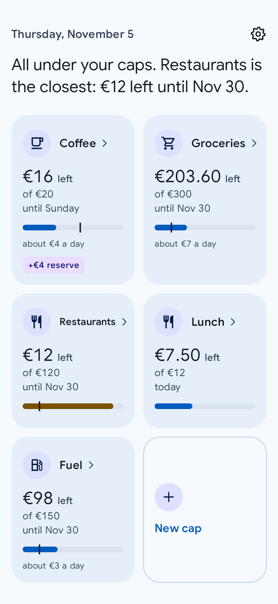
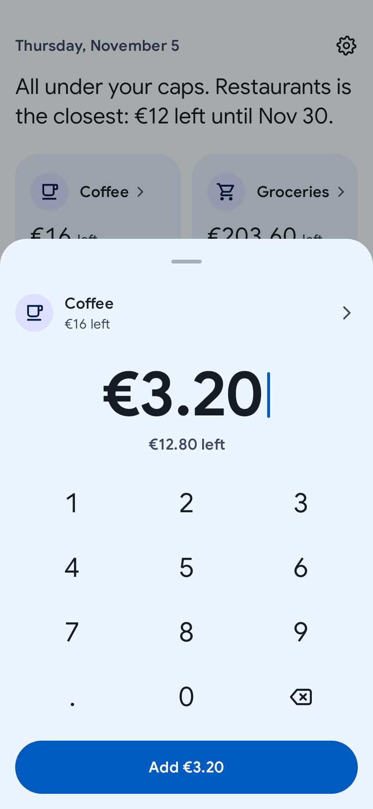
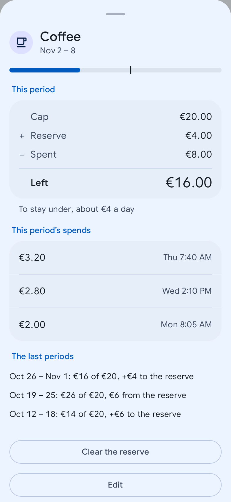
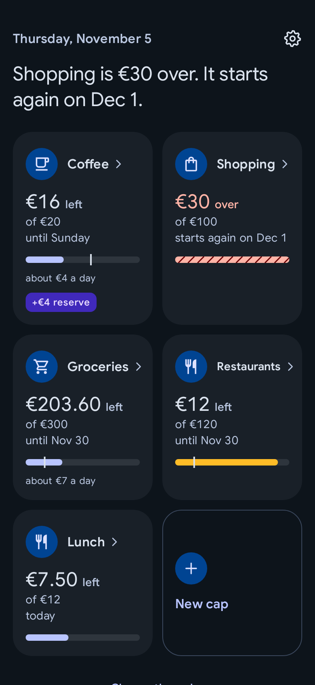
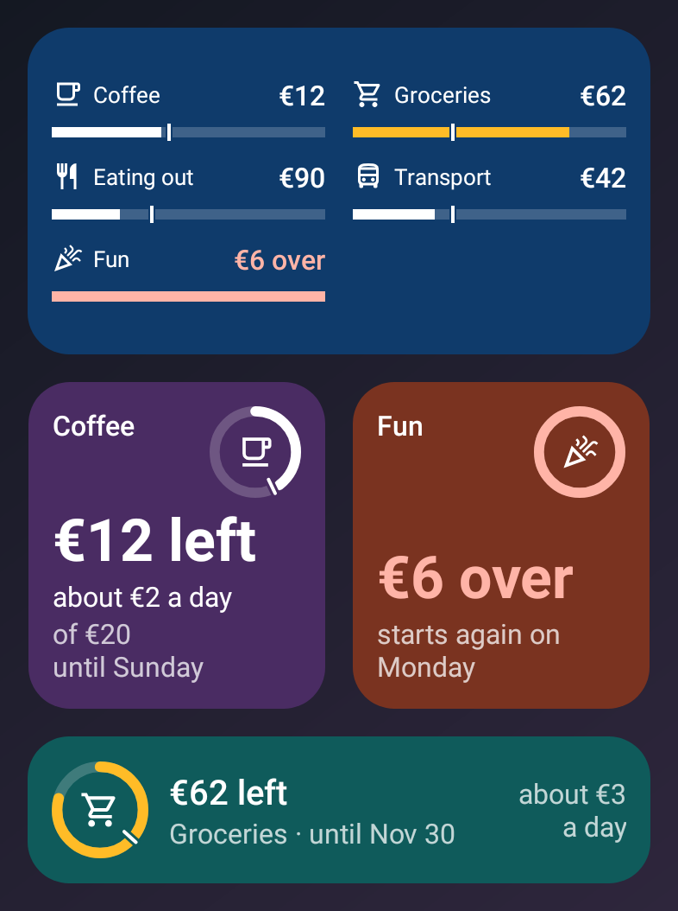
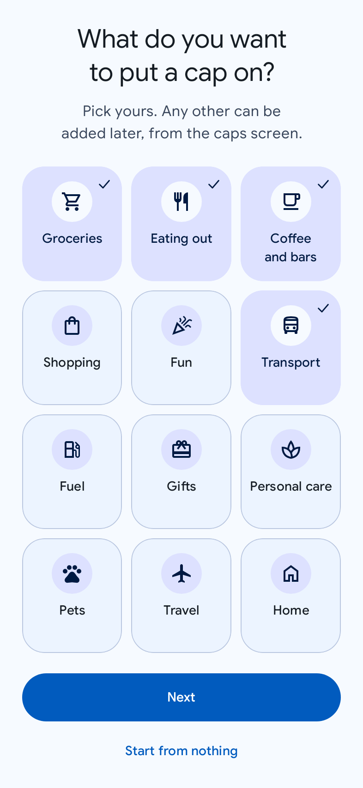
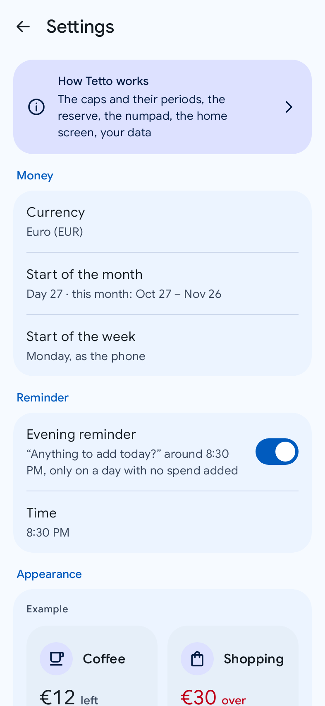
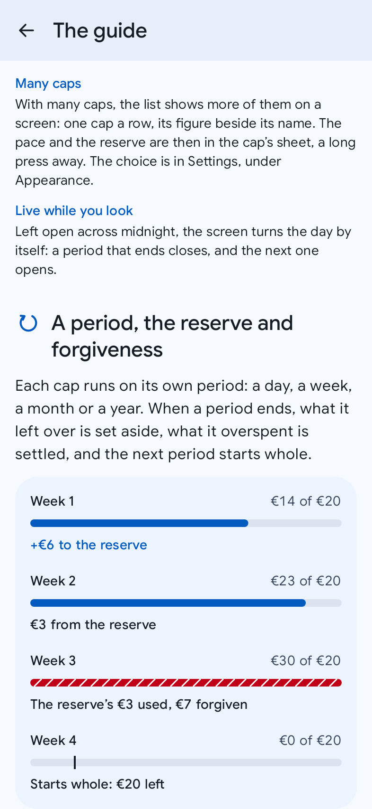

<div align="center">

# 🏠 Tetto

**How much you can still spend, and until when. Kept on your phone, sent nowhere.**

A private, instant Android budget: a cap for each thing you spend on, each with its own period,
what is left said first, and a spend added in two touches and the amount, in the app or from the
home screen. Free, no account, no ads, no tracking, and no permission to use the internet at all.


[**⬇️ Download the latest release**](https://github.com/fiorenzobrioni/tetto/releases/latest)

</div>

## What Tetto is

"Can I still afford this?" is the question a budget is for, and most budget apps answer it last,
under a ledger, categories, accounts and charts. Tetto answers it first. You set a cap for each
thing you spend on (€20 a week for coffee, €400 a month for groceries, €600 a year for presents),
each with its own period, and the screen says what is left of each and until when.

A spend is two touches and the amount: touch the cap, type, add. No category to look for, no
date, no note. What a period leaves over goes to a reserve; an overspend uses the reserve first,
and what the reserve cannot cover is forgiven when the period ends, so a new period never starts
in debt. It is the envelope method, without the envelopes.

Tetto keeps no ledger, on purpose: no history screen, no statistics, no accounts, no income. Its
speed comes from having none.

## Screenshots

<table>
  <tr>
    <td align="center" width="33%"><br><sub><b>The caps</b>: what is left, first</sub></td>
    <td align="center" width="33%"><br><sub><b>Two touches and the amount</b>, the preview first</sub></td>
    <td align="center" width="33%"><br><sub><b>A cap's sheet</b>: this period, and where the reserve came from</sub></td>
  </tr>
  <tr>
    <td align="center"><br><sub><b>Over, in words</b>, never by colour alone</sub></td>
    <td align="center"><br><sub><b>The cards</b>: a spend from the home screen</sub></td>
    <td align="center"><br><sub><b>First run</b>: a minute, and the caps are yours</sub></td>
  </tr>
  <tr>
    <td align="center"><br><sub><b>Settings</b>, the guide first</sub></td>
    <td align="center"><br><sub><b>The guide</b>: the reserve and forgiveness, shown</sub></td>
  </tr>
</table>

Drawn by the app's own screens from sample caps on a Thursday in November, in English (the app
also speaks Italian). The phone's status bar is not in the pictures; the cards are drawn by Glance
as a launcher draws them, on a stand-in wallpaper. The command that redraws them is in
[Build](#build).

## Features

What 1.0 will do ([VISION.md](./VISION.md) has the full scope):

- 🧢 **Caps, each on its own period**: a day, a week, a month or a year, with the week's first day
  and the month's first day yours to choose.
- 👀 **What is left, first**: one sentence on top ("All under your caps. Restaurants is the
  closest: €12 left until 30 Nov."), then a tile per cap with what is left, the cap, its last
  day, and a bar with a mark for today, so you see at once whether spending runs ahead of the days.
  With many caps, a list fits more of them on a screen: one shorter row per cap. Under them,
  your month: what you added to your caps in it and in the month before, and what your caps are
  worth in a month, to set against your salary (your month can start on payday).
- 🔢 **Two touches and the amount**: a numpad that shows what will be left before you add, and an
  undo after every change. Any spend of the current period can be corrected or deleted.
- 🛟 **Kind by design**: what a period leaves over becomes a reserve (up to one period's cap); an
  overspend uses it; what it cannot cover is forgiven when the period ends.
- 🚀 **Ready in a minute**: pick the areas you want a cap on, give each an amount and a period, and
  the caps screen opens already shaped to you.
- 💱 **One currency, any your phone knows**: changing it relabels your amounts and never converts them.
- 🏠 **Two widgets that never scroll**: «At a glance», your caps as the card's size allows, and
  «In words», one cap on the family's ring card. A touch on a cap opens the numpad over the home
  screen: a spend added without opening the app.
- ⚡ **Launcher shortcuts**: a long press on the icon, and your first four caps go straight to the numpad.
- 🌙 **An evening reminder**, if you want one, that stays quiet on a day you already added a spend.
- 💾 **Your data**: a backup file to export and restore, a CSV, and everything erased in one place.
- 🎨 **Appearance**: light or dark, two palettes, three typefaces, the same as the family's; the
  caps as tiles or as a list.
- 📖 **The guide**: what each part of the screen is for, the reserve and forgiveness shown with the
  app's own tiles and bars, in your currency; a tip on the first day leads there.
- ♿ **For every reader**: TalkBack reads each cap as one sentence and every key of the numpad with
  what it would leave; text works at twice its size; an open foldable shows a centred column.
- 🇮🇹 🇬🇧 **Italian and English**, through the system per-app language picker.

## Principles

| | |
|---|---|
| 🔒 **Private by design** | no `INTERNET` permission: Tetto sends nothing. The build fails if a network, location, exact-alarm, camera, SMS, contacts, calendar, storage or installed-apps permission appears |
| 🧾 **What is left, first** | the screen leads with what can still be spent, and until when; what was spent is the second line |
| ✌️ **Two touches** | touch a cap, type the amount, add. From the home screen too |
| 🛟 **Kind** | a reserve for what is left over, forgiveness for what it cannot cover; never a debt carried forward |
| 🔋 **Battery is a feature** | no service, no polling, nothing on a timer with the screen off; a period closes the next time it is read |
| 🎯 **Exact** | amounts kept in whole cents, never rounded on the way; periods counted in your local days |

## Install

Android 14 (API 34) or newer. There is no release yet: the first comes with 1.0 (see
[Roadmap](#roadmap)).

1. Download `tetto-vX.Y.Z.apk` from the [latest release](https://github.com/fiorenzobrioni/tetto/releases/latest).
2. Open it on the phone and allow installs from that source when Android asks.

**Verify the download.** Put the APK and its `.sha256` file in one folder and run
`sha256sum -c tetto-vX.Y.Z.apk.sha256`. To check that the APK is genuine, compare its signing
certificate (`apksigner verify --print-certs`, or AppVerifier on the phone) with this SHA-256
fingerprint:

```
28:A0:E8:60:45:9D:3C:24:06:BC:A7:6F:18:FA:1D:91:42:37:9F:A2:03:EA:85:1D:DE:4B:66:B2:55:19:9D:F1
```

**Updates.** Tetto has no network access, so it cannot check for updates. Use GitHub's
"Watch, Custom, Releases" notifications, or [Obtainium](https://github.com/ImranR98/Obtainium).
Every release installs over the previous one and keeps your caps. The notes of each version are
in [CHANGELOG.md](./CHANGELOG.md).

## Roadmap

The phased plan, with every decision and its reason, is in [PLANNING.md](./PLANNING.md) (the closed periods in [docs/planning](./docs/planning/README.md)):

- **Phase 0**, foundations: the build, the design system, CI. *Done.*
- **Phase 1**, the cap engine: periods, the reserve and forgiveness, every edge case tested. *Done.*
- **Phase 2**, the caps screen, the numpad and a cap's sheet. *Done.*
- **Phase 3**, the first run and settings. *Done.*
- **Phase 4**, your data and the evening reminder. *Done.*
- **Phase 5**, the two widgets and the launcher's shortcuts. *Done.*
- **Phase 6**, the guide and the accessibility pass. *Done.*
- **Phase 7**, the 1.0 release on GitHub.
- **Phase 8**, Google Play: optional, later.

## Build

Requires JDK 21 (the one bundled with Android Studio works) and the Android SDK.

```bash
./gradlew :app:assembleDebug        # app/build/outputs/apk/debug/app-debug.apk
./gradlew test                      # unit tests, every module
./gradlew :app:lintDebug            # lint, every module
./gradlew spotlessApply             # format the code
./gradlew :app:checkForbiddenPermissions
```

For an installable minified build to test with:
`./gradlew :app:assembleRelease -PsignReleaseWithDebugKey`. It is signed with the debug key
committed in `keystore/`, on purpose, so builds from CI and any machine share one signature.
Debug builds carry `applicationIdSuffix ".debug"` and install side by side with the release.

README screenshots: `./gradlew test -PupdateScreenshots`.

CI runs formatting, the permission check, the tests and lint **before** building the APKs,
so a red suite never produces an installable artifact. A `vX.Y.Z` tag runs the same gates,
then publishes the signed APK, its checksum and the R8 mapping, with the matching
[CHANGELOG.md](./CHANGELOG.md) section as the release notes.

## Tech stack

- **Kotlin** 2.4, **Jetpack Compose** with Material 3, Gradle 9.8 and AGP 9.4, minSdk **34**
  (Android 14), target and compile SDK **37**
- **Room** (the caps, the spends of the open periods, the closed periods), **DataStore**
  (settings), **Hilt**, **Coroutines** and **Flow**
- **Glance** for the widgets
- **Navigation 3**, as in the family
- Amounts in whole minor units (`Long`), never floating point; periods in local dates
- Unit tests on the JVM for every edge case of the cap engine; Compose UI tests with
  Robolectric, accessibility checks included

```text
Compose UI → ViewModel → :core:data (Room, DataStore; a period closed before every read)
                      ↘ :core:domain (pure Kotlin: periods, the reserve, the sentence, the widgets' fit)
```

## Project structure

```text
tetto/
├── app/                    # Application, MainActivity, the numpad over the home screen, DI
├── core/
│   ├── model/              # pure Kotlin data classes
│   ├── domain/             # pure Kotlin: periods, the reserve and forgiveness, a cap's state
│   ├── data/               # Room, DataStore, repositories
│   ├── reminder/           # the evening reminder
│   ├── designsystem/       # theme, components, icons
│   └── testing/            # shared UI test helpers (accessibility, page walks)
├── feature/                # caps, onboarding, settings, guide
├── widget/                 # the two Glance widgets and their settings
├── build-logic/            # convention plugins, the forbidden-permission check
├── tools/                  # the launcher icon script, the plan's index
└── keystore/               # the shared debug key (deliberately committed)
```

Each module joins the build with the phase that brings its first code. `:core:model` and
`:core:domain` are pure Kotlin: a class in them that needs a `Context` is in the wrong module.

## Project documentation

| File | Contents |
|---|---|
| [VISION.md](./VISION.md) | the product: principles, scope, non-goals, key decisions, the owner's answers |
| [PLANNING.md](./PLANNING.md) | architecture, cap engine, data, widgets, the phased plan and its decisions |
| [docs/planning](./docs/planning/README.md) | the closed periods of that plan's log, frozen, with an index of every section |
| [docs/adr/](./docs/adr/) | the architecture decision records |
| [CHANGELOG.md](./CHANGELOG.md) | what shipped, per version; a section is written before its tag |
| [CLAUDE.md](./CLAUDE.md) | the operating rules for AI-assisted development in this repo |

## The family

Tetto is one of five focused apps with the same look and the same rules:
[Chiaro](https://github.com/fiorenzobrioni/chiaro) (weather),
[Passo](https://github.com/fiorenzobrioni/passo) (step counter),
[Tempo](https://github.com/fiorenzobrioni/tempo) (clock and agenda) and
[Saldo](https://github.com/fiorenzobrioni/saldo) (personal finance). Saldo keeps the whole of
your finances; Tetto keeps a budget and nothing else. Each stands alone.

## License

[GPL-3.0](./LICENSE) © 2026 Fiorenzo Brioni

[Google Sans](https://fonts.google.com/specimen/Google+Sans) and
[Inter](https://github.com/rsms/inter) under the SIL Open Font License 1.1. Full attributions
in [licenses/](./licenses/).
